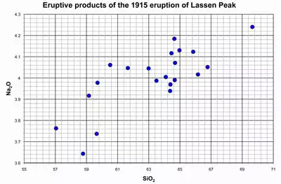

# AP Physics 🔭 <!---fit--->

# **2026-2027** Agendas

## 👨‍🏫 Mr. Porter

---

<!--- class: halloween --->

# 2026.10.26 **AP Physics**

##### **❓ of the 📅**: Would you rather travel 100 years forward or back in time?

 

#### 📋 Agenda

1. Workbooks 1.J & 1.K (25 Minutes)
2. [Vector Slides](/Presentations/Projectiles/talks/2dMotionAP2026.html) (25 Minutes)
3. Vector Practice (30 Minutes)
4. Any time left over Physics Classroom

### 🎯 Goals

🥅 __

### 📆 Upcoming

- HW: _**PC Kinematics 6 — due Wed 10/28**_
- HW: _**PC Kinematics 7 + two-stage motion — due Fri 10/30**_
- Quiz: _**Kin Quiz 4 — Fri 10/30**_

---

# 2026.10.22 **AP Physics**

##### **❓ of the 📅**: Would you rather be able to see infrared or ultraviolet light?

 

#### 📋 Agenda

1. ✅ **Kin Quiz 3**
2. AP Workbook 1.J — Rocket Motion *(if time)*
3. AP Workbook 1.K — graphical methods to find $g$ *(if time)*

### 🎯 Goals

🥅 _Use the kinematic models to solve free fall questions_

### 📆 Upcoming

- HW: _**PC Kinematics 6 — due Wed 10/28**_
- HW: _**PC Kinematics 7 + two-stage motion — due Fri 10/30**_

---

# 2026.10.21 **AP Physics**

##### **❓ of the 📅**: If gravity suddenly decreased by half for 24 hours, what would you do first?

 

#### 📋 Agenda

1. Stopping Distance debrief
2. Free Fall Five — velocity vs. time graphs
3. Free Fall Five results — what is the acceleration in free fall?
4. [Free Fall Notes](/Presentations/Projectiles/talks/2dMotionAP2026.html) & worked example packet
5. PC problem-solving

### 🎯 Goals

🥅 _Start solving free fall questions_

### 📆 Upcoming

- HW: _**Physics Classroom — Kinematics 6**_
- Quiz Thursday: graphs, word problems

---

# 2026.10.20 **AP Physics**

##### **❓ of the 📅**: If you could go back in time, what year would you travel to?

 

#### 📋 Agenda

1. Driving & Stopping Distance Assignment
2. Free Fall Five 

### 🎯 Goals

🥅 _Model Free Fall Motion_

### 📆 Upcoming

- HW: _**Finish Free Fall Five**_
- Quiz Thursday: graphs and word problems

---

 
 
 
 

###### 2026.10.16 **AP Physics** Do Now

A car is moving with constant speed vo when a tree falls into the roadway at $t = O$. It takes the driver a time $T$ to react and apply the brakes. The car then slows with a constant acceleration of magnitude $a$. Which of the following equations correctly expresses the distance $D$ traveled by the car from time $t = 0$ to the instant the car comes to rest?

#### A. $D= v_0T + \frac{1}{2}aT^2$

#### B. $D= \frac{1}{2}aT^2 + \frac{v_0^2}{2a}$

#### C. $D= v_0T+ \frac{v_0^2}{2a}$

#### D. $D = v_0T + \frac{1}{2}aT^2 + \frac{v_0^2}{2a}$

 

---

# 2026.10.16 **AP Physics**

##### **❓ of the 📅**: Who is your celebrity crush?

 

#### 📋 Agenda

0. Do Now
1. Finish Photogate Practical
2. Advanced Problem-Solving

### 🎯 Goals

🥅 _Use kinematic models to solve problems_

### 📆 Upcoming

---

 
 
 
 

###### 2026.10.15 **AP Physics** Do Now

A car on a straight track is at position $x_i$ and has initial speed $v_i$ when it begins to slow down with constant acceleration of magnitude $a$. When the car reaches position $x_f$ it has speed $v_f$. Which of the following is a correct expression for $x_f$?

#### A. $\frac{v_f^2 - v_i^2}{2a} + x_i$

#### B. $\frac{v_i^2 - v_f^2}{2a} + x_i$

#### C. $\frac{v_f^2 - v_i^2}{2a} - x_i$

#### D. $\frac{v_i^2 - v_f^2}{2a} - x_i$

 

---

# 2026.10.15 **AP Physics**

##### **❓ of the 📅**: If you were to be in the circus, what would your circus act be?

 

#### 📋 Agenda

1. Do Now
2. Photogate Lab

### 🎯 Goals

🥅 _Use mathematical models to make predictions_

### 📆 Upcoming
HW Due Friday:
- Set K12: VT Graph Challenges
- Kinematics 4: Kinematic Eqs
- Kinematics 5: Kinematic Eqs

---

# 🛝 Constant Acceleration **Lab Practical**

### Today you get a cart, a ramp, and one number to hit.

Release the cart **from rest**. It rolls **20 cm** and crosses photogate 1.

Put photogate 2 where the cart will take exactly **0.12 s** to reach it.

###### Your reference table is the only equation sheet you get. No procedure is given — that is the point.

---

# 📐 The Setup

* Cart released **from rest**: $v_{x0} = 0$
* $\Delta x_1 = 20$ cm — already marked on your ramp
* **Photogate 1** — already clamped for you
* **Photogate 2** — <mark>you</mark> decide where it goes

### 🎯 Target: $\Delta t = 0.12$ s

**Do not move the ramp or change its angle** once you have measured your acceleration.

---

# 📋 Your Job

**a. Design** 🧪
Write a procedure to find your cart's acceleration.

**b. Measure** 📏
Run it. Table, units, resolutions. Report $a$.

**c. Derive** ✏️
Get $\Delta x_2$ in terms of $\Delta x_1$, $a$, $\Delta t$ — **symbols only**.

**d. Predict & Test** 🎯
Substitute. Place gate 2. Run it. Percent error in the **time**.

**e. Evaluate** 🔍
Which measurement hurt you most? Which direction?

**f. Reason** 📈
Steeper ramp — does $\Delta x_2$ go up, down, or stay?

**g. Argue** 💬
Defend a classmate's claim with **two** reasons.

---

# 📓 In Your Notebook

#### Everything goes here

1. Title, the task in your words, labeled sketch
2. Your procedure
3. Data table — units **and** resolutions
4. Graph or calculation → $a$
5. Derivation in symbols
6. Substitution → $\Delta x_2$
7. Measured $\Delta t$ + percent error
8. Parts (e), (f), (g) in sentences

###### 🏁 Close with a conclusion: did it work, what were you most sensitive to, what would you change?

---

# 2026.10.14 **AP Physics**

##### **❓ of the 📅**: What is your favorite dinosaur? 🦖

 

#### 📋 Agenda

1. Review the Bear Question
2. Kinematic Equations & The Cross Diagram
2. Practice
3. Two-stage Kinematic questions

### 🎯 Goals

🥅 _Use mathematical models to make predicitons about motion_

### 📆 Upcoming

HW Due Friday:
- Set K12: VT Graph Challenges
- Kinematics 4: Kinematic Eqs
- Kinematics 5: Kinematic Eqs

---

# 2026.10.09 **AP Physics**

##### **❓ of the 📅**: If you were to open a store, what would you sell?

 

#### 📋 Agenda

1. Review the Bear question
3. Kinematic Equations and the Cross <mark>➕</mark> Diagram
4. Solving Problems with the Kinematic equations  

### 🎯 Goals

🥅 _Model motion mathematically_

### 📆 HW:
- Set K12: Velocity-Time Graph Challenges
- Kinematics 4: Kinematic Equations
- Kinematics 5: Kinematic Equations

---

# 2026.10.09 **AP Physics 🎃**

##### **❓ of the 📅**: If you could pick any wild animal to keep as a pet, which would it be?

 

#### 📋 Agenda

1. Quiz
2. Review the Bear question
3. Kinematic Equations and the Cross <mark>➕</mark> Diagram
4. Solving Problems with the Kinematic equations 

### 🎯 Goals

🥅 _Model motion mathematically_

### 📆 Upcoming

---

###### 2026.10.07 **AP Physics** Do Now  

Eight possible signs of combinations for the instantaneous position, velocity, and acceleration of an object moving in one dimension are given in the table. Above the table is a coordinate axis that shows the origin, marked 0, and that indicates that the ***positive direction is to the left***. Complete the chart.

  

---

# Answer

---

# 2026.10.08 **AP Physics**

##### **❓ of the 📅**: Would you rather be the hero or the sidekick?

#### 📋 Agenda

1. Do Now
2. Problem-solving with VT Graphs
    - work through entire question 
    - check answer **when done with entire question**

### 🎯 Goals

🥅 _Work through problem-solving with VT Graphs_

### 📆 Upcoming

- Quiz tomorrow: X-T Graph, V-T Graph, Stacks of Graphs

---

<!--- class: --->

# 2026.10.07 **Do Now**

 
 
 
 

 ###### 10  MINUTES 

 ####  

 

 

 

For each of these cases, if any, is...at the indicated point?

1. the **position zero** ?
2. the **position negative**?
3. the **velocity zero**?
4. the **velocity negative**?
5. the **acceleration zero** ?
6. the **acceleration negative**?

 

 

 
 

 

 

  
 
 

 

---

# 2026.10.07 **AP Physics**

##### **❓ of the 📅**: Does your family have a "motto" – spoken or unspoken?

 

#### 📋 Agenda

1. Do Now 
2. Notes - Graphical Representations
2. Problem-Solving Graphically

### 🎯 Goals

🥅 _Solve Problems Graphically_

### 📆 Upcoming

---

# 2026.10.05  **AP Physics** Do Now

 

 

###### 10 MINUTES 

####  Physics Classroom

Complete: _Mission KG2 Shape and Slope of Position-Time Graphs (MO)_

  

 

---

# 2026.10.05 **AP Physics**

##### **❓ of the 📅**: What was your favorite halloween costume?

 

#### 📋 Agenda

1. Do Now
2. Finish Card Sort Data Collection
3. Complete Summary Chart
4. Notes on Graphical Representation
5. Start Physics Classroom Homework

### 🎯 Goals

🥅 _Model Motion Graphically_

### 📆 Homework

Physics Classroom:
  - K10: Velocity-Time Graphs 1
  - K11: Velocity-Time Graphs 2

---

# 2026.10.02 **AP Physics**

##### **❓ of the 📅**: Which holiday has the best food?

 

#### 📋 Agenda

1. Lab Summary Notes
2. Finish Writing lab conclusion 
3. Start Card Sort looking at different uniform motion

### 🎯 Goals

🥅 _Model uniform motion graphically_

### 📆 Upcoming

---

# 2026.10.01 **AP Physics**

##### **❓ of the 📅**: If you could be any Disney princess, which would you choose?

#### 📋 Agenda

1. Finish Graphing x vs t data
    - print & describe in notebook: support, refute, need more
2. Collect velocity data from xt graph
3. Create VT Graphs
    - print & describe in notebook: support, refute, need more
4. How is position and time related? Can we confirm quadratic somehow?
    - Intro to linearization

---

# 2026.09.29 **AP Physics**

##### **❓ of the 📅**: Would you rather be able to talk to animals or understand all human languages?

 

#### 📋 Agenda

0. <mark>Do Now</mark> Grab your lab notebook and **1 sticker** to decorate it
1. VT Graphs & Area
    - Notes and _the **area** rule_
2. Ticker Tape Lab

### 🎯 Goals

🥅 _Use VT Graphs to calculate displacement_

🥅 _Model changing velocity motion_

### 📆 Upcoming

---

# 2026.09.28 **AP Physics**

##### **❓ of the 📅**: Is there intelligent life elsewhere in the universe? Why or why not? 👽

 

#### 📋 Agenda

1. Finish VT Graphs
2. Discuss VT Graph Idea
3. Fan Cart Lab

### 🎯 Goals

🥅 _Calculate Displacement from a VT Graph5_

### 📆 Upcoming

---

# 2026.09.25 **AP Physics**

##### **❓ of the 📅**: Would you rather be a dragon or own a dragon? 🐉

 

#### 📋 Agenda

1. Quiz
2. Velocity Time Graphs and Displacement

### 🎯 Goals

🥅 _Make calculations from VT Graphs_

### 📆 Upcoming

---

# 2026.09.23 **AP Physics** Do Now

 
 
 
 

 ###### 5 Mintes MINUTES 

 

 

 
 The position-time graph shown represents the motion of two children who are moving along a narrow, straight hallway.

1. Do either of the children ever change ***direction***?
2. Are the two children ever at the same ***position*** along the hallway?
3. Do the two children ever have the same ***speed***?

 

  
 

 
 
 

 

  
 
 

 

---

# 2026.09.23 **AP Physics**

##### **❓ of the 📅**: What's your favorite sandwich and why? 🥪 

 

#### 📋 Agenda

1. Do Now
2. AP Workbook 1.A - 1.D
3. Interpreting Velocity vs. Time Graphs  

### 🎯 Goals

🥅 _Make calculations from velocity vs. time graphs_

### 📆 Upcoming

- Quiz **Friday**: x vs. t graphs, average vs. instantaneous velo & speed, solving problems with $x = vt + x_0$

---

# 2025.09.22 **Do Now**

 
 
 
 

 ###### 5 MINUTES 

 ####  

Each graph below shows the position of an object as a function of time.

1. Rank the **displacement** of each object from least to greatest. 
2. Rank the **distance** of each object from least to greatest. 

  
 
 

 

---

# 2026.09.22 **AP Physics**

##### **❓ of the 📅**: How do you make your marshmallow for s'mores? 🍫

 

#### 📋 Agenda

1. Do Now
1. Go Over worksheet
2. Defining Average vs. Instantaneous
3. Mathematical Models
4. PC Practice - Red Car vs. Green Car

### 🎯 Goals

🥅 _Model motion with position vs. time graphs_

🥅 _Differentiate between average and instantaneous_

### 📆 <mark>**Homework**</mark>
- <input type="checkbox">PC: Speed & Velocity
- <input type="checkbox">PC: Position Time-Graphs

---

# 2026.09.21 **AP Physics**

##### **❓ of the 📅**: If you could make the world's biggest food fight, what food would you have? 

 

#### 📋 Agenda

1. [Motion Notes](../../Presentations/APCVPM/talks/CVPM2026.html)
3. PC: Distance vs. Displacement
2. Average vs. Instantaneous
3. Using Mathematical Models

### 🎯 Goals

🥅 _Start using a constant velocity model_

### 📆 HW:

- <input type="checkbox">PC: Speed & Velocity
- <input type="checkbox">PC: Red Car vs. Green Car (_if we do mathematical models_)

---

 # **AP Physics Do Now**  Register for...

 
 
 

 #  Register for... **AP Classroom** 
 
 ->> AP Exam Prep & Review
  - Website: [https://apclassroom.collegeboard.org/](https://apclassroom.collegeboard.org/)
  - Code: **RPQP72**
 
 

 

 
#  Register for... **Physics Classroom**
 ->> General Physics Practice & Homework
  - Website: [http://www.physicsclassroom.com/sign-in](http://www.physicsclassroom.com/sign-in)
  - Code: **53a74c8**
  - Register with school email as username
 
 

 

---

# 2026.09.17 **AP Physics**

##### **❓ of the 📅**: What was your favorite recess game from elementary school?

 

#### 📋 Agenda

1. Do Now
2. Using [nPlot](https://noragulfa.com/nPlot/)
2. Graph & Whiteboard Results
3. Board Meeting & Finish Lab Notebook
3. [Motion Notes](../../Presentations/APCVPM/talks/CVPM2026.html)
3. PC: Distance vs. Displacement

### 🎯 Goals

🥅 _Practice with Distance vs. Displacement_

🥅 _Define average & instantaneous_

### 📆 Upcoming

---

# 2026.09.16 **AP Physics**

##### **❓ of the 📅**: If you invited dragons 🐉 to a taco 🌮 party, would you give them spicy salsa?

 

#### 📋 Agenda

1. Buggy Lab
    - collect data and graph with [nPlot](https://noragulfa.com/nPlot/)
    - whiteboard results
    - discuss
    - write conclusions
2. [Motion Notes](../../Presentations/APCVPM/talks/CVPM2026.html)

### 🎯 Goals

🥅 _Model motion graphically_

### 📆 Upcoming

---

# 2026.09.15 **AP Physics** Do Now

 
 
 
 
 

 ###### 5 MINUTES 

 #### How Far and Where? 

In each case, a sphere is moving from left to right next to a tape marked in meters. A strobe (flash) photograph is taken every second, and the location of the sphere is recorded. The total time intervals shown are not the same for all spheres.

1. Which ball went the **_furthest_** over the first 3 seconds?
2. **_Where_** is each ball at time $t = 3 \text{ s}$?
3. What are two ways to define "furthest"? 
 
 

 

---

# 2026.09.15 **AP Physics**

##### **❓ of the 📅**: What is the best french fry shape? 🍟

 

#### 📋 Agenda

1. Do Now
1. Finish Lab ~10 minutes
1. [Data Collection Best Practices](../../AP%20Resource%20Pages/datacollection.html)
2. Buggys Lab

### 🎯 Goals

🥅 _Model Motion_

### 📆 Upcoming

---

<!--- _class: paper --->

# Buggy Lab 🚗 

## Question

_Does your toy buddy move in a **consistent** manner?_

## Purpose

Collect data on your buggies so that you can represent the motion (all aspescts) of both buggies on the **same** graph. Your final models should be able to predict the **position** of your buggy at specified times. 

 

## Constraints

You will be given scenario card that describes the setup of your buggies

---

# 2026.09.11 **AP Physics** Do Now 

 
 
 
 

###### 5 MINUTES 

#### Lab Review 

  1. Get your lab notebook
  2. Review your lab with your group
    - how did you do it?
    - what did you find?
      - what does your slope represent?
      - do you have a vertical intercept? is it negigible? what does it mean?
      - do you have any interesting findings that you think are unique to your experiment?
  
 
 

 

---

# 2026.09.11 **AP Physics**

##### **❓ of the 📅**: If you could snap your fingers and have one thing done for you, which would it be?

 

#### 📋 Agenda

1. Do Now: Lab Review
2. Board Meeting & [Uncertainty](../../Presentations/Exp%20Methods/slides/Slides/uncertainty.html)
3. Make Predictions & Test 
4. Finish Lab Notebook
5. [Data Collection Best Practices](../../AP%20Resource%20Pages/datacollection.html)

### 🎯 Goals

🥅 _Make predictions from mathematical models_

🥅 _Use uncertainty in predictions_

🥅 _Data collection best practices_

---

# 2026.09.10 **AP Physics** Do Now

1. Grab Handout and complete on your own
2. Compare answers with your lab table
3. Brainstorm together on how you would draw the best fit line for the data on the right

 

---

# 2025.09.10 **AP Physics**

##### **❓ of the 📅**: Do you think it would be easier to give up sugar or technology?

 

#### 📋 Agenda

1. Do Now 
1. [Drawing best fit lines](../../Presentations/Exp%20Methods/slides/Slides/best-fit-lines.html)
    - [Constructing Best Fit](https://serc.carleton.edu/mathyouneed/graphing/bestfit.html)
2. Co. of Restitution Lab
	1. Finish Collecting Data
	2. Graph
	3. Whiteboard Results
3. Discuss & finish lab 

### 🎯 Goals

🥅 _Learn quality data collection techniques_

🥅 _Engage in scientific discussion_

🥅 _Use graphs and data to answer questions_

---

# $e$ Board Meeting

## On your whiteboard

- Hypothesis and results
  - What did you do and what did you find? How does your data support or refute your hypothesis?

### Things to consider:
- What does your graph look like? Linear, curve, etc?
  - What does that mean? What do the graphical features like slope/intercept mean?
- How confident are you in your data? High or low levels of uncertainty?

---

# 2026.09.09 **AP Physics** 

##### **❓ of the 📅**: Sweet or savory for breakfast?

#### 📋 Agenda

0. Sit Anywhere
1. Do Now (fill out questionnaire & card)
2. Question of the Day
3. Grouping Game
4. Survival Island

### 🎯 Goals 

🥅 _Introductions_

🥅 _Classroom Culture_

### 🏠 Homework

- Signed Safety Contract

---
<!--- background: black--->
# Do **Now** 

1. Fill out index card:
    1. Name
    2. Phone number to reach your parents/guardians if you sleep through the AP Exam
    3. Favorite Candy
    4. Favorite Emoji
    5. Emoji the describes your current mood
2. Fill out Paper Quesionnaire

---

# Lab Grouping Game

- There are 13 of you
- Based on your cards get into ***LOGICAL*** groups of **three** (plus one group of 4)
- Check **whole class** answer with Mr. Porter
    - 4 Chances to Check
- Reorganize if necessary

(Yes this is the game Connections)

---

# Answers

- **KINDS OF BEANS** - KIDNEY, MUNG, NAVY
- **DEVISE** - CONCOCT, ENGINEER, HATCH
- **NASA SPACECRAFT** - GALILEO, VIKING, VOYAGER
- **GAMES WHERE YOU SAY THE GAME’S NAME** - BINGO, TAG, UNO

---

# Survival Island 🌴

1. Share your *survival skill* that **you wrote down** with your group
2. Using ***everyone's skill*** develop a plan to survive or escape the deserted island
3. On your whiteboard present your plan (drawing, mind map, set of instructions)
    - Highlight everyone's skill

---

# Surivial Plan... <!--fit--->

---

# Coefficient of Restitution Lab

Determine whether the ***coefficient of restitution***, $e$, for a specific ball remains constant when dropped from various heights. Do this by comparing drop height to bounce height for your assigned ball. 

---

# 🥼 Lets Science! 🥼 <!--fit--->

# 📓 Lab Notebooks 📓 <!--fit--->

---

# What is a Lab Notebook?

* A detailed, chronological record of a scientist's research activities, experiments, and observations. 
* Documentation of the scientific process from intial ideas to final results and conclusions. 

---

# Why keep lab notebooks?

* Document Research
* Develop Ideas
* Organize Data 
* Collaboration Tool
* Publication Support
* Troubleshooting 
* Intellectual Property Protection
* Historical Record

---

# Lab Notebooks can be Legal Documents 

* Proof of invention in Patent Cases
* Intellectual Property Protection
* Admissibility in court - must be properly maintained
* Note: Often property of the instituation where the research was conducted (i.e. Property of Regeneron, or Property of Cornell University)

---

# Remember

* Lab notebooks are most importantly scientific documentation
* They represent the scientific process and are record of your **thinking**
    * This means your ideas and conclusions and hypotheses can **change** based on **new data**

---

# Lab Notebook

* Write in **pen**
* All mistakes get a ~~single cross through~~
* Full Date (YYYY/MM/DD) at the beginning of each entry (for multiday labs date start of each day)
* Enter Lab Pages into table of contents 

---

# Lab Notebook - Pre Lab

* **Title and objective of the experiment**: 
  - Write a clear, concise title for each experiment.
  - State the main objective or purpose of the experiment in 1-2 sentences.
* **Theoretical background**: 
  - Briefly explain the relevant scientific principles.
  - Include key equations or concepts that will be tested or applied.
* **Hypotheses**: 

  - State your predictions about the experiment's outcome.
  - Base these on your understanding of the theory.

---

# Lab Notebook - Pre Lab

* **Materials and equipment list**: 
  - Provide a detailed list of all materials and equipment used.
  - Include model numbers and specifications where relevant.
* **Experimental procedure outline**: 
  - Write a step-by-step outline of the planned procedure.
  - Be specific enough that someone could replicate your experiment.

---

<!--- footer:   --->

# During the Experiment

* **Raw data in tables with units**: 
  - Create neat, organized tables for all numerical data.
  - Always include units and uncertainty estimates.
  - Label columns clearly and use consistent significant figures.
* **Observations and qualitative notes**: 
  - Record all relevant observations, even if they seem unimportant.
  - Note any unexpected occurrences or anomalies.

---

# During the Experiment 

* **Any changes to the planned procedure**: 
  - Document any deviations from the original procedure.
  - Explain why changes were made and how they might affect results.
* **Sketches or diagrams of experimental setup**: 
  - Include clear, labeled diagrams of your experimental setup.
  - Add dimensions and important details to aid in replication.

---

# Post Lab

* **Data analysis and calculations**: 
  - Show all steps in your calculations, including formulas used.
  - Explain your reasoning for each step of the analysis.
* **Graphs and charts**: 
  - Create neat, properly labeled graphs and charts.
  - Include titles, axis labels with units, and legends where appropriate.

---

# Post Lab

* **Discussion of results**: 
  - Interpret your results in the context of the experiment's objectives.
  - Explain any patterns or trends observed in the data
* **Comparison with hypotheses**: 
  - Explicitly state whether your results support or refute your hypotheses.
  - Discuss possible reasons for any discrepancies.
* **Sources of error and uncertainty**: 
  - Identify potential sources of experimental error.
  - Discuss how these might have affected your results.
  - Quantify uncertainties where possible.

---

# Post Lab

- **Conclusions**: 
  - Summarize the main findings of the experiment.
  - Relate these back to the original objectives and broader scientific principles.
  - Suggest improvements or future directions for the experiment.

---

# Ball Bounce Lab

#### Question:

Is the coefficient of restitution constant for your ball? Do this by comparing drop height to bounce height for your assigned ball.

---

# Ball Bounce Lab

#### Question:

Is the coefficient of restitution constant for your ball? Do this by comparing drop height to bounce height for your assigned ball.

#### Background: 

The coefficient of restitution (symbol: $e$) is a dimensionless quantity that describes how much energy is conserved in a collision, specifically how well an object bounces back after impact. It is used to characterize the elasticity of collisions between two bodies.

---

---

# Buggy Lab 🚗 

### Purpose

Collect data on your buggies so that you can represent the motion (all aspescts) of both buggies on the **same** graph. Your final models should be able to predict the **position** of your buggy at specified times. 

### Question

Does your Buggy move **in a consistent manner**? [Define consistent]

### Constraints

You will be given scenario card that describes the setup of your buggies

---

# Scenarios

- You can ignore the speed label, just use the colors for reference

---

# **Do Now:** Register for...

1. _AP Classroom_ ->> AP Exam Prep & Review
  - Website: [https://apclassroom.collegeboard.org/](https://apclassroom.collegeboard.org/)
  - Code: **RPPQPA**
2. _Physics Classroom_ ->> General Physics Practice & Homework
  - Website: [http://www.physicsclassroom.com/sign-in](http://www.physicsclassroom.com/sign-in)
  - Code: **003117a**
  - Register with school email as username

---

# 2025.09.09 **AP Physics**

##### **❓ of the 📅**: Is it OK to ask the genie for infinite wishes? 🧞

 

#### 📋 Agenda

1. Do Now
2. Board Meeting
3. Test out Physics Classroom -> Variables MOP
4. Buggy Lab

### 🎯 Goals

🥅 _Establish Board Meeting Norms_

### 📆 Upcoming

- Safety Contract Post

---

# Physics Classroom

- **Interactives** are a large collection of HTML5 interactive physics and chemistry simulations. 
- **Concept Builders** help discover and solidify learning concepts and discover and correct incorrect ideas.
- **Minds On** challenge student's understanding in a game where correct answers progress you to the finish line.
- **Calc Pad** provides students with math-based questions to practice their understanding and usage of equations and formulas.
- **Science Reasoning** help students to learn and grow their scientific thinking and reasoning skills in the context of various physics related tasks.

---

# Buggy Lab 🚗 

## Purpose

Collect data on your buggies so that you can represent the motion (all aspescts) of both buggies on the **same** graph. Your final models should be able to predict the **position** of your buggy at specified times. 

## Constraints

You will be given scenario card that describes the setup of your buggies

---

# Scenarios

- You can ignore the speed label, just use the colors for reference

---

# AP Physics **Do Now**

1. Go to [Data Collection Best Practices Interactive](https://www.mrporterphysics.com/AP%20Resource%20Pages/datacollection.html)
2. Read and click through the examples
3. Reflect on your _Coefficient of Restitution_ lab, did you follow these practices? How can you improve upon your design?

---
