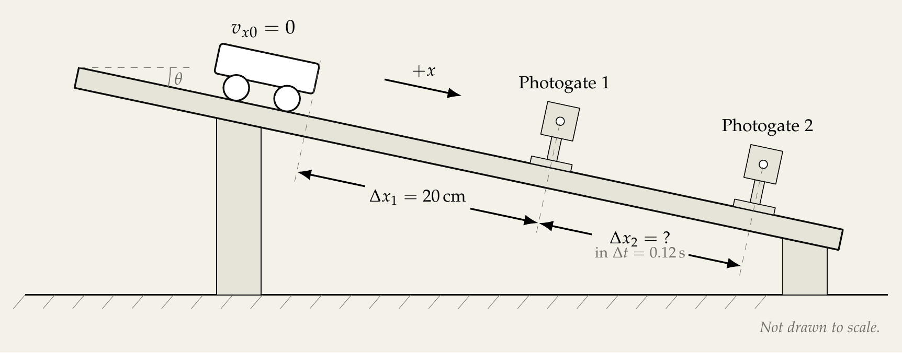
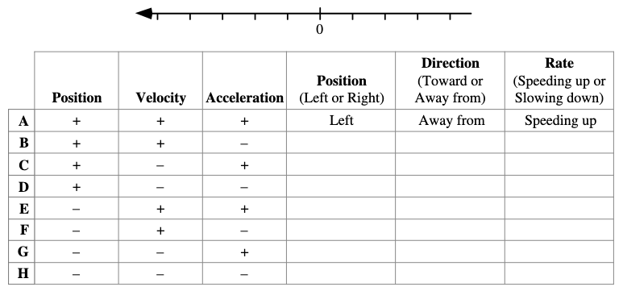
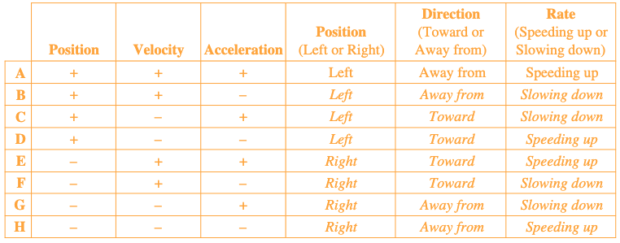
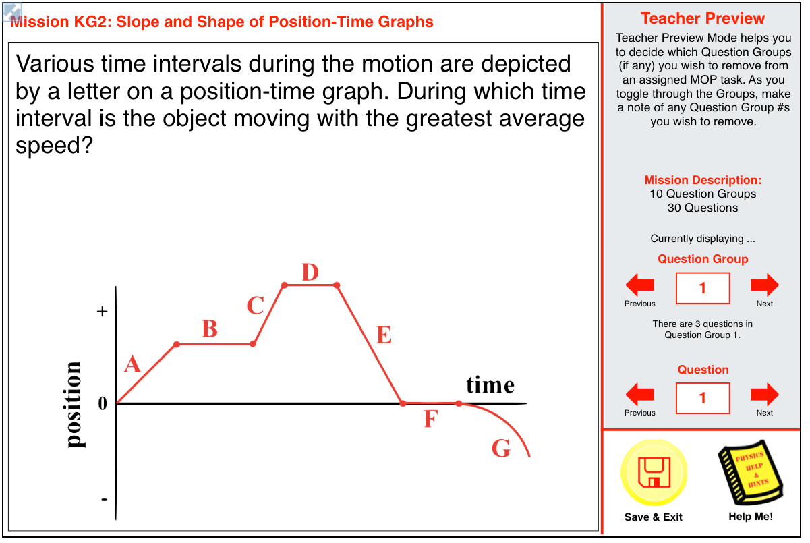
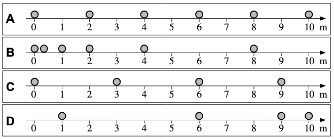
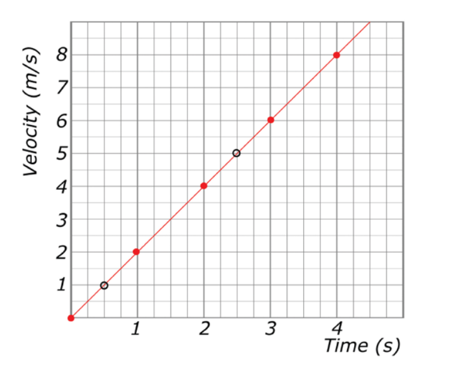

<!--- _class: lead --->

# ~~Regents Physics!~~ 🔭 

# AP Physics 🥼

## **2026-2027** Agendas

### 👨‍🏫 Mr. Porter

---

<!--- class: halloween --->

# 2026.10.28 **AP Physics**

##### **❓ of the 📅**: Is falling forever the same as floating?

 

#### 📋 Agenda

1. Vector Notes
2. Vector Practice - Graphical

### 🎯 Goals

🥅 _Represent and interpret vectors graphically_

### 📆 Upcoming

- Physics Classroom Kinematics 6 & 7
- Quiz Friday

---

# 2026.10.26 **AP Physics**

##### **❓ of the 📅**: Would you rather travel 100 years forward or back in time?

 

#### 📋 Agenda

1. Free Fall Motion Notes — signs, apex, symmetry *(carried from Thu 10/22)*
2. Worked example packet, split by where they got to on Thursday: 
3. PC free-fall problem-solving: 
4. AP Workbook 1.J / 1.K if Friday's quiz left them undone

### 🎯 Goals

🥅 _Solve free fall problems with the kinematic models_

### 📆 Upcoming

- Quiz: _**Kin Quiz 4 — Fri 10/30**_

---

# 2026.10.23 **AP Physics**

##### **❓ of the 📅**: Would you rather be able to run at 100 miles per hour or fly at 10 miles per hour?

 

#### 📋 Agenda

1. ✅ **Kinematics Quiz 3**
2. AP Workbook 1.J — Rocket Motion
3. AP Workbook 1.K — Free Fall Motion

### 🎯 Goals

🥅 _Use the kinematic models to solve free fall and rocket motion problems_

### 📆 Upcoming

- Quiz: _**Kin Quiz 4 — Fri 10/30**_

---

# 2026.10.22 **AP Physics**

##### **❓ of the 📅**: Would you rather be able to see infrared or ultraviolet light?

 

#### 📋 Agenda

1. Stopping Distance debrief
2. Free Fall Five — velocity vs. time graphs
3. Free Fall Five results — what is the acceleration in free fall?
4. [Free Fall Notes](/Presentations/Projectiles/talks/2dMotionAP2026.html) & worked example packet
5. PC problem-solving

### 🎯 Goals

🥅 _Start solving free fall questions_

### 📆 Upcoming

- HW: _**PC Kinematics 6 — due Wed 10/28**_
- HW: _**PC Kinematics 7 + two-stage motion — due Fri 10/30**_
- Quiz Friday: kinematics — graphs and word problems

---

# 2026.10.20 **AP Physics**

##### **❓ of the 📅**: If you could go back in time, what year would you travel to?

 

#### 📋 Agenda

1. Finish the last Stopping Distance question
2. Stopping Distance takeaways
3. Start free fall motion

### 🎯 Goals

🥅 _Model free fall motion_

### 📆 Upcoming

- HW: _**Free Fall Five**_
- Quiz Friday

---

# 2026.10.19 **AP Physics**

##### **❓ of the 📅**: Would you rather live in a teepee or an igloo?

 

#### 📋 Agenda

1. Finish Photogate Lab
2. Driving and reaction time activity

### 🎯 Goals

🥅 _Use kinematic models to solve problems_

### 📆 Upcoming

- Quiz Friday

---

 
 
 
 

###### 2026.10.16 **AP Physics** Do Now

A car on a straight track is at position $x_i$ and has initial speed $v_i$ when it begins to slow down with constant acceleration of magnitude $a$. When the car reaches position $x_f$ it has speed $v_f$. Which of the following is a correct expression for $x_f$?

#### A. $\frac{v_f^2 - v_i^2}{2a} + x_i$

#### B. $\frac{v_i^2 - v_f^2}{2a} + x_i$

#### C. $\frac{v_f^2 - v_i^2}{2a} - x_i$

#### D. $\frac{v_i^2 - v_f^2}{2a} - x_i$

 

---

# 2026.10.16 **AP Physics**

##### **❓ of the 📅**: If you were to be in the circus, what would your circus act be?

 

#### 📋 Agenda

1. Do Now
2. Photogate Lab

### 🎯 Goals

🥅 _Use mathematical models to make predictions_

### 📆 Upcoming
HW Due Friday:
- Set K12: VT Graph Challenges
- Kinematics 4: Kinematic Eqs
- Kinematics 5: Kinematic Eqs

---

# 🛝 Constant Acceleration **Lab Practical**

### Today you get a cart, a ramp, and one number to hit.

Release the cart **from rest**. It rolls **20 cm** and crosses photogate 1.

Put photogate 2 where the cart will take exactly **0.12 s** to reach it.

###### Your reference table is the only equation sheet you get. No procedure is given — that is the point.

---

# 📐 The Setup

* Cart released **from rest**: $v_{x0} = 0$
* $\Delta x_1 = 20$ cm — already marked on your ramp
* **Photogate 1** — already clamped for you
* **Photogate 2** — <mark>you</mark> decide where it goes

### 🎯 Target: $\Delta t = 0.12$ s

**Do not move the ramp or change its angle** once you have measured your acceleration.

---

# 📋 Your Job

**a. Design** 🧪
Write a procedure to find your cart's acceleration.

**b. Measure** 📏
Run it. Table, units, resolutions. Report $a$.

**c. Derive** ✏️
Get $\Delta x_2$ in terms of $\Delta x_1$, $a$, $\Delta t$ — **symbols only**.

**d. Predict & Test** 🎯
Substitute. Place gate 2. Run it. Percent error in the **time**.

**e. Evaluate** 🔍
Which measurement hurt you most? Which direction?

**f. Reason** 📈
Steeper ramp — does $\Delta x_2$ go up, down, or stay?

**g. Argue** 💬
Defend a classmate's claim with **two** reasons.

---

# 📓 In Your Notebook

#### Everything goes here

1. Title, the task in your words, labeled sketch
2. Your procedure
3. Data table — units **and** resolutions
4. Graph or calculation → $a$
5. Derivation in symbols
6. Substitution → $\Delta x_2$
7. Measured $\Delta t$ + percent error
8. Parts (e), (f), (g) in sentences

###### 🏁 Close with a conclusion: did it work, what were you most sensitive to, what would you change?

---

# 2026.10.14 **AP Physics**

##### **❓ of the 📅**: What is your favorite dinosaur? 🦖

 

#### 📋 Agenda

1. Review the Bear Question
2. Kinematic Equations & The Cross Diagram
2. Practice
3. Two-stage Kinematic questions

### 🎯 Goals

🥅 _Use mathematical models to make predicitons about motion_

### 📆 Upcoming

HW Due Friday:
- Set K12: VT Graph Challenges
- Kinematics 4: Kinematic Eqs
- Kinematics 5: Kinematic Eqs

---

# 2026.10.13 **AP Physics**

##### **❓ of the 📅**: If you were to open a store, what would you sell?

 

#### 📋 Agenda

1. Finish Quiz
2. The Bear Problem - Problem-Solving Packet (work as a group of 4)
3. Discuss Bear Solution
4. Kinematic Equations and the Cross <mark>➕</mark> Diagram
4. Solving Problems with the Kinematic equations 

### 🎯 Goals

🥅 _Use mathematical models to solve problems_

### 📆 Upcoming

- HW (due Friday):
  - Set K12: Velocity-Time Graph Challenges
  - Kinematics 4: Kinematic Equations
  - Kinematics 5: Kinematic Equations

---

<!--- class: --->

###### 2026.10.07 **AP Physics** Do Now  
Eight possible signs of combinations for the instantaneous position, velocity, and acceleration of an object moving in one dimension are given in the table. Above the table is a coordinate axis that shows the origin, marked 0, and that indicates that the positive direction is to the left. The three columns on the right-hand side of the table are to describe the location of the object (either left or right of the origin), the direction of the motion of the object (either toward or away from the origin), and what is happening to the speed of the object (either speeding up or slowing down at the given instant). The appropriate descriptions for the first case are shown.

  

---

###### Answer

  

---

# 2026.10.07 **AP Physics**

##### **❓ of the 📅**: Does pineapple belong on a pizza? 🍕 🍍

 

#### 📋 Agenda

1. Do Now
2. Working through problem-solving questions as a trio

### 🎯 Goals

🥅 _Use velocity-time graphs to solve problems_

### 📆 Upcoming

- Quiz Friday: X-T Graph, V-T Graph, Stacks of Graphs

---

# 2026.10.06 **Do Now**

 ###### 10  MINUTES 

 

 

For each of these cases, if any, is...at the indicated point?

1. the **position zero** ?
2. the **position negative**?
3. the **velocity zero**?
4. the **velocity negative**?
5. the **acceleration zero** ?
6. the **acceleration negative**?

 

 

 
 

 

 

---

# 2026.10.06 **AP Physics**

##### **❓ of the 📅**: Does your family have a "motto" – spoken or unspoken?

 

#### 📋 Agenda

1. Do Now 
2. Notes - Graphical Representations
2. Problem-Solving Graphically

### 🎯 Goals

🥅 _Solve Problems Graphically_

### 📆 Upcoming

---

# 2026.10.05  **AP Physics** Do Now

 

 

###### 10 MINUTES - Physics Classroom

Complete: _Mission KG2 Shape and Slope of Position-Time Graphs (MO)_
  

 

---

# 2026.10.05 **AP Physics**

##### **❓ of the 📅**: What was your favorite halloween costume?

 

#### 📋 Agenda

1. Do Now
2. Finish Card Sort Data Collection
   - check with Mr. Porter
3. Complete Summary Chart as a group of 4 & Discuss with Mr. Porter
4. Notes on Graphical Representation
5. Start Physics Classroom Homework

### 🎯 Goals

🥅 _Model Motion Graphically_

### 📆 Homework

Physics Classroom:
  - Set K10: Velocity-Time Graphs 1
  - Set K11: Velocity-Time Graphs 2

---

# 2026.10.01 **AP Physics**

##### **❓ of the 📅**: Which holiday has the best food?

 

#### 📋 Agenda

1. Finish Lab - compare data, notes, write up conclusions
2. Card sort & fan mini lab activity (not in notebooks)

### 🎯 Goals

🥅 _Model & define uniform motion_

### 📆 Upcoming

---

# 2026.09.30 **AP Physics**

##### **❓ of the 📅**: If you could be any Disney princess, which would you choose?

 

#### 📋 Agenda

1. Finish Graphing x vs t data
    - print & describe in notebook: support, refute, need more
2. Collect velocity data from xt graph
3. Create VT Graphs
    - print & describe in notebook: support, refute, need more
4. How is position and time related? Can we confirm quadratic somehow?
    - Intro to linearization

### 🎯 Goals

🥅 _Model changing velocity motion_

### 📆 Upcoming

---

# 2026.09.29 **AP Physics**

##### **❓ of the 📅**: Would you rather be able to talk to animals or understand all human languages?

 

#### 📋 Agenda

0. <mark>Do Now</mark> Grab your lab notebook and **1 sticker** to decorate it
1. Hand back quiz & discuss
1. VT Graphs and Area Rule
2. Ticker Tape Lab

### 🎯 Goals

🥅 _Use VT Graphs to calculate displacement_

🥅 _Model changing velocity motion_

### 📆 Upcoming

---

# 2026.09.25 **AP Physics**

##### **❓ of the 📅**: Would you rather be a dragon or own a dragon? 🐉

 

#### 📋 Agenda

1. Quiz
2. Finish VT Graphs
3. Ticker Tape Lab

### 🎯 Goals

🥅 _Make calculations from VT Graphs_

### 📆 Upcoming

---

# 2026.09.24 **AP Physics**

##### **❓ of the 📅**: What's your favorite sandwich and why? 🥪

 

#### 📋 Agenda

1. Finish VT Graphs
2. Physics Classroom - Position vs. Time Graphs

### 🎯 Goals

🥅 _Make calculations from VT Graphs_

### 📆 Upcoming

- Quiz tomorrow

---

# 2026.09.23 **AP Physics** Do Now

 
 
 
 

 ###### 5 Mintes MINUTES 

 

 

 
 The position-time graph shown represents the motion of two children who are moving along a narrow, straight hallway.

1. Do either of the children ever change ***direction***?
2. Are the two children ever at the same ***position*** along the hallway?
3. Do the two children ever have the same ***speed***?

 

  
 

 
 
 

 

  
 
 

 

---

# 2026.09.23 **AP Physics**

##### **❓ of the 📅**: How do you make your marshmallow for s'mores? 🍫

 

#### 📋 Agenda

1. Do Now
2. AP Workbook 1.A -> 1.D
3. Velocity vs. Time Graphs

### 🎯 Goals

🥅 _Model Motion with VT Graphs_

### 📆 Upcoming

- Quiz **Friday**: x vs. t graphs, average vs. instantaneous velo & speed, solving problems with $x = vt + x_0$
- Physics Classroom assignments due Friday

---

# 2025.09.21 **Do Now**

 
 
 
 

 ###### 5 MINUTES 

 ####  

Each graph below shows the position of an object as a function of time.

1. Rank the **displacement** of each object from least to greatest. 
2. Rank the **distance** of each object from least to greatest. 

  
 
 

 

---

# 2026.09.21 **AP Physics**

##### **❓ of the 📅**: If you could make the world's biggest food fight, what food would you have? 

 

#### 📋 Agenda

1. Using Mathematical Models
2. Red Car vs. Green Car
3. AP Workbook 1.A - 1.D

### 🎯 Goals

🥅 _Use mathematical models_

### 📆 Upcoming

---

# 2026.09.18 **AP Physics**

 
 
 
 

 ###### 10 MINUTES 

 ####  Finish Distance vs. Displacement Physics Classroom Assignment

  
 
 

 

---

# 2026.09.18 **AP Physics**

##### **❓ of the 📅**: If you could make the world's biggest food fight, what food would you have?

 

#### 📋 Agenda

1. Do Now - Finish Distance vs. Displ PC
2. [Notes on Speed and Velocity](../../Presentations/APCVPM/talks/CVPM2026.html)
3. Average vs. instantaneous
4. Using CV Mathematical model

### 🎯 Goals

🥅 _Work with constant velocity model to solve problems_

### 📆 Upcoming

- Finish Red Car Green Car (due next Friday)

---

 # **AP Physics Do Now**  Register for...

 
 
 

 ## Register for **AP Classroom** 
 
 AP Exam Prep & Review
  - Website: [https://apclassroom.collegeboard.org/](https://apclassroom.collegeboard.org/)
  - Code: <mark>**YLWWNZ**</mark>
 
 

 

 
##  Register for... **Physics Classroom**
  General Physics Practice & Homework
  - Website: [http://www.physicsclassroom.com/sign-in](http://www.physicsclassroom.com/sign-in)
  - Code: **e56dbba**
  - Register with school email as username
 
 

 

---

# 2026.09.17 **AP Physics**

##### **❓ of the 📅**: What was your favorite recess game from elementary school?

 

#### 📋 Agenda

1. Whiteboard Results and discuss
2. Finish Lab Notebook
3. [Motion Notes](../../Presentations/APCVPM/talks/CVPM2026.html)
3. Distance vs. Displacement Physics Classroom

### 🎯 Goals

🥅 __

### 📆 Upcoming

---

# 2026.09.15 **AP Physics**

##### **❓ of the 📅**: What is the best french fry shape? 🍟

 

#### 📋 Agenda

1. Do Now
2. Finish Buggy Lab
    - Collect Data
    - [Graph with nPlot](https://noragulfa.com/nPlot/) and Print 🖨️
2. Whiteboard and Compare

### 🎯 Goals

🥅 _Collect data for buggy lab_

🥅 _Model Motiong graphically_ 

### 📆 Upcoming

---

# 2026.09.14 **AP Physics** Do Now

 
 
 
 
 

 ###### 5 MINUTES 

 #### How Far and Where? 

In each case, a sphere is moving from left to right next to a tape marked in meters. A strobe (flash) photograph is taken every second, and the location of the sphere is recorded. The total time intervals shown are not the same for all spheres.

1. Which ball went the **_furthest_** over the first 3 seconds?
2. **_Where_** is each ball at time $t = 3 \text{ s}$?
3. What are two ways to define "furthest"? 
 
 

 

---

# 2026.09.14 **AP Physics**

##### **❓ of the 📅**: Should fruit be kept in the fridge?

 

#### 📋 Agenda

1. [Data Collection Best Practices](../../AP%20Resource%20Pages/datacollection.html)
2. Buggy Lab - Partners

### 🎯 Goals

🥅 __

### 📆 Upcoming

---

<!--- _class: paper --->

# Buggy Lab 🚗 

## Purpose

Collect data on your buggies so that you can represent the motion (all aspescts) of both buggies on the **same** graph. Your final models should be able to predict the **position** of your buggy at specified times. 

 

## Constraints

You will be given scenario card that describes the setup of your buggies

*Ignore speed label

---

<!-- _class: paper -->

# 2026.09.11 **AP Physics** Do Now

###### 5 MINUTES — ON YOUR OWN

#### Best Fit Lines

1. Pick up handout on front table
2. Complete on your own
2. Compare your answers to your peers
3. Discuss with Mr. Porter as a group

---

# 2026.09.11 **AP Physics**

##### **❓ of the 📅**: If you could snap your fingers and have one thing done for you, which would it be?

 

#### 📋 Agenda

1. Do Now - Best Fit Lines
2. Best Fit Lines Slides (blob vs. split method)
3. Experimental Uncertainty slides
4. Finish Lab Notebook
5. Data Collection Best Practices
6. Mathematical Modeling

### 🎯 Goals

🥅 _Practice with mathematical modeling from experimental data_

🥅 _Write conclusions from mathematical models_

### 📆 Upcoming

---

# 2026.09.09 **Regents? Physics**

##### **❓ of the 📅**: Can you ask a genie for infinite wishes? 🧞

 

#### 📋 Agenda

1. Ball Bounce Lab
    - collect data
    - create graph & drawing best fit lines
      - calculating slope
    - discuss
    - answer questions
2. Creating Mathematical Models
3. Data Collection Best Practices

### 🎯 Goals

🥅 _Discuss how to draw and calculate best fit lines_

### 📆 Upcoming

- HW: Safety Contract Signed

---

# Best Fit Lines

 

$$slope=\frac{rise}{run}=\frac{y_2-y_1}{x_2-x_1}=\frac{5 \frac{m}{s} - 1 \frac{m}{s}}{2.5 s - 0.5 s} = 2 \frac{m}{s}$$

---

# 2026.09.08 **Regents Physics** 

##### **❓ of the 📅**: Sweet or savory for breakfast?

#### 📋 Agenda

0. Sit Anywhere
1. Do Now (fill out questionnaire & card)
2. Question of the Day
3. Lab Notebooks
4. Ball Bounce Lab
5. Question

### 🎯 Goals 

🥅 _Introductions_

🥅 _Classroom Culture_

### 🏠 Homework

- Signed Safety Contract

---
<!--- _class: paper--->
# Do **Now** 

> 1. Fill out index card:
>    - Name
>    - Phone number to reach your parents/guardians if you sleep through the Regents
>    - Favorite Candy
>    - Favorite Emoji
>    - Emoji the describes your current mood
> 2. Fill out Paper Quesionnaire

---

<!--- _class: paper--->

# Survival Island 🌴

> 1. Share your *survival skill* that **you wrote down** with your group
> 2. Using ***everyone's skill*** develop a plan to survive or escape the deserted island
> 3. On your whiteboard present your plan (drawing, mind map, set of instructions)
    - Highlight everyone's skill

---

# Surivial Plan... <!--fit--->

---

<!--- _class: paper-->

# Ball Bounce Lab

> ## Question:
> Is the coefficient of restitution constant for your ball? Do this by comparing drop height to bounce height for your assigned ball.

---

# 🥼 Lets Science! 🥼 <!--fit--->

# 📓 Lab Notebooks 📓 <!--fit--->

---

# What is a Lab Notebook?

* A detailed, chronological record of a scientist's research activities, experiments, and observations. 
* Documentation of the scientific process from intial ideas to final results and conclusions. 

---

# Why keep lab notebooks?

* Document Research
* Develop Ideas
* Organize Data 
* Collaboration Tool
* Publication Support
* Troubleshooting 
* Intellectual Property Protection
* Historical Record

---

# Lab Notebooks can be Legal Documents 

* Proof of invention in Patent Cases
* Intellectual Property Protection
* Admissibility in court - must be properly maintained
* Note: Often property of the instituation where the research was conducted (i.e. Property of Regeneron, or Property of Cornell University)

---

# Remember

* Lab notebooks are most importantly scientific documentation
* They represent the scientific process and are record of your **thinking**
    * This means your ideas and conclusions and hypotheses can **change** based on **new data**

---

# Lab Notebook

* Write in **pen**
* All mistakes get a ~~single cross through~~
* Full Date (YYYY/MM/DD) at the beginning of each entry (for multiday labs date start of each day)
* Enter Lab Pages into table of contents 

---

# Lab Notebook - Pre Lab

* **Title and objective of the experiment**: 
  - Write a clear, concise title for each experiment.
  - State the main objective or purpose of the experiment in 1-2 sentences.
* ***Theoretical background**: 
  - Briefly explain the relevant scientific principles.
  - Include key equations or concepts that will be tested or applied.
* **Hypotheses**: 

  - State your predictions about the experiment's outcome.
  - Base these on your understanding of the theory.

---

# Lab Notebook - Pre Lab

* **Materials and equipment list**: 
  - Provide a detailed list of all materials and equipment used.
  - Include model numbers and specifications where relevant.
* **Experimental procedure outline**: 
  - Write a step-by-step outline of the planned procedure.
  - Be specific enough that someone could replicate your experiment.

---

<!--- footer:   --->

# During the Experiment

* **Raw data in tables with units**: 
  - Create neat, organized tables for all numerical data.
  - Always include units and uncertainty estimates.
  - Label columns clearly and use consistent significant figures.
* **Observations and qualitative notes**: 
  - Record all relevant observations, even if they seem unimportant.
  - Note any unexpected occurrences or anomalies.

---

# During the Experiment 

* **Any changes to the planned procedure**: 
  - Document any deviations from the original procedure.
  - Explain why changes were made and how they might affect results.
* **Sketches or diagrams of experimental setup**: 
  - Include clear, labeled diagrams of your experimental setup.
  - Add dimensions and important details to aid in replication.

---

# Post Lab

* **Data analysis and calculations**: 
  - Show all steps in your calculations, including formulas used.
  - Explain your reasoning for each step of the analysis.
* **Graphs and charts**: 
  - Create neat, properly labeled graphs and charts.
  - Include titles, axis labels with units, and legends where appropriate.

---

# Post Lab

* **Discussion of results**: 
  - Interpret your results in the context of the experiment's objectives.
  - Explain any patterns or trends observed in the data
* **Comparison with hypotheses**: 
  - Explicitly state whether your results support or refute your hypotheses.
  - Discuss possible reasons for any discrepancies.
* **Sources of error and uncertainty**: 
  - Identify potential sources of experimental error.
  - Discuss how these might have affected your results.
  - Quantify uncertainties where possible.

---

# Post Lab

- **Conclusions**: 
  - Summarize the main findings of the experiment.
  - Relate these back to the original objectives and broader scientific principles.
  - Suggest improvements or future directions for the experiment.

---

<!--- _class: paper --->

## Ball Bounce Lab

> **Purpose:** To determine the mathematical relationship between drop height and bounce height, express it as an equation built from your own graph, and test that equation by predicting an unmeasured bounce.

> **Essential Question:** How does the height a ball bounces depend on the height from which it is dropped?

---

<!--- _class: paper --->

## Ball Bounce Lab

> **Background**: The coefficient of restitution (symbol: $e$) is a dimensionless quantity that describes how much energy is conserved in a collision, specifically how well an object bounces back after impact. It is used to characterize the elasticity of collisions between two bodies.

---

# Board Meeting 

### Rules 📝

1. 👂 Listen 
2. 🗣️ Speak Clearly
3. ❔ Ask Questions
4. 🤔 Seek to understand
5. 👉 Refer to your board and use **evidence**
7. 📊 Use & connect multiple representations
6. 🌟 Come to consensus

 

### Goals 🎯

1. Practice Presenting to Class
    - speaking clearly
    - listening intently
2. Learn how to come to class consensus
    - What does the *majority* of the data show?
3. Create a culture of learning from each other

 