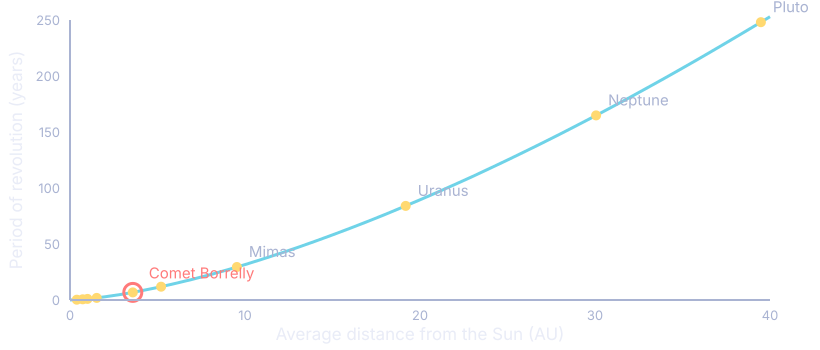
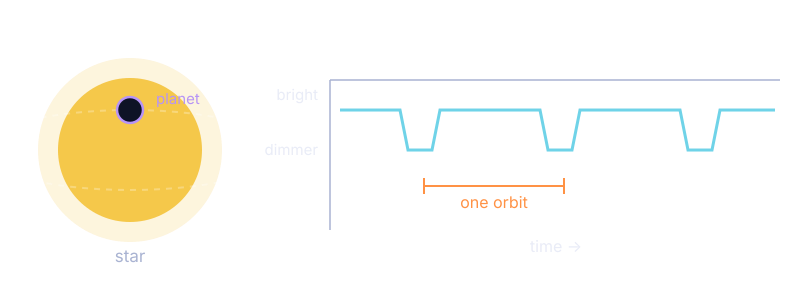
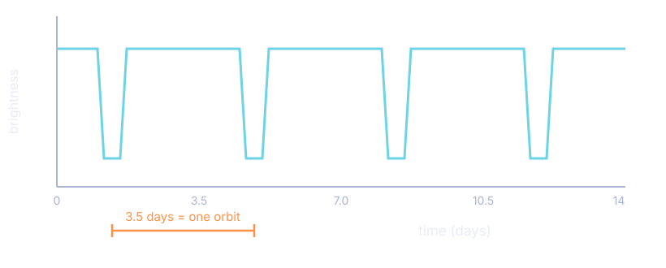
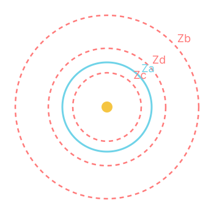

<!-- _class: title-slide -->

# 🪐 Planets and Orbits
## Unit 1: Discovering New Worlds — Lesson 3
### Why Comet Borrelly's water changes phase · Kepler's Laws · which exoplanets stay in the habitable zone

<!--
THE 5E TEACHING DECK for L3. The companion packet is "Planets and Orbits" (ess-u1-l3-orbits.pdf); the consolidation deck is U1_L3_Orbits_Guided_Notes_Slides.
PERFORMANCE EXPECTATION: HS-ESS1-4 — use mathematical or computational representations to predict the motion of orbiting objects in the solar system.
INVESTIGATIVE PHENOMENON: Comet Borrelly has water that is frozen most of the time, but every several years it shoots out a jet of vaporised water and dust.
TIME: 7–9 days.
THE ARC IN ONE LINE: distance explains phase → but average distance hides the shape → Kepler III turns period into distance → Kepler I turns eccentricity into shape → now we can judge an exoplanet.
-->

---

<!-- _class: phase-title -->

# ENGAGE
## Why does water on Comet Borrelly change from ice to vapour every 6 years?

<!--
LAUNCH: remind students that the Driving Question Board surfaced "Does the planet have the right temperature to sustain life? Does the planet have liquid water?"
THE PROBLEM TO NAME: exoplanet data does not tell us whether water is there — our technology can only detect water inside our own solar system. So ask: "How can we use what we know about water in OUR solar system to make claims about liquid water on exoplanets?"
If students don't get there, go back to the performance task prompt.
GROUPING: independent, then small group. ROUTINE: Rumors. LITERACY: text annotation.
-->

---

<!-- _class: lt1 lt2 -->

# Water in Our Solar System

| Object | Water | Avg. distance (10⁶ km) |
|---|---|---|
| Mercury | traces of vapour in a very thin atmosphere | 57.9 |
| Venus | traces of vapour in the atmosphere | 108.2 |
| **Earth** | **71% of the surface is water; mostly liquid** | **149.6** |
| Mars | almost all ice; a little vapour; some transient liquid | 227.9 |
| Comet Borrelly | ice most of the time — then a jet of vapour | 240 |
| Europa | water-ice crust; possibly a salty ocean below | 778.4 |
| Mimas | a big ball of frozen water | 1,426 |
| Uranus / Neptune / Pluto | ice | 2,871 / 4,498 / 5,910 |

<!--
TEXT ANNOTATION: students read independently and mark 3–5 details that matter for telling the story.
SUPPORT QUESTIONS: Why is most of Earth's water liquid while almost everything else is ice or vapour? What could explain Comet Borrelly?
DIFFERENTIATION: the full table overwhelms some students. Start them on four rows — Mercury, Earth, Jupiter's moon Europa, Comet Borrelly. Guide with: which are closest and furthest? what does "average distance" mean? what forms of water are named?
IMPLEMENTATION TIP — DO NOT GIVE THIS AWAY: make sure students know what "average distance" means, without revealing the point of the lesson, which is that a comet has a low average distance because it spends part of its orbit very far out and part very close in.
-->

---

# The Phenomenon

**Comet Borrelly** carries water that is **frozen solid** most of the time.

Then, every several years, it **shoots out a jet** of vaporised water and dust.

Nothing else in the table does this.

**The puzzle**

Earth's water is mostly **liquid**.
Everything closer to the Sun has only **vapour**.
Everything further out has only **ice**.

And Borrelly does **both**.

**Describe the phenomenon.** Talk with your group and tell the story captured in the video and the table.

<!--
VIDEO: Comet Borrelly flyby — https://www.jpl.nasa.gov/videos/comet-borrelly-flyby/
THE STORY STUDENTS SHOULD TELL: most of Earth's water is liquid, but on almost every other object it is ice or vapour; and Borrelly's is frozen most of the time, then vaporises every several years.
TURN AND TALK: what other phenomena do you know where water in different places is in different phases? (Ice melting in a drink, puddles steaming off hot pavement, snow on a mountain while it rains in the valley.) This connects to energy ideas they already hold.
-->

---

# Develop an Initial Model

**Your model should:**

1. Show the Sun and objects at **different distances**
2. Label the **phase of water** on each
3. **Annotate** it — say *how* the orbit explains the phase
4. Include **data** from the table as support

Then write on a sticky note: **what might explain the fact that Comet Borrelly's water is frozen most of the time, but every several years shoots out a jet of vapour and dust?**

<!--
ROUTINE — RUMORS: after independent brainstorming, students pick the idea they are most confident about and share it with several classmates, listening for trends, then report trends to the class. Low stakes, surfaces everyone's thinking. See the Unit 1 Guide for the steps.
LOOK AND LISTEN FOR these middle-school energy ideas:
  • The Sun transfers more electromagnetic energy to Borrelly every several years, raising the average kinetic energy (temperature) of the water molecules enough to vaporise them (MS-PS1.A, MS-PS3.A, MS-PS4.B). → Explore 1 CONFIRMS this.
  • Maybe its tilt changes, like Earth's seasons (MS-ESS1.B, MS-PS4.B). → Explore 1 gives NO evidence for this. What it shows instead is that Borrelly's distance from the Sun changes enormously during one orbit.
CATEGORISE the ideas on a poster titled "Water in Our Solar System" and return to it through the unit.
ACCESS FOR ALL LEARNERS: incomplete ideas are evidence of sensemaking. There is plenty of lesson left.
-->

---

# What Do We Need to Investigate?

Write **at least three** questions you want to investigate in order to explain Comet Borrelly.

Questions that will take us where we need to go:

- At what distance does Borrelly orbit the Sun at **different points** in its orbit?
- What is Borrelly's orbit **like** — what shape is it?
- How is Borrelly's orbit **different** from other objects' orbits?
- What patterns show up in the orbits of objects with **ice**? **vapour**? **liquid**?

<!--
Students generate 3 questions independently, pair up, share, then choose two to bring to the class.
THESE ARE THE BRIDGE to Explore 1. If none of them surface, the orbital data table will still do the work — but it is much better if the class asks for it.
DIFFERENTIATION: if a group already explains the phases AND Borrelly completely, you may skip Explore 1 and Explain 1 for them — but they still have to graph the orbital variables before Explore 2.
-->

---

<!-- _class: phase-title -->

# EXPLORE 1
## Identifying patterns in solar system data

<!--
LAUNCH: remind students they said they need to investigate Borrelly's distance from the Sun and the characteristics of its orbit. Tell them they are looking for evidence of patterns in solar system orbital data.
GROUPING: 2–3 students. ROUTINE: Domino Discover.
MATERIALS: the handout, computers with Sheets or Excel.
-->

---

<!-- _class: lt1 lt6 dense -->

# Solar System Orbital Data

| Object | Avg. dist. (AU) | Period (yr) | Min. (AU) | Max. (AU) | Most of its water |
|---|---|---|---|---|---|
| Mercury | 0.387 | 0.241 | 0.307 | 0.467 | vapour |
| Venus | 0.723 | 0.615 | 0.718 | 0.728 | vapour |
| **Earth** | **1.000** | **1.00** | **0.983** | **1.017** | **liquid** |
| Mars | 1.523 | 1.88 | 1.381 | 1.666 | ice |
| **Comet Borrelly** | **3.590** | **6.80** | **1.350** | **5.830** | **ice — much vaporises every few years** |
| Europa | 5.203 | 11.87 | 4.950 | 5.459 | ice crust, liquid ocean below |
| Mimas | 9.539 | 29.46 | 9.041 | 10.124 | ice |
| Uranus | 19.185 | 84.03 | 18.324 | 20.078 | ice |
| Neptune | 30.061 | 164.82 | 29.709 | 30.386 | ice |
| **Pluto** | **39.479** | **248.06** | **29.658** | **49.304** | **ice** |

One AU is Earth's average distance from the Sun.

<!--
DON'T HAND THEM THE GRAPH. Ask what they should look for, listen for "evidence of patterns", then ask: what have you done before to represent data so patterns are easier to see? They will say "graph it" — and if not, point back at the Star Circle data from L2.
CONFERRING PROMPTS while they graph:
  • What data is most relevant to explaining why water is in different phases on different objects?
  • What patterns could help explain Borrelly?
CCC 1 — PATTERNS, middle-school element: graphs and charts are useful for identifying patterns in data. Foreground this at the end of the phase; Explore 2 builds the high-school element on top of it.
IF THEY HAVE NEVER GRAPHED IN SHEETS, stop and teach it. They must create and analyse graphs themselves — that is how the modelling practice develops.
-->

---

# The Pattern in the Graph

As average distance **increases**, period **increases** — and **faster** than the distance does.

<!--
THE CURVE IS NOT A STRAIGHT LINE. That matters. Neptune is 30 times further out than Earth but takes 165 years, not 30. Students should notice the curve bending upward.
AT THIS POINT it is fine for them to say only "a further planet has further to travel". Gravity's role comes in Unit 2.
BORRELLY SITS ON THE CURVE at its AVERAGE distance — which is exactly why average distance is not enough. That is the next slide.
-->

---

# What the Average Hides

### Almost everything

| | Min | Max |
|---|---|---|
| Venus | 0.718 | 0.728 |
| Earth | 0.983 | 1.017 |
| Mars | 1.381 | 1.666 |
| Neptune | 29.709 | 30.386 |

Barely changes at all.

### Two that don't

| | Min | Max |
|---|---|---|
| **Borrelly** | **1.350** | **5.830** |
| **Pluto** | **29.658** | **49.304** |

Borrelly's distance changes by a factor of **more than four** in one orbit.

<!--
THIS IS THE SLIDE THAT CRACKS THE PHENOMENON. Let students find it in the data rather than telling them.
CONFERRING PROMPTS for the See–Think–Wonder:
  • What patterns do you see between the phase of water and average distance from the Sun?
  • What pattern do you see in the minimum and maximum distance columns?
  • Do all objects fit that pattern?
  • Which patterns — or exceptions — could help explain Borrelly?
DOMINO DISCOVER then surfaces this to the whole class. Refer to the Unit 1 Teacher Guide for the routine.
DIFFERENTIATION: some students need sentence starters in the "See" column.
-->

---

# See – Think – Wonder

| See | Think | Wonder |
|---|---|---|
| Objects whose water is **ice** orbit further from the Sun than Earth | The further out, the colder — so water is frozen | Do the ice and vapour worlds have *any* liquid water? Did they ever? |
| Objects whose water is **vapour** orbit closer than Earth | The closer in, the hotter — so water boils off | Does Borrelly ever have liquid water? |
| **Borrelly and Pluto** change distance a lot across one orbit | This is probably why Borrelly's water vaporises every few years | Do our exoplanets orbit where water could be liquid? |
| As average distance goes **up**, so does the **period** | A further orbit is a longer way round | …and do they **stay** there? |

<!--
These are the responses the teacher copy of "What are orbits like in our solar system?" lists. Students will not produce all four — Domino Discover is how the rest reach the class.
IF A PATTERN DOESN'T SURFACE: display student graphs and work the conferring questions until it does, then ask whether the new pattern is relevant to the water question.
THE WONDER COLUMN IS THE BRIDGE to the whole rest of the lesson — "do they stay there?" is literally the Elaborate phase.
-->

---

<!-- _class: phase-title -->

# EXPLAIN 1
## Revising solar system models

<!--
LAUNCH: we are trying to figure out why water exists in different phases on different objects, and why Borrelly's changes phase during its orbit. Students now use evidence of patterns to revise their Engage models.
GROUPING: 2–3 students. Then a CLASS CONSENSUS DISCUSSION.
-->

---

# Revise Your Model

**Look for these four things in a strong revision:**

1. Objects whose water is mostly **vapour** orbit **closer** to the Sun than Earth
2. Objects whose water is mostly **ice** orbit **further** than Earth
3. **Borrelly and Pluto** have far more **elliptical** orbits — min and max distances nothing alike
4. **Annotations** that say *how* the orbit explains the phase, not just labels

<!--
CONFER while groups revise, to get a sense of the range of ideas and to choose who shares.
CLASS CONSENSUS DISCUSSION STEPS: 1) select a few groups' ideas; 2) first group shares; 3) someone reiterates what they said; 4) class asks clarifying questions — repeat 2–4 per group; 5) confer in table groups; 6) whole-class discussion toward agreement.
SELECT STRATEGICALLY, not randomly. Choose based on what you saw while conferring AND on where the phase needs to go.
PROMPTS TO SURFACE STABILITY AND CHANGE:
  • What patterns did you see? How did graphing help you see them?
  • What determines whether an object's temperature is stable or unstable across its whole orbit?
  • What is causing the phase of water to change, or stay the same?
-->

---

# Key Points to Land

- **Graphing** made the patterns visible in a way the table did not
- Objects orbit at **different distances**, and that changes their temperature and the phase of their water
- Most solar system orbits are **nearly circular**, so those objects hold a steady enough temperature for water to stay in one phase the whole way round
- Some objects sit in a **habitable zone** — and that is where we should look for exoplanets that could support life

<!--
THE BOLD TERMS ARE ONES STUDENTS WILL HAVE FIGURED OUT WITHOUT KNOWING THE WORD. It is appropriate to supply the vocabulary here, after the sensemaking — not before.
ACCESS FOR MULTILINGUAL LEARNERS: learning vocabulary from context after making sense of an experience works far better than a word list, and is especially good for transitioning language learners.
CCC 1 — PATTERNS: assess whether students apply the high-school element from L1 by naming the specific empirical evidence behind each pattern. If they don't, prompt them to.
THEN: Domino Discover to decide 1–3 things that belong in the class consensus model. Document where everyone can see it.
-->

---

<!-- _class: lt1 -->

# The Habitable Zone

**Habitable zone** — the band of distances from a star where a planet can hold **liquid water** on its surface.

Too close → the water is **vapour**
Too far → the water is **ice**
In between → **liquid**

Our solar system's zone runs from about **142** to **172** million km.

Earth orbits at **150** million km.

But a zone is a range of **distances**.

A planet does not sit at one distance. It travels an **orbit**.

So: does it **stay** in the zone?

<!--
THE HABITABLE ZONE IS NOT A FIXED DISTANCE — it depends on the star. A dim star's zone is much closer in. This matters enormously at Explain 2, where HD-20782 b orbits further from its star than any other planet in our data set and is still too close.
SET UP THE NEXT PHASE: we now know what to look for in an exoplanet. But the exoplanet data gives us almost nothing — no distance at all. That is the Explore 2 problem.
-->

---

<!-- _class: phase-title -->

# EXPLORE 2
## Developing a mathematical model for orbits

<!--
LAUNCH: explain that the investigation now moves from our solar system to planets orbiting other stars. Ask students why we are making that move.
TELL THEM about the TRANSIT METHOD — and note that it detects exoplanets but gives us no data about the distance at which they orbit.
IMPLEMENTATION TIP: "transit method" is a shared tool, not a key concept for this unit. It is fine to simply teach the term without exploring it first.
GROUPING: pairs.
-->

---

# The Transit Method

When a planet passes in front of its star, the star's light **dims slightly**, then recovers. We cannot see the planet — but we can see the **dip**.

<!--
SIMULATION: NASA, 5 Ways to Find a Planet — Transit Method. https://exoplanets.nasa.gov/alien-worlds/ways-to-find-a-planet/#/2
Pairs work through single planet, different sized planets, multiple planets, guided by: What patterns do you see? What is your evidence? What inferences can we make, and why?
LOOK AND LISTEN FOR:
  • WHEN / HOW OFTEN the planet passes in front — we know because the light decreases the same amount each time.
  • RELATIVE SIZE of planets — bigger planets make the light decrease more.
  • NUMBER of planets — the light decreases by different amounts.
Project the simulation and have several pairs share. Choose strategically so a range of ideas surfaces.
CCC 1 — PATTERNS: by now students should reach for patterns automatically when handed a simulation.
-->

---

# Reading a Light Curve

The dips repeat every **3.5 days**. That is how long Kepler-5b takes to go once around its star — its **orbital period**.

<!--
TAKE TIME FOR THIS KEY POINT: the most important idea in this phase is that the transit method tells us HOW OFTEN a planet passes in front of a star. If it does not surface from the simulation, show this graph and have them approximate the spacing.
SOURCE: NASA JPL, "Exploring Exoplanets with Kepler" — https://www.jpl.nasa.gov/edu/teach/activity/exploring-exoplanets-with-kepler/
ONCE THEY HAVE IT, name the variable: ORBITAL PERIOD. That is the one they work with for the rest of the phase.
ACCESS FOR MULTILINGUAL LEARNERS: hearing classmates describe the activity they just did provides comprehensible input for emerging learners, and gives transitioning learners a chance to rehearse ideas before whole-class talk.
-->

---

# What the Transit Method Gives Us

**What we get**

- Orbital **period**
- Relative **size** of the planet
- **How many** planets

**What we don't get**

- How **far** the planet orbits from its star

**So:** can we use the pattern we found in our *own* solar system — period against average distance — to work out the distance for an exoplanet?

<!--
NARRATE THE TRANSITION, showing artifacts of what has been figured out: "The transit method does not tell us anything about the distance at which exoplanets orbit. We just figured out that it shows there is something orbiting, and that's all! Remember in Explore 1 we observed a pattern between average distance and orbital period? Let's go back to that relationship."
Display the Explore 1 graph and have pairs turn and talk about how to use it to make claims about EXOPLANET distances.
LISTEN FOR: you can find where the exoplanet's orbital period intersects the graph. Acknowledge it and suggest the class tries it.
CCC 1 — PATTERNS alongside SEP 2 — DEVELOPING AND USING MODELS.
-->

---

# The Problem With Reading Off a Graph

**If an exoplanet's orbital period is 50 Earth years, what is its average distance from its star?**

Different pairs will get different answers — somewhere between about **12.5** and **14 AU**.

Why did the answers differ?

Why is that a problem when we are making a **claim**?

The graph makes it hard to say **exactly** where the period meets the curve.

Less precision → **less confidence** in the claim.

**How scientists solve this:** write the pattern as an **equation** derived from the data.

<!--
THIS DISAGREEMENT IS THE POINT OF THE SLIDE. Collect the range, then ask why it varies. Do not resolve it by giving a better graph — resolve it by moving to an equation.
(For your own reference, the equation gives 13.57 AU. Their range brackets it, which is the honest situation: the graph is not WRONG, it is not PRECISE.)
NEXT: students revisit their spreadsheets and derive an equation for the relationship between average distance and orbital period.
-->

---

# Deriving the Equation

**In Google Sheets**

1. Graph the data — average distance from the Sun against period of revolution
2. Double-click the graph, choose **Series** from the right-hand menu
3. Click **Trendline** at the bottom of the Series menu
4. Try the trendline types until one fits. **Power Series** should fit exactly
5. Set **Label** to **Use Equation**, then switch on **Show R²**

An **R² of 1** means the trendline fits the data perfectly. Your equation: average distance = the **cube root** of (period)².

<!--
IMPLEMENTATION TIP: this is their first time deriving an equation as a mathematical representation, so this activity is more guided than later ones will be. The goal is that by the end of Explain 2 they understand WHY an equation is necessary for identifying some patterns — not that they internalise the derivation or the choice of function.
CONSIDER whole-class check-ins at each step so nobody is lost.
MAKE SURE every group ends with an equation that represents the data.
DECIDE whether a share-out is worth it — if every group is confident and the equation is right, it may be redundant.
NOTE: in the Sheets output, R does NOT represent average distance.
-->

---

<!-- _class: phase-title -->

# EXPLAIN 2
## Using a mathematical model to find exoplanet orbits

<!--
LAUNCH: "Now that we have a mathematical representation of the relationship between a planet's average distance from its host star and its orbital period, how can we use that to make a claim about objects orbiting OTHER stars?"
TELL THEM about Johannes Kepler, who went through a similar process. The point of deriving equations is being able to make predictions in situations where we have less information.
THEN point out that Kepler's equation has one more variable — the mass of the Sun — and ask how we might account for stars of different masses. Star masses will be given in solar masses.
GROUPING: pairs. ROUTINE: Class Consensus Model.
-->

---

# Kepler's Third Law of Planetary Motion

$$a^{3} = M\,T^{2} \qquad\Longleftrightarrow\qquad a = \sqrt[3]{M\,T^{2}}$$

| Symbol | Meaning | Units |
|---|---|---|
| $a$ | average distance from the star — the **semi-major axis** | AU |
| $T$ | period of revolution | Earth years |
| $M$ | mass of the host star | solar masses |

**Verbal model:** the **cube** of a planet's average distance from its star equals the **mass** of that star multiplied by the **square** of the planet's orbital period.

<!--
HAVE STUDENTS WRITE THE VERBAL MODEL THEMSELVES on the Kepler's Third Law handout before you show this. Ensure they see the connection before moving on.
THE CONNECTION TO MAKE EXPLICIT: their own equation was a = cube root of T², which is Kepler's law with M = 1 — because the Sun IS one solar mass. Their equation was right. It was a special case.
-->

---

# Same Star, So Distance Follows Period

Four objects orbit **Star Z**.

| Object | Period (yr) |
|---|---|
| Planet Za | 1.2 |
| Planet Zb | 3.5 |
| Planet Zc | 0.80 |
| Planet Zd | 1.8 |

Same star → same $M$ → distance depends on **period alone**.

**Zc < Za < Zd < Zb.** Because of the cube root, Zb's period is **2.9×** Za's but its distance only **2.0×**.

<!--
RELATIVE TO Za: Zc at (0.80/1.2)^(2/3) = 0.76 of Za's distance; Zd at (1.8/1.2)^(2/3) = 1.31; Zb at (3.5/1.2)^(2/3) = 2.04.
WATCH FOR students who space the orbits in proportion to the periods. The cube root is exactly what makes that wrong, and it is worth drawing both versions on the board.
REASONING THEY SHOULD GIVE: a longer period means a larger average distance, because a³ = MT² and M is fixed.
-->

---

# Worked Examples

| Object | Star mass (solar) | Period (yr) | Average distance (AU) |
|---|---|---|---|
| Planet Ya | 0.7 | 0.58 | **0.618** |
| Planet Yb | 6.5 | 1.45 | **2.391** |

**Ya:** $a=\sqrt[3]{(0.7)(0.58)^{2}}=\sqrt[3]{0.2355}=\mathbf{0.618}$ AU

**Yb:** $a=\sqrt[3]{(6.5)(1.45)^{2}}=\sqrt[3]{13.666}=\mathbf{2.391}$ AU

Yb's period is only **2.5×** Ya's — but its star is **nine times heavier**, and that is what pushes it almost **four times** further out.

<!--
WATCH FOR two errors: forgetting the star mass entirely, and taking the cube root before multiplying.
YB IS THE USEFUL EXAMPLE because it isolates the effect of M. Ask: if two planets have the same period but one orbits a much heavier star, which is further out? (The heavier one.) That is genuinely counterintuitive until you look at the equation.
-->

---

<!-- _class: lt1 -->

# Our Exoplanet Data Set

| Exoplanet | Star mass | Period (yr) | **Avg. dist. (AU)** | HZ inner | HZ outer | In the zone? |
|---|---|---|---|---|---|---|
| Kepler-79 b | 1.165 | 0.0369 | **0.117** | 1.711 | 4.229 | no |
| Kepler-18 b | 0.972 | 0.00962 | **0.045** | 1.463 | 3.227 | no |
| **Kepler-186 f** | 0.544 | 0.356 | **0.410** | 0.242 | 0.464 | **yes** |
| **Kepler-442 b** | 0.610 | 0.3078 | **0.387** | 0.252 | 0.531 | **yes** |
| **TOI-2257 b** | 0.33 | 0.0964 | **0.145** | 0.079 | 0.167 | **yes** |
| HD-20782 b | 0.96 | 1.605 | **1.352** | 2.613 | 4.632 | no |
| **Trappist-1 f** | 0.089 | 0.0252 | **0.038** | 0.023 | 0.048 | **yes** |
| **Trappist-1 g** | 0.089 | 0.0340 | **0.047** | 0.023 | 0.048 | **yes** |

<!--
STUDENTS CALCULATE THE BOLD COLUMN IN PAIRS before this slide is shown.
HD-20782 b IS THE SLIDE'S BEST TEACHING MOMENT: it orbits FURTHEST of all eight (1.352 AU) and is still too close, because its star's zone starts at 2.613 AU. "Habitable" is not a distance — it is a distance relative to THAT star.
A COMPLETE ANSWER shows the substitution and the comparison, e.g. "Kepler-186 f — plugging T = 0.356 yr and M = 0.544 solar masses into Kepler's Third Law gives a = 0.410 AU, which falls within the habitable zone of 0.242–0.464 AU."
TRAPPIST-1 g only just makes it: 0.047 against an outer limit of 0.048.
CCC 3 — SCALE, PROPORTION AND QUANTITY: using algebraic thinking to examine data and predict the effect of changing one variable on another.
-->

---

# Five Are in the Zone — But Do They Stay?

**In the habitable zone at their average distance**

Kepler-186 f
Kepler-442 b
TOI-2257 b
Trappist-1 f
Trappist-1 g

**But we calculated an *average*.**

Comet Borrelly's average distance is **3.59 AU** — and it ranges from **1.35** to **5.83**.

Any of these could do the same.

**What we still need:** the **shape** of each orbit — or its **minimum and maximum** distance from its star.

<!--
CLASS CONSENSUS DISCUSSION on three prompts: how did the mathematical model describe the pattern more precisely than the graph? which exoplanets are in the zone at their average distance (cite evidence)? does that mean they stay there, and what else would we want to know?
SELECT TWO OR THREE GROUPS DELIBERATELY, not randomly — choose to elevate ideas that move the class toward understanding how a mathematical model generates evidence for a claim.
SHARING OPTIONS: document camera; photocopy and distribute; photograph and project.
TAKE TIME FOR THESE KEY POINTS:
  • The graph showed THAT the variables are related; the model described it precisely, because it carries exponents and a star-mass coefficient.
  • Plugging in period GENERATED new data — average distance — that we did not have.
  • That generated data is EVIDENCE for a claim about liquid water.
  • We don't know whether they STAY in the zone. We need orbit shape.
-->

---

# Updating: What Counts as an Evidence-Based Claim?

### Already on our list

- It comes from a reliable source
- It comes from an investigation you did
- It is not just an opinion
- Many scientists agree on the interpretation
- **Patterns in data** count — but you need evidence for the pattern too
- A **model based on evidence**

### New from this lesson

- We can use technology like a **spreadsheet** to derive **mathematical models** that let us generate data
- Data **generated from a mathematical model** can serve as evidence for a claim or prediction
- Sometimes you need **two pieces of data together** before either one is evidence

<!--
Ask students to share their current thinking about what we are trying to figure out: does the exoplanet have a stable temperature and maintain liquid water?
Then facilitate a discussion about what counts as an evidence-based claim, using THIS 5E as the shared reference. Add the right-hand items to the class poster.
THE THIRD ONE IS SUBTLE AND WORTH DWELLING ON: average distance alone was not evidence that a planet is habitable. Average distance PLUS eccentricity is. That is exactly where the Elaborate phase goes.
-->

---

<!-- _class: phase-title -->

# ELABORATE
## Constructing orbits to see whether water can exist

<!--
LAUNCH: frame where we are — which exoplanets stay within the habitable zone throughout an ENTIRE orbit? The only data we have is orbital period and the average distance we calculated.
ASK students to brainstorm how we could figure out whether they stay in the zone.
LOOK AND LISTEN FOR: we can find a relationship between what we know and what we want, and build a mathematical model; we can use it to calculate the unknown and use that as evidence. Leverage those into Kepler's First Law.
GROUPING: pairs, then groups of three. ROUTINE: Think-Talk-Open Exchange. LITERACY: text annotation.
-->

---

# Term 1: The Major Axis

The **major axis** $d$ is the distance between the two points on an orbit that are **furthest apart**. The **semi-major axis** $a$ is half of it — and it equals the planet's **average distance** from its star. That is the same $a$ you calculated with Kepler's Third Law.

<!--
THE CONNECTION TO MAKE EXPLICIT: a is not a new quantity. It is the number they already have for every exoplanet.
ECCENTRICITY IS EXAGGERATED in this drawing. Earth's real orbit is far rounder — say so, or students will leave thinking planetary orbits look like this.
DIFFERENTIATION: these two pages of student material are dense and introduce several tier-three terms. Consider small-group instruction for multilingual learners and below-grade-level readers — read aloud, and prompt them to connect the written text, the diagram and the equation.
-->

---

# Term 2: The Distance Between the Foci

The Sun holds **99.9%** of the solar system's mass, so the solar system's **centre of mass** sits almost exactly at the Sun. Those two points — the centre of mass and the Sun — are the **foci** of the orbit. The further apart they are, the more **stretched** the orbit.

<!--
THE SUN IS NOT QUITE AT THE CENTRE. The planets revolve around the Sun, but the Sun revolves around the solar system's centre of mass. Because the Sun is so massive, the two are almost the same point — close enough that it LOOKS like the Sun is at the centre.
NOTE FOR THE CONSTRUCTION ACTIVITY: the habitable zone is always measured from the focus that represents the STAR, not from the centre of the ellipse. Say this before they start measuring or half the class will measure from the middle.
-->

---

# Kepler's First Law of Planetary Motion

$$e = \frac{f}{d} \qquad\Longleftrightarrow\qquad f = e\,d$$

| Symbol | Meaning |
|---|---|
| $e$ | **eccentricity** — how circular or elliptical |
| $f$ | distance between the **foci** |
| $d$ | length of the **major axis** |

$e = 0$ → a perfect **circle**

closer to **1** → more **stretched**

Earth: $e = \mathbf{0.0167}$

<!--
THE ALGEBRA MOVE TO NAME OUT LOUD: we isolated the unknown f, then substituted the values we had, e and d. Students did exactly this with a in Explain 2. Naming the move is the point — this is SEP 5, using mathematics and computational thinking.
HAVE STUDENTS WRITE THE VERBAL MODEL on the handout, as they did for the Third Law.
WHY LOW ECCENTRICITY MATTERS: if e ≈ 0 then f ≈ 0, so the foci sit almost on top of each other, the orbit is almost circular, the planet stays at nearly the same distance, receives nearly constant energy, and holds a stable temperature. That is Earth — and it is one of the major reasons Earth can sustain life.
-->

---

# Constructing an Orbit

**With a loop of string and two tacks**

1. Calculate the distance between the foci: $f = e \times d$
2. Place two tacks that far apart — these **are** the foci
3. Loop the string round both, pull it taut with a pencil, and trace
4. Mark the **habitable zone** limits, measured **from the star's focus**
5. Decide: does the planet **stay** inside the zone?

**Start with Earth as the demonstration.** 1 cm between tacks on a 60 cm orbit is visually nothing — the orbit comes out looking like a circle, and it stays in the 28.5–34.5 cm band the whole way round.

<!--
TEACHER GUIDANCE: watch the "Classroom Demonstrations — Elliptical Orbits" video before running this.
DEMONSTRATE WITH EARTH while students follow along for practice: calculate f from the major axis and eccentricity, construct the orbit, mark the habitable zone limits, and determine that Earth stays inside.
SAY WHY: Earth's low eccentricity means a small foci distance, which means its distance barely changes.
THEN ASK which other exoplanets have a LOWER eccentricity than Earth's 0.0167. Listen for Trappist-1 f (0.010) and Trappist-1 g (0.002). Tell them those two need not be constructed — they can assume both stay in the zone.
IMPLEMENTATION TIP: this phase feels more teacher-led than the rest of the unit. That is fine. Constructing orbits is not the end in itself — it is one more chance to interpret a mathematical model and use it to make evidence-based claims.
EACH STUDENT then constructs Kepler-186 f, Kepler-442 b and TOI-2257 b.
-->

---

<!-- _class: lt1 dense -->

# Orbital Data for Construction

| Object | Scaled major axis (cm) | String (cm) | Eccentricity | **Scaled foci distance (cm)** | Scaled HZ (cm) | Stays in? |
|---|---|---|---|---|---|---|
| Earth | 60 | 30.5 | 0.0167 | **1.00** | 28.5 – 34.5 | yes |
| Kepler-186 f | 50 | 26 | 0.040 | **2.00** | 14.8 – 28.3 | yes |
| Kepler-442 b | 50 | 26 | 0.040 | **2.00** | 16.3 – 34.4 | yes |
| **TOI-2257 b** | 25 | 18.7 | **0.496** | **12.40** | 6.8 – 14.4 | **no** |
| Trappist-1 f | 10 | 5.0 | 0.010 | **0.10** | 1.7 – 3.6 | yes |
| Trappist-1 g | 10 | 5.0 | 0.002 | **0.02** | 1.7 – 3.6 | yes |

Eccentricity and major axis from the NASA Exoplanet Archive. Scaled values are for the string construction.

<!--
EVERY FOCI DISTANCE IS f = e × d USING THE SCALED MAJOR AXIS. Students calculate this column.
A NOTE ON THE SOURCE TABLE: the teacher materials list 0.06 and 0.01 cm for the two Trappist planets; e × d gives 0.10 and 0.02. At this scale both are "essentially zero" and the conclusion is identical, so use the computed values and move on.
THINK-TALK-OPEN EXCHANGE in groups of three: how did you construct your orbit? how is each variable in Kepler's First Law represented in your model? does your planet stay in the zone? Refer to the Unit 1 Teacher Guide for the routine.
-->

---

# The Verdict

**Stay in the zone**

Kepler-186 f
Kepler-442 b
Trappist-1 f
Trappist-1 g

Low eccentricity → small foci distance → nearly circular → distance barely changes.

**Does not: TOI-2257 b**

$e = 0.496$ on a 25 cm major axis puts the foci **12.4 cm** apart — half the width of the whole orbit.

Measured from the star, it runs from about **6.3 cm** to **18.7 cm**. The zone is only **6.8–14.4 cm**.

**TOI-2257 b is Comet Borrelly all over again** — and at Explain 2 its *average* distance looked perfectly habitable.

<!--
TAKE TIME FOR THESE KEY POINTS:
  • We algebraically manipulated Kepler's First Law to isolate f, then plugged in e and d.
  • The two tacks ARE f, the distance between the two centres of mass.
  • The longest distance across the orbit IS d.
  • How circular or stretched the drawn orbit looks IS e.
  • Kepler-186 f, Kepler-442 b, Trappist-1 f and Trappist-1 g stay in the zone throughout an entire orbit. TOI-2257 b orbits within the zone for part of its orbit but does not stay there.
THE CALLBACK IS THE WHOLE LESSON. Make students say it: why was the average not enough? Because an average hides variation, and only the SHAPE tells you which kind of orbit you have.
EXTENSION for groups who finish early and show mastery: hand them diameter, mass and density data for solar system planets and ask them to find patterns associated with having an atmosphere, then apply those patterns to the exoplanet data set.
-->

---

<!-- _class: phase-title -->

# EVALUATE
## Developing and revising models with new ideas about orbits

<!--
GROUPING: small groups of 3–4, the same groups as the Unit Launch. ROUTINES: Idea Carousel, Domino Discover.
MATERIALS: the Planets and Orbits Model Rubric, "Connect to the Performance Task", the Driving Question Board, groups' revised model charts, the class evidence-based claim poster.
-->

---

# Revise and Share: Idea Carousel

**Annotate other groups' models with sticky notes. Every note carries a symbol:**

**✔** an idea in the model that **resonates**
**➕** an idea that should be **added**
**?** an idea you don't think is **relevant**
**Δ** a suggestion for how to **clarify** an idea or represent it better

Then use the feedback — and ideas you saw in other models — to revise your own.

<!--
LOOK AND LISTEN FOR these two ideas during the carousel; discuss with groups whose models are missing them:
  • The habitable zone in our solar system runs 142.12–172.04 million km, and Earth orbits at an average of about 150 million km — inside the zone.
  • Earth's orbit is very circular (e = 0.0167), so it stays inside the zone throughout an orbit and keeps water mostly liquid. This is one of the major reasons Earth can sustain life.
IF A SPECIFIC IDEA SURFACED IN SOME GROUPS BUT NOT OTHERS, have those groups share with the class. A share-out from every group is not needed.
ACCESS FOR MULTILINGUAL LEARNERS: Idea Carousel is ideal for emerging language learners — students with only receptive language can engage by listening and adding annotations.
-->

---

<!-- _class: dense -->

# What a Strong Model Includes

**Distance** — Earth sits inside the habitable zone, with a number attached

**Shape** — Earth's orbit is nearly circular, so that distance barely changes

**Consequence** — stable distance means stable temperature means water stays **liquid**

**Contrast** — something showing what goes wrong without those features: Comet Borrelly, or TOI-2257 b

| Change to the model | Evidence | Scientific reasoning |
|---|---|---|
| We added an orbit at the right distance for liquid water **and** relatively circular (low eccentricity) | Objects closer than Earth hold only vapour; objects beyond Mars only ice. Borrelly and Pluto have very elliptical orbits and swing through dramatic temperature changes | Life needs liquid water and a fairly stable temperature, so Earth's orbit being at the right distance **and** staying near it is a large part of why Earth can sustain life |

<!--
THE REFLECTION PROMPT first: how was creating mathematical representations from data — graphs and equations — useful in revising your model? Expected: the graph let us see THAT the variables are related; the equation described the relationship accurately because it included exponents and a star-mass coefficient, and that let us generate data we could not measure.
RUBRIC AS A SELF-REFLECTION TOOL — some ways to use it:
  • students self-assess against the rubric;
  • build a fictional composite piece of student work and critique it as a class while students critique their own;
  • collect and score the work with an eye on how accurate their self-assessments were;
  • pair students to review each other's work and the accuracy of the self-assessment;
  • give everyone a chance to revise using what surfaced.
ACCESS FOR ALL LEARNERS: the prompts at the end of the rubric ask students why these new ideas matter to their lives. Consider a whole-class share and display the responses.
-->

---

# Back to the Driving Question Board

**Which questions can we now answer?**

- *Does the planet have the right temperature to sustain life?* — we can now calculate how far it orbits and compare that to its star's habitable zone
- *Does the planet have liquid water?* — we can say whether liquid water is **possible**, which is as far as the evidence goes
- *Does it stay that way?* — we can now answer this too, from the **shape** of the orbit

**Still open:** does it have an **atmosphere**? What is it **made of**? Those are the next questions.

<!--
Let students know they will now use all the ideas in their models as a lens to analyse exoplanet data and finalise their performance task argument.
MOVE ANSWERED QUESTIONS on the Driving Question Board and add the new ones that this 5E raised. The board should visibly change after every lesson or it stops being a live document.
-->

---

<!-- _class: lt1 dense -->

# Vocabulary Reference

| Term | Meaning |
|---|---|
| **Orbital period** | the time a planet takes to go once around its star |
| **Semi-major axis** ($a$) | half the major axis; equals the planet's **average distance** from its star |
| **Major axis** ($d$) | the distance between the two points on an orbit that are furthest apart |
| **Foci** | the two points that define an ellipse; the star sits at one of them |
| **Eccentricity** ($e$) | how circular ($0$) or stretched (closer to $1$) an orbit is; $e = f/d$ |
| **Habitable zone** | the band of distances from a star where liquid water can exist on a planet's surface |
| **Transit method** | detecting a planet by the dip in its star's brightness as it passes in front |
| **AU** | astronomical unit — Earth's average distance from the Sun |
| **Kepler's First Law** | orbits are ellipses with the star at one focus; $e = f/d$ |
| **Kepler's Third Law** | $a^{3} = M\,T^{2}$ |

<!--
STANDARDS COVERED IN THIS 5E:
  HS-ESS1-4 — use mathematical or computational representations to predict the motion of orbiting objects in the solar system.
  SEP 2(3) Developing and Using Models · SEP 5(2) Using Mathematics and Computational Thinking
  ESS1.B(1) — Kepler's laws describe common features of the motions of orbiting objects, including their elliptical paths around the Sun.
  CCC 1(4) Patterns — mathematical representations are needed to identify some patterns.
  CCC 3(5) Scale, Proportion and Quantity — algebraic thinking is used to examine scientific data and predict the effect of a change in one variable on another.
ASSESSMENT BOUNDARY: Kepler's laws should not deal with more than two bodies, nor involve calculus.
-->
