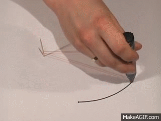
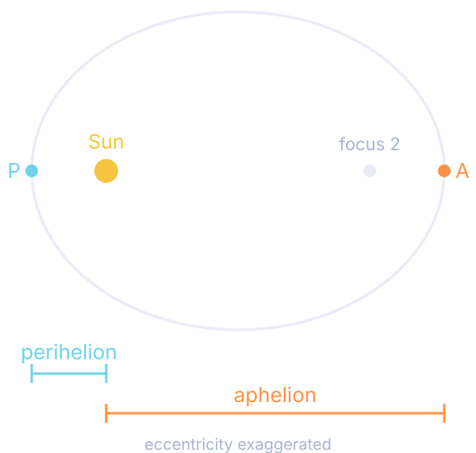
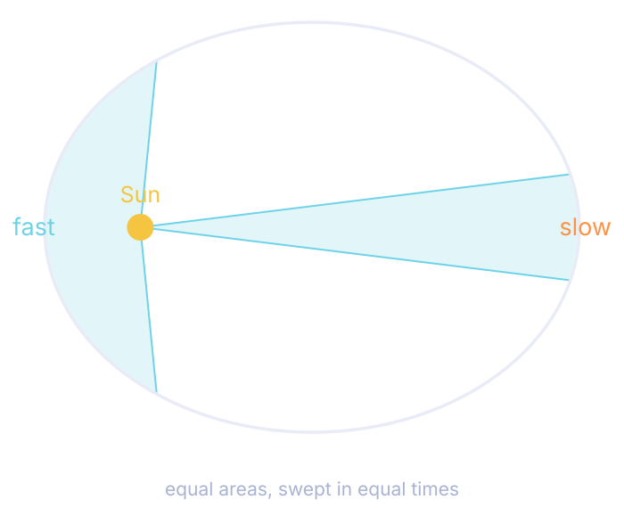

<!-- _class: title-slide -->

# 🌑 Ellipses and Eccentricity

## Guided Notes — Unit 1: Discovering New Worlds

### Lesson 3, continued · building an orbit · measuring it · judging your answer

<!--
WHAT THIS DECK IS: the projection companion to the packet "Guided Notes: Ellipses and Eccentricity" (ess-u1-guided-notes-ellipses.pdf). Slides follow the packet Part for Part. Students fill their blanks as each slide comes up.
WHY IT EXISTS: it is the bridge into the NYS investigation "Unearthing Mars" (HS-ESS1-4), Thu 11/19 and Fri 11/20. Every part aims at steps 13-16 of its Student Directions.
WHAT IT DOES NOT REPEAT: the orbits deck already did foci, major axis and e = f/d. This picks up from there. If students have not seen that deck, run its Part E first.
EVERY BLANK ANSWER is shown in gold. Advance, let students write, then discuss.
TIMING: about 35 minutes at pace, leaving the block's second half for the practice packet.
-->

---

<!-- _class: phase-title -->

# PART A

## Building an Ellipse

---

# The Rule Behind the Shape

PACKET PART A — 2 blanks

Pick any point on the curve. Measure its distance to each focus. **Add** the two distances.

Move to a different point and do it again. You get the same total every time.

That is why two pins and one string work. The pins sit at the foci. The string cannot stretch, so the pencil is forced to keep that sum constant — and the only shape that obeys is an ellipse.

<!--
PACKET: Part A, the opening two blanks.
RUN IT LIVE IF YOU CAN. Two pins, a loop of string, a pencil, one volunteer at the board. Thirty seconds of watching beats any slide.
THE POINT TO LAND: the shape is not drawn freehand and it is not a squashed circle. It is the consequence of one rule.
-->

---

# One String, One Major Axis

PACKET PART A — 3 blanks

Stretch the string to one end of the orbit. The two distances lie flat along the same line — so **the string is the major axis**, $d$.

As long as the string does not change, $d$ **cannot change**.

→ pins **further apart** → $f$ larger → $e = f/d$ gets larger, orbit more stretched
→ pins **closer together** → $f$ smaller → $e$ gets smaller, orbit rounder
→ both pins in the **same hole** → $f = 0$, $e = 0$, and you have drawn a circle

<!--
PACKET: Part A, the "One string, one major axis" box.
THIS IS THE SLIDE THAT MAKES ECCENTRICITY FEEL PHYSICAL. Eccentricity is not a number someone looked up — it is how far apart you put the pins.
ASK: "If I want a rounder orbit, do I change the string or the pins?" The pins. Every time.
-->

---

# Worked: Tacks and String

PACKET PART A — question 1

Two tacks **6.0 cm** apart, drawn with a **20.0 cm** string.

The string is the major axis → $d = 20.0$ cm

The tack separation is the distance between the foci → $f = 6.0$ cm

$e = \dfrac{f}{d} = \dfrac{6.0}{20.0} = \mathbf{0.300}$

Now move the tacks to **2.0 cm** apart, same string: $d$ is still 20.0 cm, $f$ drops to 2.0 cm, and $e = \mathbf{0.100}$ — **rounder**.

<!--
PACKET: questions 1 and 2.
WATCH FOR: students who change d when the pins move. The string did not change, so d did not change. That is the whole trick of the question.
QUESTION 3 (the string shorter than the pin gap) is worth asking aloud: the pencil cannot reach, because the shortest route between the pins is the straight line between them.
-->

---

<!-- _class: phase-title -->

# PART B

## Perihelion, Aphelion, and the Trick You Need Thursday

---

# Two Names on the Major Axis

PACKET PART B — 1 blank

A planet's distance from the Sun changes as it goes round, because the Sun sits at a focus — not at the center.

| Name | Where | Measured from |
|---|---|---|
| **Perihelion** | *closest* to the Sun | the Sun, at its focus |
| **Aphelion** | *farthest* from the Sun | the Sun, at its focus |

Both sit at the **ends of the major axis**.

<!--
PACKET: Part B, the table and the diagram.
PERI = NEAR, AP = AWAY. Worth saying once; the Greek does the memorising for them.
BOTH DISTANCES ARE MEASURED FROM THE SUN, never from the center. That is packet question 6 and it is the one students get wrong under time pressure.
-->

---

# Add for $d$, Subtract for $f$

PACKET PART B — 1 blank

The Sun cuts the major axis into two pieces, so reading straight off the diagram:

$$\text{aphelion} + \text{perihelion} = d$$

$$\text{aphelion} - \text{perihelion} = f$$

**On Thursday you never measure focus-to-focus.** The second focus is empty space — there is nothing to put a ruler against. You measure both distances from the Sun and subtract.

<!--
PACKET: Part B, the two identities and the "Why this matters on Thursday" box.
THIS IS THE MOST IMPORTANT SLIDE IN THE DECK. Step 14d of the investigation is exactly this subtraction, and it is where marks are lost.
WHY THE SUBTRACTION WORKS: the Sun is off center by half of f on each side, so the long piece exceeds the short piece by exactly f. Draw it on the board if they look unsure.
-->

---

# Worked: One Measured Orbit

PACKET PART B — the worked example

Measured: aphelion **14.6 cm**, perihelion **11.4 cm**

$d = 14.6 + 11.4 =$ 26.0 cm

$f = 14.6 - 11.4 =$ 3.2 cm

$e = \dfrac{f}{d} = \dfrac{3.2}{26.0} =$ 0.123

<!--
PACKET: the Part B worked example, three blanks.
PACE: do this one with them, then set question 4 (aphelion 15.3, perihelion 12.7 → e = 0.093) cold. That answer is almost exactly Mars, and noticing it is the point.
-->

---

# The Check That Costs Ten Seconds

PACKET PART B — question 5

A student measures the major axis directly: **24.0 cm**.
Then aphelion **13.1 cm** and perihelion **12.1 cm**.

$13.1 + 12.1 = 25.2$ cm, but the major axis measured **24.0 cm**.

The three measurements disagree by **1.2 cm**, so at least one is wrong. **Remeasure all three.**

Aphelion $+$ perihelion **must** equal the major axis. That is a free check on your own work — and it is free on Thursday too.

<!--
PACKET: question 5.
TEACH THIS AS A HABIT, not a question. Every student who runs this check Thursday catches their own ruler error before it becomes a 40% deviation.
COMMON CAUSES of the disagreement: the ruler did not pass through the Sun, or it stopped short of the curve.
-->

---

<!-- _class: phase-title -->

# PART C

## Eccentricity From a Drawing

---

<!-- _footer: Formula and wording: NYS Earth Science Reference Tables, Equations. -->

# Two Wordings, One Formula

PACKET PART C

You already have this. Here it is in both the wording in your notes and the wording on the reference tables — they are the same statement.

$$e = \frac{f}{d}
\qquad\text{is the ESRT's}\qquad
\text{eccentricity} = \frac{\text{distance between foci}}{\text{length of major axis}}$$

On the Regents, and on Thursday, it will be the **words**. In your notes it is the letters. Know both.

<!--
PACKET: Part C, the formula box.
MAKE THEM FIND IT IN THE ESRT NOW, not Thursday. Students who have never located the equation on the page lose two minutes hunting for it under lab conditions.
-->

---

# No Units, and Scale Does Not Matter

PACKET PART C — 5 blanks

**1. Eccentricity has no units.**

Centimeters divided by centimeters — the units cancel. "0.094 cm" is wrong even when the number is right.

**2. A scale drawing gives the true eccentricity.**

$f$ and $d$ are both shrunk by the same factor, and a ratio does not care about scale.

**Precision rules for Thursday**

Measure every length to the nearest tenth of a centimeter.

Report eccentricity to the nearest thousandth — three decimal places.

Rounding $0.0937$ to $0.09$ throws away the digit that tells Mars apart from Earth.

<!--
PACKET: Part C, five blanks plus the precision rules.
POINT 2 IS THE ONE WORTH DWELLING ON. A pencil drawing on a desk can be compared with a planet 228 million km away, because eccentricity is a ratio. That is not a trick — it is why the model works at all.
PACKET QUESTION 9 makes it concrete: two students draw the same orbit at different sizes, 3.0/30.0 and 4.5/45.0, and both get 0.100.
-->

---

<!-- _class: phase-title -->

# PART D

## Kepler's Second Law

---

# Equal Areas in Equal Times

PACKET PART D — 3 blanks

A line from the Sun to the planet sweeps out equal areas in equal times.

To keep the area the same while the radius is short, the planet must cover more angle — so it moves fastest at perihelion and slowest at aphelion.

<!--
PACKET: Part D, three blanks.
THE DIAGRAM IS HONEST: the two shaded sweeps really do have equal area, to within 0.1%. Students can check it by eye and it holds up.
NOT NEEDED FOR THE MARS LAB. This is the natural cut if the block is running short — but the practice packet uses it in questions 5 and 15.
-->

---

# Mars Swings, Earth Does Not

PACKET PART D — question 10

**Mars**, $e = 0.093$

Sun well off center → perihelion and aphelion differ by a lot → **big** change in speed across the year.

**Earth**, $e = 0.017$

Orbit nearly circular → distance barely changes → speed barely changes.

Bigger eccentricity → bigger difference in distance → **bigger difference in speed**.

A comet at $e = 0.97$ whips past the Sun and then crawls for most of its orbit.

<!--
PACKET: questions 10 and 11.
THIS IS ALSO WHY MARS GAVE KEPLER THE ANSWER. Its orbit is stretched enough for the discrepancy to show in Brahe's data — Earth's or Venus's would have hidden it.
-->

---

<!-- _class: phase-title -->

# PART E

## Judging Your Answer

---

<!-- _footer: Percent deviation formula: NYS Earth Science Reference Tables, Equations. -->

# How Far Off Is It?

PACKET PART E — 3 blanks

Measuring a drawing is never perfect. Your pencil has width, your plotted points scatter, the ruler reads to a tenth. So the question is not *is it right?* but **how far off is it?**

$$\text{percent deviation} = \frac{\text{difference from accepted value}}{\text{accepted value}} \times 100$$

The **accepted value** for Mars' eccentricity is 0.094. The difference is taken as a positive number — high or low does not matter. Report to the nearest tenth of a percent.

<!--
PACKET: Part E, three blanks.
PERCENT DEVIATION AND PERCENT ERROR ARE THE SAME THING. The ESRT says deviation; the investigation says error. Say so once so neither word stops them.
-->

---

# Worked: 0.087 Against 0.094

PACKET PART E — the worked example

A student's model gives $e = 0.087$. Accepted: $0.094$.

difference $= |0.087 - 0.094| = 0.007$

$\dfrac{0.007}{0.094} \times 100 = \mathbf{7.4\%}$

A big deviation is **never** evidence that Mars is wrong. It points at **the model**: plotted points off, orbit drawn carelessly, the axis not through the Sun, the ruler misread.

<!--
PACKET: the worked example, then questions 12-14.
QUESTION 13 IS THE REASONING ONE: the partner who says the accepted value must be wrong. Four centuries of observation against one pencil drawing — the deviation measures our procedure, not the planet.
QUESTION 14: we divide by the ACCEPTED value so everyone is measured against the same reference and results can be compared.
-->

---

<!-- _footer: ESRT, Solar System Data · NYSED, ESS Investigation "Unearthing Mars", Student Directions step 2. -->

# 0.093 or 0.094?

PRACTICE PACKET — question 27

The **ESRT** gives Mars an eccentricity of **0.093**.

The **investigation** tells you the accepted value is **0.094**.

Both are roundings of the true value, about **0.0934**.

**Use the value the investigation gives you: 0.094.**

When a procedure names the accepted value, that is what you are scored against.

Recalculating the worked example against 0.093 gives **4.3%** instead of 7.4% — about one percentage point apart, and both say the same thing: **the model was good**.

<!--
PUT THIS IN FRONT OF THEM NOW. A student who spots the clash mid-lab on Thursday stops working and asks; a student who has seen this slide shrugs and carries on.
NEITHER SOURCE IS WRONG. Mars' eccentricity is about 0.0934 and the two tables round it differently. That is worth one honest sentence about significant figures.
-->

---

# Thursday, in Four Steps

THE INVESTIGATION

You will plot Mars' orbit from **Tycho Brahe's own observations**, then:

**1.** measure the **major axis** $d$, to 0.1 cm

**2.** measure **aphelion** and **perihelion** from the Sun — and check they add to $d$

**3.** **subtract** them for $f$, then compute $e = f/d$ to the nearest thousandth

**4.** compute **percent deviation** against the accepted $e = 0.094$

Nothing on that list is new to you after today. The only new thing Thursday is **where the plotted points come from**.

<!--
THE CLOSER. Say the last line out loud — it is the one that lowers the temperature before a state investigation.
WHAT IS GENUINELY NEW THURSDAY: triangulating Mars' position from paired observations. The measuring and the arithmetic are already theirs.
-->

---

<!-- _class: lt -->

# Vocabulary

| Term | Meaning |
|---|---|
| **Foci** | the two points that define an ellipse; the Sun sits at one, the other is empty |
| **Major axis** ($d$) | the longest line across the orbit, through both foci |
| **Perihelion** | the point in the orbit **closest** to the Sun |
| **Aphelion** | the point in the orbit **farthest** from the Sun |
| **Eccentricity** ($e$) | how stretched an orbit is; $e = f/d$, no units, 0 to 1 |
| **Percent deviation** | how far a measured value falls from the accepted one, as a percentage |
| **Accepted value** | the value established by many careful measurements — here, $e = 0.094$ for Mars |

**aphelion $+$ perihelion $= d$** &nbsp;·&nbsp; **aphelion $-$ perihelion $= f$** &nbsp;·&nbsp; **$e = f/d$**

<!--
PACKET: the closing terms.
THE THREE RELATIONS ON THE BOTTOM LINE ARE THE WHOLE SHEET. A student who can write those three from memory can do Thursday's investigation.
-->
