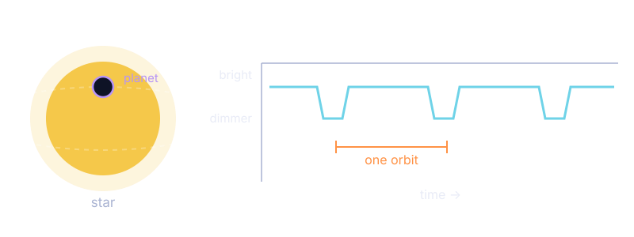
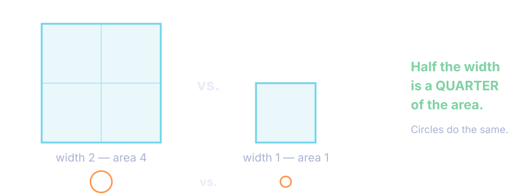
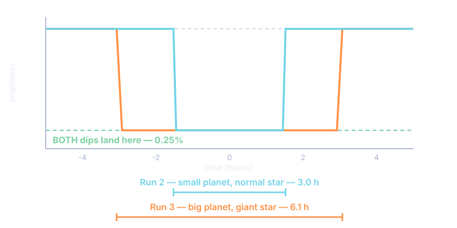
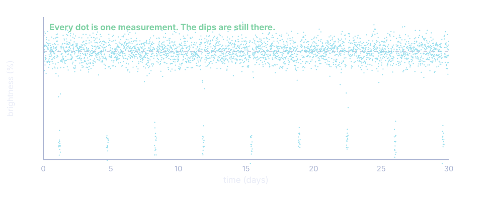

<!-- _class: title-slide -->

# 🪐 Exoplanets and the Transit Method

## Earth and Space Science — Unit 1: Discovering New Worlds

### Lesson 3 lab · a star dims for a few hours · what that tells you about a world you will never see

<!--
WHAT THIS DECK IS: the deck that RUNS the two-day transit lab. Launch, instructions for every part, the worked examples on screen, and the discussion slides. It is not a content deck to be read through on its own — it alternates with students working in the simulator and on the paper.
BUILT 2026-11-05 against Nathan's review of the lab (verdict: rebuild). He asked for "slides to go with this lesson — introductions, instructions, and information that goes with the lesson, i.e. a slide for the question 11 discussion." The question 11 discussion is slides 12 and 13.
THE SIMULATOR: Transit Method Explorer, mrporterphysics.github.io/AP Resource Pages/Earth Science Pages/transit-method-explorer.html. One self-contained page, no login.
PACING: Day 1 is Parts A–C (slides 1–18, ending after question 21). Day 2 is Parts D–G (slides 19–37). Both are 80-minute B/D blocks. On a 40-minute A/C day this needs a third meeting.
MATH LEVEL: these students are at Algebra I. Every worked example on these slides is also printed in the packet — project it and WORK IT WITH THEM rather than letting them read it. That is the single change this rebuild is built around.
STANDARDS: HS-ESS1-4 (mathematical representations to predict orbital motion) · SEP4 Analyzing and Interpreting Data, the spine · SEP5 Mathematics and Computational Thinking · CCC2 Cause and Effect, carried by the three controlled tests in Part B.
-->

---

# How These Two Days Work

### Day 1 — Parts A to C

1. Predictions, **on paper, before any device**
2. Three measurements off one graph
3. Three controlled tests
4. Turning a dip into a planet's size

### Day 2 — Parts D to G

5. Real Kepler data from NASA
6. Could anything live there?
7. Transfer — exam-style questions
8. The CER: one star, three conclusions

**One rule for the whole lab:** you **measure from the graph first**, and only then check the numbers. The tick boxes that print the answers stay off until a question tells you otherwise.

<!--
Put this up while packets are handed out. It is the only slide that shows the whole shape; after this students only ever see the part they are in.
Say the rule out loud and say WHY: the state exam gives them a graph and asks them to read it. A readout that prints the answer removes the only skill being practised. The simulator hides depth, duration and period behind "Reveal the values" on purpose.
Do not preview question 11 here. It lands harder if they walk into it.
-->

---

<!-- _class: phase-title -->

# PART A
## Before You Open Anything

---

# The Question This Lab Answers

### A star gets very slightly dimmer for a few hours.
### What can that tell you about a world you will never see?

- We have **never photographed** most of the planets we know about
- We know their **size**, their **distance** from their star, and whether they could have **liquid water**
- All of it comes from a graph of **brightness over time**

**Part A is predictions.** You are not expected to be right. You are expected to have something on the page before the data arrives, so you can check it afterwards.

<!--
LAUNCH. Four minutes, no device open — laptops closed or lids down.
The hook worth landing: over 5,000 confirmed exoplanets, and almost none of them have ever been seen as a dot of light. Everything we claim to know about them came out of graphs like the one they are about to make.
Question 1 asks for a sketch of brightness over time. Collect two or three on the board WITHOUT saying which is right. The two predictions worth having visible all lesson: "the star goes dark" and "the brightness does not come back up". Question 5 sends students back to their own sketch to compare.
Question 4 asks how much a planet dims a star: 50%, 1%, or 0.0001%. Almost everyone guesses far too large. Do not correct it — Part B will.
-->

---

# Why Only Mercury and Venus

QUESTION 2

**A planet can only cross the face of the Sun if it is between you and the Sun.** Mars, Jupiter and Saturn orbit *outside* Earth's orbit — when they line up with the Sun they pass **behind** it, not across it.

<!--
Question 2 and its diagram. The geometry is the whole of question 31 later, moved to someone else's solar system, so it is worth the three minutes.
Ask: "Stand up. If I am the Sun and Marcus is Earth, who in this room could ever transit?" Only someone physically between them. That is the entire rule.
Question 3 extends it: Mercury orbits 2.6x as often as Venus, so it gets 2.6x as many chances to line up — seven Mercury transits against four of Venus between 2003 and 2049. Same reasoning turns up on question 32.
-->

---

<!-- _class: phase-title -->

# PART B
## Three Things One Graph Can Tell You

---

# Opening the Simulator

**1.** Open the **Transit Method Explorer** — the link is in Canvas.
**2.** Press **Reset everything** so the whole room starts from the same system.
**3.** Leave both tick boxes at the bottom of the control panel **unticked**.

### The graph has two views. Read the label.

| **Now showing** says | The button says | What you can measure |
|---|---|---|
| single transit | Switch to 30-day survey | depth, duration |
| 30-day survey | Switch to single transit | period |

<!--
Five minutes, together, before anyone touches a slider.
TWO THINGS TO POINT AT, and only two.
(1) The two tick boxes are OFF. "Show measurement guides" marks WHERE to measure without giving values — that is the middle rung for a student who cannot find the baseline. "Reveal the values" prints the numbers and is for CHECKING, after they have measured.
(2) The view control, above the graph. "Now showing" names the view you are in; the button beside it names the view it takes you to. Students get sent between the two views four times in this lab. This was rebuilt after the first run — the button used to carry the name of the CURRENT view, which read as an instruction to a student already looking at it.
Also worth naming now: "Pin this curve" keeps the previous run on the graph as a dashed grey line. They will need it in ten minutes and will not find it under pressure.
-->

---

# Three Measurements, One Graph

### 🔻 Depth
How far the curve drops below the flat baseline. **In per cent.**

### ⏱ Duration
How long the star stays dimmed — start of the drop to end of the rise. **In hours.**

### 🔁 Period
Middle of one dip to the middle of the next. **In days.**

Only the **30-day survey** shows two dips, so that is the only view you can measure a period in.

**Keep these three straight.** Every remaining question in the lab depends on knowing which is which — and two of them sound alike.

<!--
Questions 5 to 7, about 20 minutes. This is reading practice and nothing else.
Question 5 sends them back to their own sketch from question 1. The two things most students miss: the brightness returns to EXACTLY where it started, and the dip is far shallower and far more sharp-sided than they drew.
Question 6: estimate depth and duration off the axes with "Show measurement guides" on, THEN tick "Reveal the values" and record both. Readings within about 15% are good work at this stage. Starting system reads 1.02% and 3.20 h.
Question 7: the 30-day survey. Seven dips in the window; period 4.08 days. A student who counts 7 dips and divides 30 by 7 gets 4.3 — praise it, then point out the window does not start and end on a transit, so measuring one gap directly is better.
Circulate with one question: "Which of the three is that number?"
-->

---

# The Three Controlled Tests

**One slider at a time.** Change one thing, write down what moved and what did not, then put it back.

| | Change | Everything else |
|---|---|---|
| **Run 2** | planet radius → **5.5** R⊕ | untouched |
| **Run 3** | star radius → **2.00** R☉ | untouched |
| **Run 4** | orbital distance → **0.10** AU | untouched |

Before each run, press **Pin this curve**. The previous curve stays on the graph as a dashed grey line, on the same axes, so a longer transit really does look longer.

<!--
Questions 8 to 16, about 25 minutes. The core of the lab.
BE STRICT ABOUT ONE SLIDER. If two change, nothing can be concluded and the run has to be done again. This is the one place to insist — it is CCC2, cause and effect, and the rubric scores it.
Run 1 (the reset state) is 1.02% / 3.20 h / 4.08 d. Run 2 gives 0.25% / 3.05 h / 4.08 d. Run 3 gives 0.25% / 6.14 h / 4.08 d. Run 4 gives 1.02% / 4.52 h / 11.55 d.
Watch the clock: they need to be through Run 3 with fifteen minutes left, because question 11 is the slide after next and it is the reason the lab exists.
-->

---

# Run 2: You Halved the Planet

QUESTION 9

**Half the radius is a quarter of the area** — and the dip measures blocked **area**, not blocked width. Depth went 1.02% → 0.25%: divided by **four**, not by two.

<!--
Question 9 — the r^2 relationship. Nathan's review: students at this level will not spot this unaided, so the packet builds it in four steps instead of asking for it.
RUN IT IN THIS ORDER. Ask for the prediction FIRST, out loud, before anything on this slide: "You halved the planet. What happens to the depth?" Almost everyone says "half". Let them commit to it.
Then (a) 1.02 / 0.25 = about 4. The division corrects them, not you.
Then (b) name the fraction: one quarter.
Then (c) this picture — count the small squares inside the big one. Four. Countable, not abstract.
Only then (d), the sentence: the dip measures AREA, area depends on radius SQUARED, so the depth follows the square of the radius.
The box underneath in the packet — "the squaring rule" — is the lookup they will use in Parts C, F and G. Point at it and tell them to fold the corner.
-->

---

# The Squaring Rule

| Do this to the radius | and the area does this |
|---|---|
| double it (×2) | 2 × 2 = **4** times bigger |
| triple it (×3) | 3 × 3 = **9** times bigger |
| halve it (×½) | ½ × ½ = **¼** — a quarter of the area |
| ten times smaller | 1/10 × 1/10 = **1/100** of the area |

Whatever you do to a radius, the area does it **twice over**. And to go **backwards** — from a change in area to a change in radius — you undo the squaring with a **square root**. That is the whole of Part C.

<!--
Leave this up while they finish question 9(d) and work question 10.
This is a reference slide, not new content. The point of putting it on the board is that Part C is five minutes away and the square root will arrive with no warning otherwise.
If a student asks why it is squared and not cubed: the planet blocks a flat disc of the star's face, and the area of a disc goes as r^2. Volume would be cubed. Do not go further than that — the relation is INTRODUCED as a ratio of areas here, not derived. That is the assessment boundary.
-->

---

# Run 3: You Doubled the Star

QUESTIONS 10 AND 11 — STOP HERE

<!--
THIS IS THE SLIDE. Question 11 is the hinge of the whole lab and Nathan asked for it by name.
Put this up only AFTER both runs are recorded in their tables. Do not show it early.
Both curves on the same axes. Run 2 was a small planet on a normal star. Run 3 was a big planet on a giant star. Two systems with nothing in common.
Give them thirty seconds of silence to look at it before you say anything. Ask for what they notice, not for the answer.
What should come out: the depths are IDENTICAL — both land on the same green line at 0.25%. The durations are not: 3.0 hours against 6.1 hours, twice as long.
Then the next slide asks the question that matters.
-->

---

# Two Astronomers Each Measure a 0.25% Dip

## Do they have the same planet?

**Run 2**
small planet · normal star
depth **0.25%** · **3.0 h**

**Run 3**
big planet · giant star
depth **0.25%** · **6.1 h**

**Depth alone can never size a planet.** It gives you the *ratio* of the planet to its star — and the same ratio comes from a small planet on a small star or a big planet on a big star.

<!--
THE FIVE MINUTES THAT MATTER MOST. Questions 11 and 12.
Ask the question on the slide and WAIT. Do not accept the first hand. Turn-and-talk for sixty seconds if the room is quiet, then take three answers.
The answer is no. And the only things that tell the two systems apart are the DURATION, and knowing how big the star is.
Then question 12 makes it concrete: an astronomer measures 0.25% and nothing else. Can they work out how big the planet is? No. They need the star's radius first — and that comes from somewhere else entirely, from the star's temperature and brightness. That is the H-R diagram, which they already have from Lesson 2.
EVERYTHING AFTER THIS DEPENDS ON IT. Part C is the arithmetic of this. Question 33 is the state-exam version of it. The CER cannot be answered without it.
Before you move on, get ONE SENTENCE from a student, in their words, and write it on the board. Leave it there for the rest of the lab. Day 2 opens by reading it back.
-->

---

# Run 4: You Moved It Further Out

QUESTIONS 13 TO 15

| | Run 1 | Run 4 | |
|---|---|---|---|
| Depth (%) | 1.02 | 1.02 | **unchanged** |
| Duration (h) | 3.20 | 4.52 | up |
| Period (days) | 4.08 | 11.55 | **up, much more than double** |

**Depth did not move** — the two radii did not change, so the planet blocks the same fraction of light. It just takes longer to get round.

**Period nearly tripled** when distance doubled. That is **Kepler's Third Law**: $T^2 = a^3$. Double the distance and the period goes up by $\sqrt{2^3} = 2.83$ — and 4.08 × 2.83 = 11.5 days.

<!--
Questions 13 to 15. Faster than Run 3 — the surprise is behind them now.
Question 14: why depth did not change. Depth is set by the two radii and nothing else. Moving the planet changes neither.
Question 15 names Kepler's Third Law. They met it in the PhET Kepler's Laws lab the meeting before — this is the same law showing up in someone else's solar system, which is worth saying out loud. It comes back as the whole of Part D.
Question 16 closes Part B: fill in depth / duration / period in three sentences. If they can do that from memory, Part B worked.
-->

---

<!-- _class: phase-title -->

# PART C
## How Big Is the Planet?

---

# Turning a Dip Into a Size

$$\text{depth} = \left(\frac{R_{\text{planet}}}{R_{\text{star}}}\right)^{2} \qquad\text{so}\qquad \frac{R_{\text{planet}}}{R_{\text{star}}} = \sqrt{\text{depth}}$$

$$R_{\text{planet}} \ (\text{Earth radii}) = \sqrt{\text{depth}} \times R_{\text{star}} \ (\text{solar radii}) \times 109$$

**The 109 is not magic.** The Sun is **109 times wider than Earth**. It converts an answer in solar radii into an answer in Earth radii.

The square root is there because question 9 found that depth follows the radius **squared**. A square root is how you undo a square.

<!--
Point back at question 9 explicitly — question 17 asks them to do exactly that, and the answer is "because depth is a ratio of AREAS and area goes as radius squared".
Where the star's radius comes from: the H-R Diagram in the reference tables, where the diagonal lines are marked in solar radii. They used that chart in Lesson 2. This is the lab's one genuine cross-lesson dependency.
Do not derive the depth equation. Assessment boundary: it is INTRODUCED as a ratio of areas.
-->

---

# Worked Example — Do This One With Me

**A star of radius 0.50 R☉ shows a transit 0.64% deep. How big is the planet?**

**Step 1 — percentage to a decimal.** Divide by 100. &nbsp;&nbsp; 0.64 ÷ 100 = **0.0064**

**Step 2 — square root, to undo the squaring.** &nbsp;&nbsp; √0.0064 = **0.080**

**Step 3 — × the star's radius × 109.** &nbsp;&nbsp; 0.080 × 0.50 × 109 = **4.4 R⊕**

**Does that make sense?** 4.4 Earth radii is bigger than Earth, much smaller than Jupiter (11.2). If you ever get a planet **wider than its star**, go back to Step 1 — you forgot to divide by 100.

<!--
WORK THIS ON THE BOARD. Do not let them read it. These students are at Algebra I and the packet carries the same example in print so they can follow back.
These numbers appear nowhere else in the lab, so nothing is given away.
Make every student press the square-root key on their own calculator during step 2. Test value: root 0.25 should give 0.5. A student who cannot find the key now will stall silently for the next twenty minutes.
STEP 1 IS THE WHOLE GAME. Forgetting to convert the percentage is the most common error on this page: root(1.00) = 1.00, which would make the planet exactly as wide as its star. The sanity check at the bottom is how they catch it themselves.
Then questions 18 and 19 are the same three steps twice, and question 21 checks it against TRAPPIST-1e in the simulator.
-->

---

# Two Identical Dips, Two Different Planets

QUESTIONS 18 TO 20

| | Star radius | Depth | Planet comes out as |
|---|---|---|---|
| **Telescope A** | 1.00 R☉ (like our Sun) | 1.00% | **10.9 R⊕** — a gas giant |
| **Telescope B** | 0.20 R☉ (a red dwarf) | 1.00% | **2.2 R⊕** — a small rocky world |

**Same dip. Same 1.00%.** One is Jupiter-sized, the other is barely bigger than Earth. The *only* difference is how big the star is.

**Question 20, in one sentence:** you cannot size a planet from its transit depth unless you already know how big its star is.

<!--
This is question 11 again, now with numbers attached. If question 11 landed, this slide is a confirmation; if it did not, this is the second chance.
Question 21 sends them to the TRAPPIST-1e preset in the simulator to check: a planet SMALLER than Earth (0.92 R⊕) making a 0.50% dip — a huge, easily detected signal — because the star is only 0.119 R☉ across. Compare with Kepler-452b on Day 2: nearly twice the size of TRAPPIST-1e, and a dip 28 times shallower.
END OF DAY 1 HERE, after question 21.
-->

---

<!-- _class: phase-title -->

# PART D
## Real Data From the Kepler Space Telescope

---

# Day 2 — Where We Got To

### Yesterday's one sentence:

*Depth gives you the planet **compared with its star** — so it means nothing until you know how big the star is.*

- **Depth** → the planet's size, *once you know the star*
- **Duration** → how big the star is, and how fast the planet moves
- **Period** → how far out it orbits, *once you know the star's mass*

**Today:** real data from a real telescope, then the question that makes it matter — could anything live there?

<!--
Five minutes. Read back the sentence a student gave you yesterday — the one you wrote on the board at question 11. From a student, not from you.
Then the three bullets, as a check: ask the room which measurement answers which question before you reveal them.
KEPLER, worth sixty seconds: between 2009 and 2018 it stared at one patch of sky and measured the brightness of 150,000 stars at once, looking for exactly the dips they spent yesterday making. It found more than 2,600 planets. The data in Part D is that telescope's actual data.
Hand out the NASA/JPL light-curve page now. Part D needs it; it does not need a device.
-->

---

# Kepler's Third Law, For Other People's Suns

$$\text{Our solar system:} \qquad R^{3} = T^{2} \qquad\text{so}\qquad R = \sqrt[3]{T^{2}}$$

**Other stars are not all the Sun's mass.** A heavier star pulls its planets round faster. So the law gains one term — $M_s$, the star's mass compared with the Sun's:

$$R = \sqrt[3]{T^{2} \times M_{s}}$$

**Watch your units.** $T$ must be in **years** before it goes into the formula. The light curves give you **days**. Divide by 365.

<!--
They met R^3 = T^2 in the PhET Kepler's Laws lab. The star-mass term is the only new thing on this slide; say so, so it does not read as a new law.
The unit trap is the error that actually costs them. Days straight into the formula gives an answer in the tens of thousands of AU. The sanity check: "is that plausible for a planet that orbits in three days?"
Next slide works an example before anyone starts question 22. Do not skip it.
-->

---

# Worked Example — Jupiter, Four Steps

**Jupiter takes 11.86 years to orbit the Sun. How far out is it?**

**1.** Get the period into **years**. &nbsp; Already in years — nothing to do. *(A period in days gets divided by 365 first.)*

**2.** **Square** it. &nbsp;&nbsp; 11.86 × 11.86 = **140.7**

**3.** **Cube root** of that. &nbsp;&nbsp; ∛140.7 = **5.20 AU**

**4.** For million km, **× 149.6**. &nbsp;&nbsp; 5.20 × 149.6 = **778 million km**

**Find the cube-root key now.** On most calculators: **SHIFT** then the ˣ√ key — or raise to the power 1 ÷ 3. **Test it: ∛8 should give you 2.**

<!--
Nathan asked for this example by number — question 22 went out with no worked example and the cube root is where the room stalls.
WORK IT ON THE BOARD, and make the whole class find the cube-root key during step 3. Five minutes here saves the next twenty. The packet carries the same example in print.
JUPITER IS IN NEITHER TABLE. It models the method without answering a row of question 22 or 23.
Sanity check worth saying: Jupiter really is about 5 times further out than Earth, and it really is about 778 million km. The method produces a number you can check against something you already know — that is the only reason to trust it on Kepler-6b.
Two conversions they need all page: 1 year = 365 days, 1 AU = 149.6 million km.
-->

---

# The Kepler Planets

QUESTIONS 22 TO 26

| Planet | Star mass | Period (days) | Distance (AU) |
|---|---|---|---|
| Kepler-5b | 1.37 | 3.55 | 0.0506 *(done for you)* |
| Kepler-6b | 1.21 | read it off | ? |
| Kepler-7b | 1.36 | read it off | ? |
| Kepler-8b | 1.21 | read it off | ? |
| Kepler-452b | 1.04 | 384.84 | ? |

Periods read off a graph will vary between students by a tenth of a day. **That is fine** — the distance barely moves. Science is not spoiled by a reading error that small.

<!--
25 minutes. Question 22 first (our own solar system, M_s = 1), then question 23 (the exoplanets).
Say the tolerance out loud before they start. A student who thinks their 3.3 days is wrong because their neighbour got 3.2 will stop working.
Question 24: the first four all orbit at about 0.05 AU — one eighth of Mercury's distance — and whip round in three to five DAYS. Kepler-452b is at 1.05 AU and takes 385 days.
Question 25 is the one worth discussing as a class: why were the hot Jupiters found first? Because confirming a planet needs several repeat dips. A 3-day period gives you a fresh one every three days; Kepler-452b transits once every 385 days, so confirming it took YEARS. They were not more common — just quicker to prove.
Question 26: model says 0.668% for Kepler-5b, measurement says 0.725%. Not a broken model — real stars are dimmer at the edge and real transits cut off-centre. A 0.06% disagreement is EVIDENCE THE MODEL IS GOOD. Say that explicitly; it is the honest-science moment of Day 2.
The NEXT slide is where the messy-data conversation goes. Use it with question 26, not before.
-->

---

# What the Telescope Actually Sends Back

**Three evenly spaced dips confirm a planet.** One dip could be a sunspot, a glitch, or another star passing behind. A planet comes back **on a schedule** — count the dips above.

<!--
NEW on this deck. A colleague's worksheet does its whole activity on raw scatter plots like this one, and ours were all clean curves — this slide closes that gap without changing what students hand in.
THE FIGURE IS OURS, generated from the same transit model as every other diagram in this lesson. Their figures were not reused; provenance was unknown and the lab's attribution block has to stay honest. It is also plotted on OUR axis — brightness in per cent, baseline 100 — because their sheet mixes a "relative flux, baseline 0" plot with a "relative brightness, baseline 1.000" plot and never warns the student that depth is read differently on each. Do not introduce that confusion here.
HOW TO USE IT, two minutes, alongside question 26:
(1) "What is different about this graph?" — every dot is a separate measurement, and the star's brightness is never exactly the same twice. Real telescopes wobble.
(2) "Can you still find the planet?" Yes. Count the dips: nine, evenly spaced, about 3.5 days apart. That is Kepler-5b, the planet whose depth they just compared against the model.
(3) Then the three-dip rule in the green box — this is the new infobox in Part D, just before question 25. The rule is why Kepler had to stare at the same patch of sky for four years.
THE POINT TO LAND: the noise does not hide the planet, it just means you need MORE dips to be sure. That is exactly why the close-in giants were confirmed first.
-->

---

<!-- _class: phase-title -->

# PART E
## Could Anything Live There?

---

# The Habitable Zone

Too close and water **boils away**. Too far and it **freezes**. The band in between is the **habitable zone**.

$$\text{inner edge} = 0.95 \times \sqrt{L} \qquad\qquad \text{outer edge} = 1.37 \times \sqrt{L}$$

**Worked example — a star with L = 0.25, a quarter as bright as the Sun.**

**1.** √0.25 = **0.50** &nbsp; *(one square root — both edges use it)*
**2.** Inner: 0.95 × 0.50 = **0.475 AU** &nbsp;&nbsp; **3.** Outer: 1.37 × 0.50 = **0.685 AU**

**Being in the zone does not make a planet habitable.** It means liquid water is *possible* — nothing more.

<!--
20 minutes for Part E. The rule is GIVEN, not derived.
Work the L = 0.25 example on the board. The only thing to emphasise: you take the square root ONCE and use it twice. Students routinely do root(0.95 x L).
Then question 27 checks the rule on our own solar system first: zone runs 0.95 to 1.37 AU. Venus at 0.72 is too close — and Venus really is a runaway greenhouse at 465 C. Mars at 1.52 is outside — and Mars really has lost its surface water. THE RULE PASSES A TEST ON A SYSTEM WE CAN CHECK, which is the only reason to trust it on one we cannot. Say that sentence.
-->

---

# Kepler-452b Sits on the Line

QUESTION 28

| | |
|---|---|
| Star's luminosity | L = 1.215, so √L = 1.10 |
| Inner edge | **1.047 AU** |
| Outer edge | 1.510 AU |
| The planet, from question 23 | **1.049 AU** |

**A gap of two thousandths of an AU.** That is far smaller than the uncertainty in the star's measured brightness. Nobody knows which side of the line this planet is on.

<!--
DO NOT MARK THIS AS A CLEAN "INSIDE" OR "OUTSIDE". This is deliberate and it is in the key.
Full credit for recognising the planet is ON THE BOUNDARY. Full credit too for a student who picks a side but says the margin is too small to be sure. This is a real unresolved question about a real planet, not a trick, and it is a better science lesson than a clean answer would be.
If a student is frustrated by that, that frustration IS the lesson — real measurements come with real uncertainty, and a scientist's job includes saying "the data cannot settle this".
The CER in Part G is deliberately unambiguous by contrast, so they get one of each.
-->

---

# TRAPPIST-1e: Twelve Times Closer Than Mercury

QUESTIONS 29 AND 30

| | |
|---|---|
| Star's luminosity | L = 0.00055, so √L = 0.0235 |
| Habitable zone | **0.022 to 0.032 AU** |
| The planet orbits at | **0.029 AU** — near the middle |

**"Any planet that close must be boiling hot."** No. Distance on its own means nothing — what matters is distance **relative to how bright the star is**. TRAPPIST-1 gives out about one two-thousandth of the Sun's light, so its habitable zone is pulled right in.

<!--
Question 30 is the conceptual payoff of Part E, and it is a classmate-says-X question, which is the format the state exam uses.
A planet can orbit twelve times closer to its star than Mercury does to the Sun and still be temperate, provided the star is faint enough.
The misconception being killed: comparing distances ACROSS two systems where the stars are nothing alike. It is the same error as reading a depth without knowing the star — the third time this lab has made the same point, now about luminosity instead of radius.
Worth naming: that is the pattern of the whole lab. Every single measurement means nothing until you bring the star into it.
-->

---

<!-- _class: phase-title -->

# PART F
## Transfer — The State-Exam Version

---

# These Are Three Questions You Have Already Answered

| If it is about… | Go back to | The rule |
|---|---|---|
| **which planets can transit at all** | Q2 | Only a planet *inside* the observer's own orbit can pass in front of the star |
| **how often a transit happens** | Q3 | Shorter period → more transits in the same stretch of time |
| **depth, duration and star size** | Q11 | Depth is a *ratio*. A bigger star takes longer to cross. |

**They look new because the stars are new.** The reasoning is not new. Work out which of the three you are being asked before you answer.

<!--
15 minutes. Can be done individually as a check for understanding, or collected as an exit ticket.
The strategy table is new in this rebuild. Transfer items fail for reading reasons, not physics reasons — a student who recognises question 31 as question 2 in disguise answers it in ten seconds.
Question 31 is the geometry (answer 1 — her own orbit must be outside its orbit). Question 32 is the period comparison; the packet now gives a working line, 400 / 8 and 400 / 40, because the arithmetic is not what is being tested, the comparison is.
Question 34 needs the H-R Diagram from the reference tables and now carries a plotting step first: put a finger on 2600 K along the bottom, slide up to a luminosity of 0.00055, mark the spot. THEN look for a name. DX Cancri is the closest match; accept Wolf 359 or Proxima Centauri.
-->

---

# Reading a Duration Off a Graph

QUESTION 33

**Do not eyeball the whole width at once. Three easy reads, not one hard one:**

**1.** Find the flat **baseline** at the top — the star's normal brightness.
**2.** Read the time where the curve **leaves** the baseline.
**3.** Read the time where it **gets back** to the baseline. Then **subtract**.

Gridlines are **one hour apart**. Times before the middle of the crossing are **negative** — so subtracting gives, for example, 4 − (−4) = **8 hours**.

<!--
This scaffold is new in the rebuild. The negative-time subtraction is a genuine Algebra I obstacle and it was invisible in the first version — a student who cannot do 5.5 - (-5.5) reads the duration as 5.5 hours and everything after it is wrong.
Question 33: same planet, two different stars, same star mass so the same orbital speed. Star A gives about 11 hours, Star B about 6. Accept +/- 1 hour.
33(c) wants BOTH pieces of evidence and the rubric scores it: DURATION (same speed, so twice as long to cross means twice as far to go — A is wider) and DEPTH (A's dip is 0.45%, B's is 2.1%, so the same planet covers a much smaller fraction of A). Star A is 1.50 R-sun and Star B is 0.70 — a ratio of 2.1, which matches both.
Watch for students reading the two graphs against each other: THE TWO BRIGHTNESS SCALES ARE DIFFERENT. It says so under the figure and they will miss it.
-->

---

<!-- _class: phase-title -->

# PART G
## Putting It Together

---

# The Three Equations, All In One Place

| To find | Use |
|---|---|
| the planet's **size** | $R_{\text{planet}} = \sqrt{\text{depth}} \times R_{\text{star}} \times 109$ |
| the planet's **distance** | $R = \sqrt[3]{T^{2} \times M_{s}}$ &nbsp; *(T in years)* |
| the **habitable zone** | inner $= 0.95\sqrt{L}$ &nbsp; outer $= 1.37\sqrt{L}$ |

**Conversions:** % → decimal, divide by 100 &nbsp;·&nbsp; days → years, divide by 365 &nbsp;·&nbsp; AU → million km, × 149.6

**Nothing new is being asked.** You have used every one of these today. The only new thing is that **you** decide which number goes into which equation.

<!--
Nathan's review asked for the equations to be provided here, in those words. They are now in the packet too, in a box immediately above the CER.
Say the line in the orange box out loud. Students see a CER and assume it is a new kind of hard. It is three calculations they have each already done once, plus the decision about which is which.
Leave this slide up for the whole of Part G. It is the reference, not a step.
-->

---

# First, Sort the Data

A telescope watches a star for **90 days**. The star has radius **0.30 R☉**, mass **0.30 M☉**, luminosity **0.010**. The dips are **0.25% deep**, repeating every **26 days**.

| The number | What it is | Which step uses it? |
|---|---|---|
| 0.25% | depth of each dip | ? |
| 26 days | the period | ? |
| 0.30 R☉ | the star's radius | ? |
| 0.30 M☉ | the star's mass | ? |
| 0.010 | the star's luminosity | ? |
| 90 days | how long it watched | ? |

<!--
DO THIS TOGETHER, on the board, before anybody calculates anything. It is the single highest-value five minutes in Part G.
The arithmetic is three calculator steps and is not where the credit lives. The hard part — the part Nathan's review identified — is deciding WHICH NUMBER FEEDS WHICH EQUATION.
Answers: depth and star's RADIUS -> Step 1, the size. Period and star's MASS -> Step 2, the distance. Luminosity -> Step 3, the zone. 90 days is NOT NEEDED — it only tells you about three dips were seen.
The unneeded number is deliberate. Students at this level assume every number given must be used, and the state exam does not work that way.
Watch for the two 0.30s being swapped. Radius sizes the planet; mass places the orbit. They are not interchangeable and the answer looks plausible either way.
-->

---

# Then Work the Three Steps

### Step 1 — size
0.25 ÷ 100 = 0.0025
√0.0025 = 0.050
0.050 × **0.30** × 109
= **1.6 R⊕**

### Step 3 — the zone
√0.010 = 0.100
inner = **0.095 AU**
outer = **0.137 AU**

### Step 2 — distance
26 ÷ 365 = 0.0712
0.0712² = 0.00507
× **0.30** = 0.00152
∛0.00152 = **0.115 AU**

### So?
0.115 is between 0.095 and 0.137 — **inside the zone**

<!--
DEBRIEF SLIDE. Do not show it until they have worked the frame in the packet, or you have given them the answers.
If time is short: do the data organiser together in class and set the three steps plus the claim and reasoning as homework. The organiser is the part that needs you in the room.
WHAT SEPARATES PROFICIENT WORK, and it is not the arithmetic: whether the student brings the STAR into every single step — its radius to size the planet, its mass to place the orbit, its luminosity to judge the temperature. A student who reports "0.077 AU, very close, so too hot" has done every calculation correctly and still missed the lesson of the whole lab.
Unlike question 28, this one has a clean answer on purpose. The planet sits about a third of the way across the zone, comfortably inside, no boundary ambiguity.
FOR AN EARLY FINISHER: what single measurement would settle whether this planet actually has water? None of these — you would need a spectrum of its atmosphere taken during transit, which is what JWST now does.
-->

---

# Writing the Reasoning

**You may start your sentences like this:**

*"The depth on its own could not tell me the planet's size, because…"*

*"I had to use the star's mass to find the distance, because…"*

*"A distance of 0.115 AU would be far too hot next to our Sun, but this star…"*

**Reasoning is not repeating your numbers.** It is saying **why each number was meaningless until you brought the star into it.** That is the whole lab in a paragraph.

<!--
The sentence frames are new in the rebuild. They are in the packet too. Students at this level can do the calculation and then write three sentences that just restate the answers; the frames force the word "because".
Say the green box out loud. It is the assessment criterion stated as a sentence, and students write better when they know what is being scored.
A proficient Reasoning paragraph hits all three: the depth needed the star's radius, the period needed the star's mass, the distance needed the star's luminosity. Three "because"s.
-->

---

# Vocabulary

**Transit** — a planet passing directly between its star and the observer, blocking a small part of the star's light.

**Light curve** — a graph of a star's brightness over time.

**Transit depth** — how far the curve drops, as a percentage. Gives the *ratio* of planet radius to star radius.

**Transit duration** — how long the dip lasts, in hours. Depends on the star's size and the planet's speed.

**Orbital period** — time from one transit to the next, in days.

**Habitable zone** — the band of distances from a star where liquid water is possible.

**Astronomical unit (AU)** — the average Earth–Sun distance, 149.6 million km.

<!--
Reference slide. Leave it up while rubrics are filled in, or project it during the unit review.
The two definitions students most often blur are depth and duration — both start with "d", both are read off the same graph, and only one of them involves time. If you drill one pair before the unit test, drill that one.
RUBRIC: the last page of the packet, Proficient / Developing across four rows, with a student self-score column and a Glow / Grow box. Have students score themselves before you collect it.
-->
