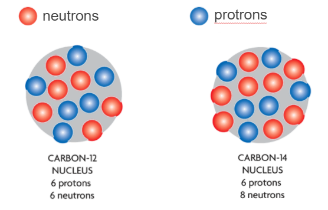
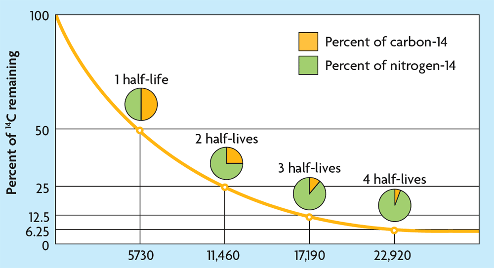
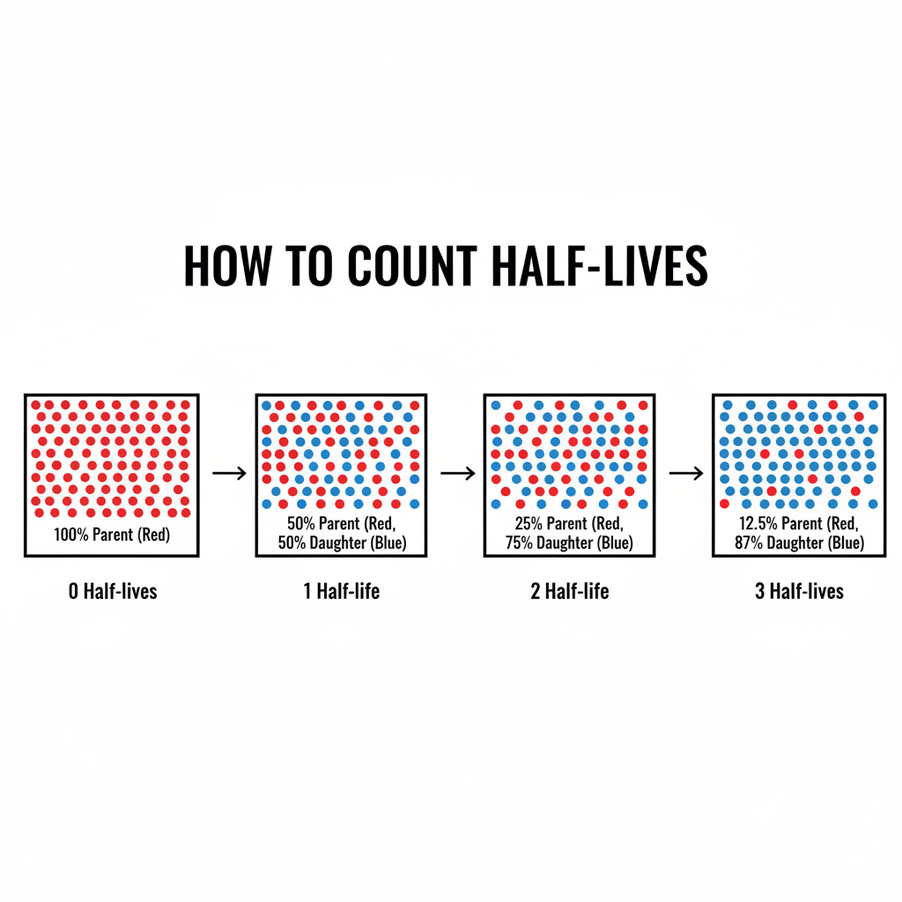
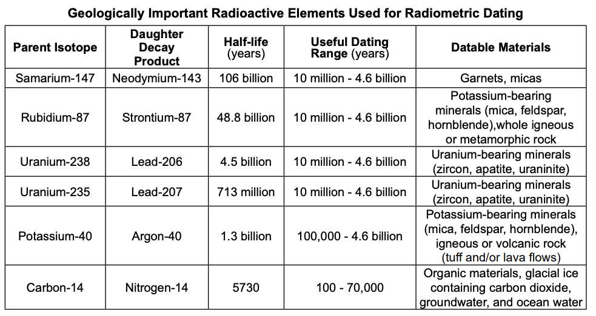

<!--
  ABSOLUTE DATING — Earth's History, first half
  ============================================================
  Split out of the old `GeologicDating.md` on 2026-11-20, which carried
  absolute AND relative dating in one file and taught the relative-dating
  principles as direct instruction.

  WHY THE SPLIT. In the traditional Earth's History unit the two halves no
  longer run back to back — the Reading an Outcrop lab sits between them,
  and students are supposed to INVENT the relative-dating principles in
  that lab. A single deck invited running the principles slides first,
  which takes the whole lab with it. The relative half is now
  `U2_Relative_Dating.md` and opens with a stop sign.

  RUNS: the absolute-dating meetings — the Candium lab, the half-life
  notes block, and the formation / cratering notes block.

  FIXES MADE IN THE SPLIT (all verified against the 2026 Rev. ESSRT):
    * "Page 15 on reference table" -> page 12. The table moved in this
      edition and p.15 is now the Rock Cycle infographic.
    * Carbon-14 "effective range ~50,000 years" -> the ESSRT's own Useful
      Dating Range column says 100 - 70,000 years. It said 50,000 twice
      and contradicted the booklet students sit the exam with.
    * The worked example used 5,700 yr for the C-14 half-life and got
      11,400; the quiz slide in the same deck used 5,730. The ESSRT says
      5730, so the example is now 5,730 and 11,460 — which also matches
      the quiz answer.
    * "Part 2: Absolute Dating" and "Part 2: Relative Dating" were both
      numbered Part 2.
    * Two empty slides removed.
    * Six isotopes on the table, not four or five — and Samarium-147's
      2026 materials column names meteorites, which is HS-ESS1-6 printed
      on the reference table.
  theme: physicalSci -> strata.
-->

<!-- _class: title-slide -->

# Absolute Dating

## Putting a number on a rock

### Earth & Space Science · Earth's History

---

<!-- _class: phase-title -->

# The question

## Nobody was there. Nothing was written down. So how do we know?

---

# Two ways to ask "how old?"

### Relative

- *"This rock is older than that one."*
- An **order**, no numbers.
- Comes from the layers themselves.

### Absolute

- *"This rock is 1.2 million years old."*
- A **number**.
- Comes from radioactive decay.

We are doing **absolute** first. You will build the relative half yourself, later, out of an outcrop.

---

## Radioactive decay

- Unstable **parent** isotopes decay into stable **daughter** isotopes.
- The decay is **exponential**, and its clock is the **half-life**.
- **Half-life:** the time for half the parent atoms to decay.

---

## Visualizing half-life

- Each half-life, the remaining parent is cut in half.
- The curve **never reaches zero**.

---

## Counting half-lives

| Half-lives | Parent | Daughter |
|---|---|---|
| 0 | 100% | 0% |
| 1 | 50% | 50% |
| 2 | 25% | 75% |
| 3 | 12.5% | 87.5% |
| 4 | 6.25% | 93.75% |

**Parent + daughter always adds to 100%.** Nothing leaves the sample — it only changes form.

---

## Radiocarbon (Carbon-14)

- C-14 is made in the atmosphere and taken up by living things.
- After death no new C-14 comes in, and what is there decays.
- Measured as the ratio of C-14 to stable C-12 and C-13.

**Useful dating range: 100 to 70,000 years** — read it off the ESSRT, page 12. Not "about 50,000." The reference table gives you the range; use the table's number, not a textbook's.

---

## Worked example

### Carbon-14 has a half-life of **5,730 years** ESSRT p. 12

A sample has gone through **2 half-lives**.

1. **How many years?** &nbsp; $2 \times 5{,}730 = \mathbf{11{,}460}$ years
2. **Parent remaining?** &nbsp; $100\% \to 50\% \to \mathbf{25\%}$
3. **Daughter?** &nbsp; $\mathbf{75\%}$
4. **What is the daughter?** &nbsp; **Nitrogen-14**

---

<iframe width="1100" height="600" src="https://www.youtube.com/embed/phZeE7Att_s?si=WPMtXoAPdP8jUNG_" title="YouTube video player" frameborder="0" allow="accelerometer; autoplay; clipboard-write; encrypted-media; gyroscope; picture-in-picture; web-share" referrerpolicy="strict-origin-when-cross-origin" allowfullscreen></iframe>

---

## What radiometric dating cannot do

- After about **10 half-lives** so little parent is left that it cannot be measured reliably.
- **C-14 is everywhere in once-living things** — which is why it is the famous one.
- But it reaches only **70,000 years**. For older rock you need a slower isotope.
- The slower isotopes are **less abundant**, so you need the right mineral.

If you cannot get a number at all — what can you still say about a rock's age?

---

<!-- _class: compact -->

# The other isotopes

## ESSRT **page 12** moved in the 2026 edition

There are **six** on the table, not four:

| Parent | Daughter | Half-life | Useful range |
|---|---|---|---|
| Samarium-147 | Neodymium-143 | 106 billion | 10 My – 4.6 By |
| Rubidium-87 | Strontium-87 | **49.7 billion** | 10 My – 4.6 By |
| Uranium-238 | Lead-206 | 4.5 billion | 10 My – 4.6 By |
| Uranium-235 | Lead-207 | **703 million** | 10 My – 4.6 By |
| Potassium-40 | Argon-40 | 1.3 billion | 100,000 – 4.6 By |
| Carbon-14 | Nitrogen-14 | 5,730 | 100 – 70,000 |

**Samarium-147 is the row everyone skips**, and in this edition its materials column reads *"Garnets, lunar fragments, and **meteorites**."* The table is telling you which isotope dates a meteorite — which is how we know the Earth is 4.6 billion years old.

---

---

<!-- _class: phase-title -->

# How the Earth Began

## And why its own rocks will not tell us

---

## The solar system formed about **4.6 billion** years ago

- One collapsing cloud of gas and dust; the planets grew by **accretion**.
- Early Earth was **molten** and **differentiated** by density — core, mantle, crust.
- Then a long period of **heavy bombardment**.

**Accretion** — small pieces colliding and sticking until they become a planet.

---

## The evidence is not from Earth rocks

**Meteorites**
≈ 4.6 billion yr — leftovers from the forming solar system.

**Moon rocks**
≈ 4.4 billion yr — a surface with no plate tectonics to recycle it.

**Oldest Earth minerals**
Jack Hills zircons **4.4 By**; Acasta Gneiss **4.0 By**. ESSRT p. 6

Earth is 4.6 billion years old, but its oldest rock is 4.0 billion. **Where did the first 600 million years of rock go?**

---

## The cratering record

- The Moon, Mars and Mercury **keep** their craters.
- Earth has very few. Three things erase them:

**Erosion** · **Plate tectonics** · **Volcanism**

- So Earth destroys its own early record — and we read that record off bodies that do not.

---

## Quick check

**1.** The half-life of carbon-14 is approximately:
(1) 573 years &nbsp;&nbsp; (2) **5,730 years** &nbsp;&nbsp; (3) 57,300 years &nbsp;&nbsp; (4) 730 years

**2.** A sample has one-quarter of its original C-14. About how old is it?
(1) 2,865 yr &nbsp;&nbsp; (2) 5,730 yr &nbsp;&nbsp; (3) **11,460 yr** &nbsp;&nbsp; (4) 17,190 yr

---

## Quick check

**3.** Which statement about half-life is correct?
(1) It varies with temperature.
(2) It is the time for all parent atoms to decay.
(3) **It is constant for a given isotope.**
(4) It increases as more atoms decay.

**4.** Which isotope would you use to date a rock thought to be 3 billion years old?
(1) Carbon-14 &nbsp;&nbsp; (2) **Uranium-235** &nbsp;&nbsp; (3) Carbon-12 &nbsp;&nbsp; (4) Nitrogen-14

For 4, the answer comes from the **Useful Dating Range** column, not the half-life column.

---

## Exit ticket

1. Define **half-life** in your own words.
2. State **one** reason carbon-14 could not date a dinosaur bone — and name the column on the ESSRT that tells you so.
3. Earth's oldest rock is younger than Earth. **Explain why.**

---

<!-- _class: phase-title -->

# Next

## You have a number. Next you get an order — and you work it out yourselves.
