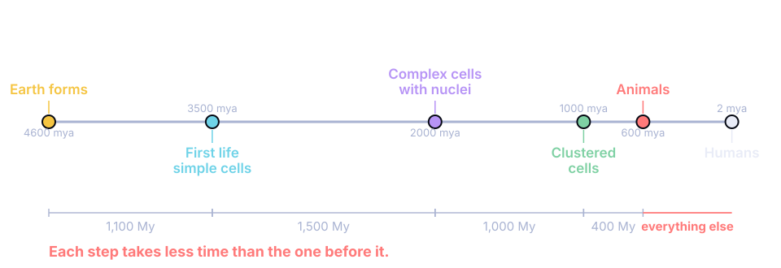
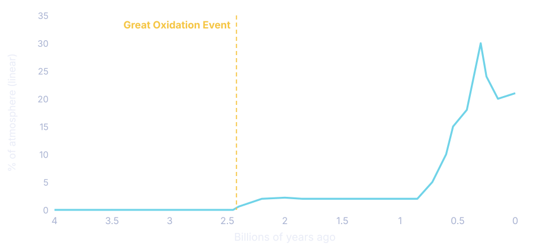
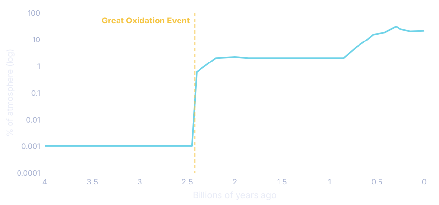
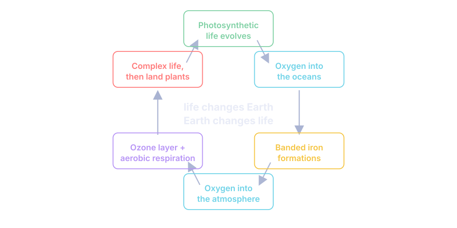
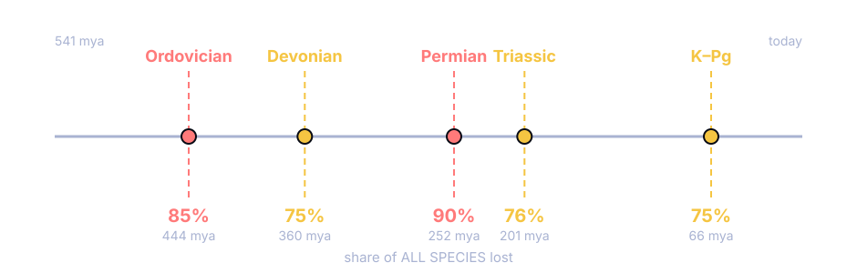

<!--
  COEVOLUTION OF EARTH AND LIFE — ES-5 · HS-ESS2-7
  ============================================================
  Built 2026-11-20 for the traditional Earth's History unit. It is the
  guided-notes conversion of `U2_Probability_of_Life_L2_Slides.md`, the
  New Visions 5E deck, which is now superseded.

  WHAT CHANGED, AND WHAT DID NOT.
  The CONTENT and the FIGURES are carried over — they are good, and the
  seven SVG/PNG diagrams are reused unchanged. What changed is the
  STRUCTURE. The NV deck ran Engage -> Explore -> Explain -> Elaborate &
  Evaluate across one long arc. This unit's Explains are guided notes
  (Nathan, 2026-11-13: New Visions is "too much inquiry and not enough
  direct instruction"), so the same material is now three notes blocks
  that match three meetings:

    BLOCK 1  (40 min, A/C)  the early atmosphere, cyanobacteria,
                            banded iron, the Oxygen Revolution
    BLOCK 2  (80 min, B/D)  the coevolution argument both ways, with
                            the built packet as the student work
    BLOCK 3  (40 min, A/C)  the five mass extinctions and the
                            radiations after them

  Blanks use ..., the house guided-notes
  device, which now lives in the strata theme rather than in a deck.

  NUMBERS: 2026 Rev. ESSRT throughout. The banded-iron interval is the
  chart's own "Oceanic Oxygen ... 2.8-2.5" entry on p.6 and the Oxygen
  Revolution is its "2.4-2.1" entry — both are Precambrian Events, and
  students should find them on the chart rather than take them from me.
-->

<!-- _class: title-slide -->

# Coevolution of Earth and Life

## Life changed the planet. The planet changed life.

### Earth & Space Science · Earth's History

---

<!-- _class: phase-title -->

# Block 1

## The air you are breathing is a waste product

---

<!-- _class: compact -->

# Where this sits

NOTES 1 — 8 blanks

You have put a **number** on rock (half-life) and an **order** on rock
(superposition). Now the rock gets read for something else: what was **alive**,
and what it did to the planet.

**The claim for this block:** Earth's atmosphere is not a leftover from its
formation. It was built — by living things — and the
rock record shows when.

---

## Earth's first atmosphere

- The early atmosphere came from volcanic outgassing:
  water vapor, carbon dioxide, nitrogen.
- There was essentially **no free oxygen**.
- Any oxygen that did appear reacted immediately with rock and dissolved iron.

**The misconception this kills:** that life appeared on an Earth that already had
breathable air and simply adapted to it. The order is the other way round.

---

<!-- _class: compact -->

## Cyanobacteria and the banded iron formations

ESSRT p. 6 — find it yourself

The chart's Precambrian Events column reads:

> Oceanic Oxygen (produced by photosynthesizing cyanobacteria) combined with
> iron, forming repeated iron-oxide rich layers on ocean floor
> **2.8–2.5** billion years ago

**The sequence:** cyanobacteria photosynthesize → oxygen enters the
ocean → it bonds with dissolved
iron → iron oxide settles out in layers → repeat.

Why *banded*? What has to change, over and over, to make a stripe?

---

## The Oxygen Revolution

ESSRT p. 6

- Once the dissolved iron was **used up**, oxygen had nowhere to go but up.
- The chart: *"Oxygen from ocean escapes to Earth's atmosphere"*,
  **2.4–2.1** billion years ago.
- That is roughly 400 million years **after** the
  banded iron began.

Two entries, two different places. In the first, the oxygen is in the
**ocean** and locked into rock. In the second it reaches the **air**. Students
routinely collapse these into one event.

---

## Same data, two scales

**Linear** — shows how late, and how fast.

**Logarithmic** — shows the early rise you cannot see above.

Neither graph is lying. **Choosing the axis changes the story** — and on a
constructed response you must say which one you read.

---

<!-- _class: phase-title -->

# Block 2

## The loop runs both ways

---

## What "coevolution" actually claims

NOTES 2 — 6 blanks

### Life → Earth

- Oxygen in the atmosphere
- The ozone layer, which let life onto land
- Limestone and chalk: rock made of bodies
- Coal and oil
- Soil

### Earth → Life

- Oxygen permitted complex, large, active organisms
- Continents moving changed climate and isolated populations
- Volcanism and impacts drove extinctions
- Ice ages reshaped habitats

---

## The feedback loop

This is why it is called **co**evolution and not just "evolution." Each change
in the living world changes the physical world, which changes what can live
next. The arrow never points one way for long.

---

## Why oxygen permits complexity

- Aerobic respiration releases far more energy per
  unit of food than anaerobic.
- More energy per cell makes large, active, multicellular bodies possible.
- The chart backs this up: **first sponges 0.89**, **Ediacaran fauna
  0.635–0.541** — all *after* the Oxygen Revolution, not before.

Multicellular life shows up roughly 1.5 billion years after oxygen reached the
air. **Why the delay?** What does that gap tell you about how good this argument
is?

---

## Correlation is not cause

Two curves rising together is **not** an argument. To claim coevolution you
need a mechanism — a reason one causes the other —
and you need the order to be right.

**On a constructed response, say three things:** the pattern in the data, the
mechanism that links them, and the evidence that the cause came **first**.

---

## What this evidence cannot show

- The fossil record is **incomplete** — the rock cycle destroyed most of it.
- Early organisms were soft and microscopic and rarely preserved at all.
- Non-biological processes can **mimic** biosignatures.
- Radiometric dates carry uncertainty — a Rb-87 reading at 2.5 By rests on only
  a **3.4%** change in the sample.
- The oxygen curve is **reconstructed** from indirect evidence, not measured.

Naming the limits of your evidence is not weakness. On the Regents it is part
of a complete answer.

---

<!-- _class: phase-title -->

# Block 3

## Five times, most of life died

---

## The five mass extinctions

NOTES 3 — 5 blanks

| When | Period boundary | Likely driver |
|---|---|---|
| 444 mya | End Ordovician | Glaciation, sea level fall |
| ~375 mya | Late Devonian | Spread of forests, ocean anoxia |
| **252 mya** | End Permian — **the largest** | Siberian volcanism, warming |
| 201 mya | End Triassic | Volcanism, CO₂ |
| 66 mya | End Cretaceous | Impact + Deccan volcanism |

All five boundaries are marked on **ESSRT p. 6** with an arrow in the Life on Earth column.

---

## The chart calls only one of them "largest"

**252 million years ago, the Permian–Triassic.** Students reach for 66 mya
because it is the famous one — but the chart reserves the word *largest* for
252, and that is the one an exam question will mean.

Why would a volcanic province erupting for a million years kill more than an
asteroid that arrived in an afternoon?

---

## Life rebuilds the planet afterwards

- An extinction empties niches.
- What survives **radiates** into them — the Paleogene line on the chart reads
  *"Many modern groups of mammals evolve."*
- So extinctions are not only endings. They reset which lineages get to build
  the next world.

Mammals were around for 150 million years before 66 mya and stayed small. The
asteroid did not create them — it removed what was in their way.

---

## Closing — the rehearsal

**Worked → faded → cold.** One full constructed response modeled in NYSED's
form, one with the reasoning blanked, then a released cluster with no scaffold.

**The frame for every one of them:**

1. State the **pattern** in the data you were given.
2. Give the **mechanism** linking the two things.
3. Show the **order** — the cause came first.
4. Name one **limit** of the evidence.

---

## Exit ticket

1. Banded iron formations stop forming about 1.8 billion years ago.
   **What does that tell you about the atmosphere, and what caused the change?**
2. Give **one** way life changed the planet and **one** way the planet changed life.
3. Which mass extinction does the reference table call the largest, and when was it?
