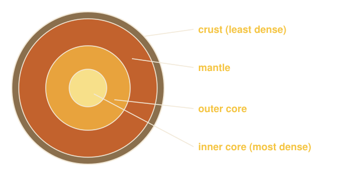
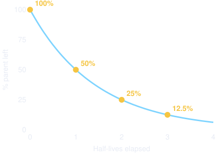

<!-- _class: title-slide -->

# ☄️ Stability of the Solar System
## Notes 1–4 — Unit 2: Probability of Life Elsewhere
### how the solar system formed · reading rock ages · why Earth hides its craters · relative dating

<!--
WHAT THIS DECK IS: the projection companion to the four one-page notes blocks in ess-u2-notes-l1.pdf. One block per sitting, 15-30 minutes each, NOT one long session. Stop at each NOTES divider.
  Notes 1 - meeting 3 (Mon 11/30), 20 min.  Notes 2 - meetings 4-5 (Tue 12/1 and Wed 12/2), 15 + 15 min.
  Notes 3 - meeting 7 (Fri 12/4), 20 min.   Notes 4 - meeting 8 (Mon 12/7), 25 min.
NOT the teaching deck. The 5E instruction lives in U2_Probability_of_Life_L1_Slides. These blocks replace the New Visions Explain phases: each one comes right after its Explore.
EVERY BLANK ANSWER is shown in gold. Advance, let students write, then discuss.
STANDARDS: HS-ESS1-6 (HE-3) evidence from ancient Earth materials, meteorites and other planetary surfaces for Earth's formation and early history · HS-ESS2-5 (ES-2) water's effects on Earth materials, Notes 3 only. Notes 4 (relative dating, geologic time) is added content New Visions does not teach.
-->

---

<!-- _class: phase-title -->

# NOTES 1
## How the Solar System Formed

---

# From a Cloud to a Solar System

NOTES 1 — 7 blanks

About 4.6 billion years ago, a cloud of gas and dust (a **nebula**) collapsed under its own gravity.

1. Most material fell to the center and became the Sun.
2. The rest flattened into a spinning disk.
3. Dust grains collided and stuck together into larger bodies: accretion.
4. Inner planets are small and rocky; outer planets are mostly gas.

Same disk, same time — so Earth, the Moon, Mars and the meteorites should all be about the same age.

<!--
NOTES 1, top half. 8 minutes.
MISCONCEPTION: that the planets formed at different times, or that the Sun "captured" them. One disk, one event.
LINK BACK to Unit 1: this nebula is the leftover material from earlier stars - that is where the iron and the rock came from.
-->

---

# Early Earth Sorted Itself by Density

NOTES 1 — 6 blanks

Early Earth was hot enough to be mostly molten — heated by constant impacts and radioactive decay.

While molten, its materials sorted by density.

Dense iron and nickel **sank**. Lighter rock **rose**.

<!--
NOTES 1, diagram: students label crust, mantle, outer core, inner core.
TRY IT 1 - why is the core iron and nickel? Two parts required: Earth was molten, AND materials sorted by density. A response with only "iron is heavy" is incomplete.
TRY IT 2 - accretion: grains collide and stick, growing bodies pull in more.
WORKED EXAMPLE on the page: inner planets rocky because it was too hot near the young Sun for ices and gas to collect.
-->

---

<!-- _class: phase-title -->

# NOTES 2
## Reading Rock Ages

---

# Half-Life Is the Clock

NOTES 2 — 7 blanks

A radioactive **parent** isotope decays into a stable daughter product.

**Half-life** — the time for half of the parent atoms to decay. It is constant.

After 1, 2, 3 half-lives: 50%, 25%, 12.5% parent left.

**Age** = number of half-lives × one half-life

<!--
NOTES 2, first sitting (meeting 4, after the dating lab). 15 minutes, to the end of this slide and the next.
MISCONCEPTION: that after two half-lives the parent is all gone. It halves each time: 100, 50, 25, 12.5.
MISCONCEPTION: that heat or pressure changes the rate. Nothing does - that is why it works as a clock.
-->

---

# Choosing the Isotope

NOTES 2 — 4 blanks · ESSRT

| Parent → daughter | Half-life (years) | Useful dating range (years) | Used on |
|---|---|---|---|
| Uranium-238 → Lead-206 | 4.5 billion | 10 million – 4.6 billion | zircon, other minerals |
| Potassium-40 → Argon-40 | 1.3 billion | 100,000 – 4.6 billion | igneous, volcanic rock |
| Carbon-14 → Nitrogen-14 | 5730 | 100 – 70,000 | organic material |

Pick the isotope whose **useful dating range** includes the sample's age. The shortest half-life is *not* automatically right.

<!--
NOTES 2. Have the ESSRT open to "Geologically Important Radioactive Elements Used for Radiometric Dating" - students copy the three half-lives from it.
THE TRAP (Try It 4): a 200,000-year-old bone. Nearly everyone says carbon-14. Its range ends at 70,000 years. Potassium-40 is the one whose range includes 200,000.
-->

---

# What the Ages Show

NOTES 2 — 4 blanks

Earth's oldest minerals, Moon rocks and meteorites all date to about 4.4–4.6 billion years. They formed together.

Many impact craters date to about 3.8–4.0 billion years ago — the **Late Heavy** Bombardment.

**Worked example.** A volcanic rock has 25% of its original potassium-40.
100 → 50 → 25 is **2 half-lives**. 2 × 1.3 billion = **2.6 billion years**.

**Try it 3:** 50% uranium-238 left → 1 half-life → 4.5 billion years

<!--
NOTES 2, second sitting (meeting 5). 15 minutes.
THE REVERSAL to land: three different kinds of sample, from three different places, give the same age. That is the evidence for one formation event.
TRY IT 4 answer: 200,000 years is outside carbon-14's useful dating range (100-70,000).
-->

---

<!-- _class: phase-title -->

# NOTES 3
## Why Earth Hides Its Craters

---

# Hit Just as Hard

NOTES 3 — 11 blanks

Earth and the Moon were hit at about the same rate. Earth just does not show it.

| Body | Known craters | Atmosphere | Liquid water | Moving plates |
|---|---|---|---|---|
| Moon | over 1,000,000 | none | none | no |
| Mars | over 300,000 | thin | not today | no |
| Earth | about 128 | thick | yes | yes |

<!--
NOTES 3, 20 minutes, the day after the Role of Water lab.
THE MISCONCEPTION THIS WHOLE LESSON TURNS ON: "Earth was hit less." It was not - if anything more, with its stronger gravity. Ask the room before revealing the table.
-->

---

# What Erases a Crater

NOTES 3 — 8 blanks

**At the surface, mostly water**

**Weathering** — rock is broken down where it sits
- *physical*: ice expands in cracks
- *chemical*: minerals dissolved

**Erosion** — pieces carried away

**Deposition** — pieces dropped

**From inside Earth**

**Plate tectonics** — old crust is recycled

**Volcanism** — lava covers the surface

Earth's surface is constantly **erased and rebuilt**. The Moon's is not.

<!--
NOTES 3. Tie each word to yesterday's lab: chalk in vinegar = chemical weathering; the stream table = erosion and deposition.
TRY IT 5: one process AND how it removes a crater - both required.
TRY IT 6: Mars has channels and 300,000 craters - water flowed in the past, but not for long or not recently.
WORKED EXAMPLE on the page: the Moon has no atmosphere, water or moving plates, so nothing wears its craters away.
-->

---

<!-- _class: phase-title -->

# NOTES 4
## Relative Dating and Geologic Time

---

# Four Rules for Putting Rock in Order

NOTES 4 — 8 blanks

**Relative age** is only the order in which things happened.

| Rule | What it says |
|---|---|
| **Superposition** | The oldest layer is at the bottom |
| **Original horizontality** | Sediment is laid down flat; tilting came later |
| **Cross-cutting** | A fault or intrusion is younger than what it cuts |
| **Unconformity** | A buried erosion surface: a gap in the record |

<!--
NOTES 4, 25 minutes, opening meeting 8. This is ADDED content: New Visions teaches radiometric dating only, and the ESSRT geologic history chart is unusable without it.
It leads straight into the L2 timeline card sort that follows in the same block.
-->

---

# Reading an Outcrop

NOTES 4 — worked example

Oldest to youngest: **Layers 1, 2, 3** deposited → **X** intrudes (it cuts 1–3) → **erosion** makes the unconformity → **Layer 4** deposited (X does not cut it).

<!--
NOTES 4. Ask for the order BEFORE revealing the line under the diagram.
TRY IT 7: oldest rock is Layer 1, by superposition. Both the layer and the principle are required.
COMMON ERROR: placing X last because it "goes through everything". It stops at the unconformity.
-->

---

# Index Fossils and Geologic Time

NOTES 4 — 9 blanks · ESSRT

An **index fossil** comes from a species that lived a short time over a wide area. Layers with the same index fossil are about the same age.

Time is divided into eons, then eras, then periods — set by major changes in the fossil record.

The **Precambrian** covers almost 90% of Earth's history.

The three eras since: Paleozoic → Mesozoic → Cenozoic

<!--
NOTES 4. Have the ESSRT open to the Geologic History of New York State chart and find the three eras on it.
TRY IT 8: short-lived AND widespread - both required.
-->
