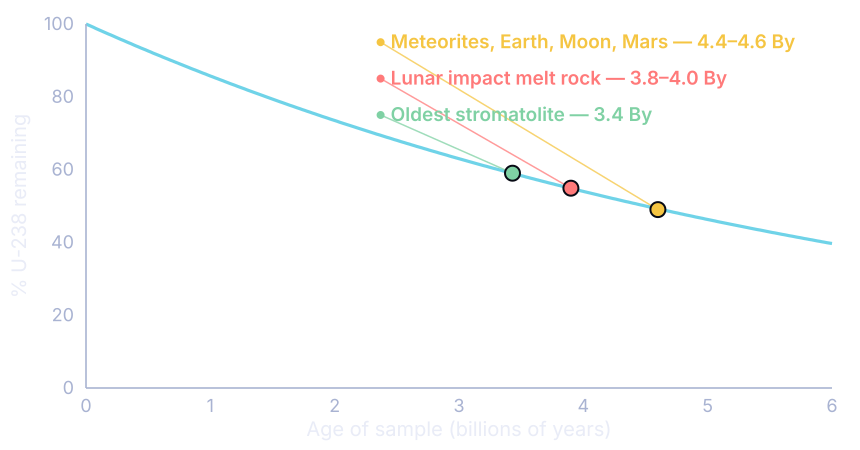
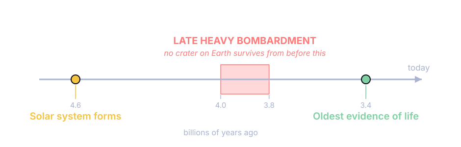

<!-- _class: title-slide -->

# ☄️ Stability of the Solar System
## Unit 2: Probability of Life Elsewhere — Investigation 1
### why the Moon is covered in craters · and Earth is not

<!--
WHAT THIS DECK IS: the 5E teaching deck for Investigation 1 of Unit 2. It runs across FIVE meetings and the phase-title slides mark where each one starts. Student packet: "Stability of the Solar System" (ess-u2-l1-stability.pdf). Organizer: "Performance Task Organizer" (ess-u2-pto.pdf), Part D.

THE FIVE MEETINGS
  M1 Mon 11/23 (A, 40 min) — ENGAGE
  M2 Tue 11/24 (B, 80 min) — EXPLORE 1, the dating lab
  M3 Mon 11/30 (C, 40 min) — EXPLAIN 1, the Late Heavy Bombardment
  M4 Tue 12/01 (D, 80 min) — EXPLORE 2, the water lab
  M5 Wed 12/02 (A, 40 min) — EXPLAIN 2 + EVALUATE. Elaborate (rock cycle) goes home.

STANDARDS: HS-ESS1-6 (evidence from ancient Earth materials, meteorites and other planetary surfaces for Earth's formation and early history) · HS-ESS2-5 (properties of water and its effects on Earth materials and surface processes). SEP: Analyzing and Interpreting Data; Planning and Carrying Out Investigations. CCC: Stability and Change; Patterns.

THE ONE THING: students arrive believing Earth was hit by fewer asteroids. They must leave knowing Earth was hit just as hard and DOES NOT SHOW IT. Everything in this investigation serves that single reversal. Do not give it away on day one.
-->

---

# Where we are

**The unit question:** what set of conditions allowed humans to evolve on Earth — and why did it take so long?

This investigation answers **one piece** of it:

### Was early Earth even a safe place for life to start?

**You already know**
- Earth is ~4.5 billion years old
- Life appeared ~3.5 billion years ago
- Five mass extinctions happened before us

**You are about to find out**
- What the solar system was like back then
- Why that delayed the start of life
- Why Earth has almost no craters

<!--
LAUNCH: hold up the Performance Task Organizer. "This is the one document you keep for the whole unit. Four investigations, four times you come back to it. Today starts the first one."

Point at the map table in PTO Part B. Students who cannot say which piece they are working on read all four Evaluate sections as four unrelated essays.

Do not preview the answer. The reversal in Explain 1 only lands if they walk in with the wrong model.
-->

---

<!-- _class: phase-title -->

# ENGAGE
## Craters in the Solar System
### Meeting 1 · Monday 11/23 · 40 minutes

<!--
PACKET PART A. See-Think-Wonder.

RUN: numbers on the board first, THEN the surfaces. Google Mars, Google Moon, Google Earth at Barringer Crater. 12-15 minutes exploring in pairs.

ROUTINE: Domino Discover on the See column — every student puts one observation up before anyone interprets. It stops the three fastest talkers from setting the class model.

DO NOT RESOLVE ANYTHING TODAY. The Wonder column is the agenda for the next four meetings. Send every question to the Driving Question Board.
-->

---

# The numbers

## 🌍 Earth
# ~128
impact craters discovered

## 🔴 Mars
# 300,000+
impact craters

## 🌕 The Moon — more than **one million**

These three worlds are neighbors. They sit in the same part of the solar system. **So why is Earth's number so much smaller?**

<!--
Write the three numbers on the board and leave them there for the whole investigation.

Ask for first reactions before any exploring. You will hear "Earth gets hit less" and "our atmosphere burns them up." WRITE BOTH ON THE BOARD, in the students' own words, attributed. Those two sentences are what Explore 1 and Explore 2 exist to test.

The atmosphere claim is partly true and completely insufficient — it stops small meteoroids, not anything that leaves a kilometer-wide crater. Do not say that yet. Ask it in Explain 1: "does that explain Barringer Crater, which did land?"

LOOK AND LISTEN FOR: students who notice Earth is mostly water and heavily vegetated. That is the beginning of the right answer and it is worth naming as a noticing without confirming it.
-->

---

# What to look for

**🌕 Moon**
Craters on top of craters. Every size. Everywhere. No gaps.

**🔴 Mars**
Heavily cratered — but also large smooth areas, channels, canyons.

**🌍 Earth — Barringer Crater**
Small. Isolated. Rim already worn down. Hard to find others.

Record what you **see**, what it makes you **think**, and what you **wonder**.

<!--
CONFERRING PROMPTS while they explore:
 • "Which surface looks oldest to you? What makes you say that?"
 • "Mars has smooth regions. What could smooth a surface out?"
 • "You found one crater on Earth. How hard was it?"

The Mars question is a deliberate plant — Mars has ancient water channels, and students noticing the smooth areas are seeing erosion without a name for it yet. Let it sit.

STEER THE WONDER COLUMN toward: Were they destroyed? When did this happen? Are these worlds made of different stuff? Are they the same age?

The last two open Explore 1. If nobody asks them, ask them yourself and credit the class.
-->

---

<!-- _class: phase-title -->

# EXPLORE 1
## Dating the Early Solar System
### Meeting 2 · Tuesday 11/24 · 80 minutes · **lab**

<!--
PACKET PART B AND C. PhET "Radioactive Dating Game".

TIMING for the 80-minute block:
  0:00  Do Now — yesterday's crater numbers, one sentence: why the difference?
  0:10  Decay Rates tab, Part 1a (packet q1-7) — whole class on the projector for q1-3, then pairs
  0:30  Dating Game tab, Part 1b — pairs
  0:45  Part 2: Tables 1 and 2, then Tables 3 and 4 off the decay curve
  1:05  Part D — Making Sense See-Think-Wonder
  1:15  Class Consensus Discussion on rows 3 and 4 only

LAB MINUTES: 80. Log it.

THE TWO FINDINGS they must leave with — do not state either one, make them read it off their own tables:
  1. Earth, Moon, Mars and meteorites are ALL the same age (~4.4–4.6 By)
  2. Lunar impact melt rocks are ALL younger and tightly clustered (3.8–4.0 By)
-->

---

# Radioactive decay

An unstable **parent** isotope changes into a stable **daughter** isotope.

**Carbon-14 → Nitrogen-14**
half-life **5,730 years**

**Uranium-238 → Lead-206**
half-life **4.5 billion years**

Nothing is lost. Every daughter atom **used to be** a parent atom.

The rate **never changes.** Not with heat, not with pressure, not with chemistry. That is what makes it a clock.

<!--
PACKET q1-3. Red dots = undecayed parent. Blue dots = daughter. CONFIRM THE PALETTE ON THE PROJECTOR BEFORE CLASS — PhET has shipped more than one color scheme for this tab.

The "rate never changes" line is the single most important sentence in the Explore. It is why a rock can be dated at all, and it is the Stability and Change crosscutting concept in one sentence: the decay rate is the stable thing, which is how we measure everything that isn't.

MISCONCEPTION: students think the atoms "disappear" or "burn up." Point at the pie chart — the whole pie is always there, only the proportions move.
-->

---

# Half-life

The time for **half of what is left** to decay. Then half of that. Then half of that.

| Half-lives | Parent remaining |
|:--|:--|
| 0 | 100% |
| 1 | **50%** |
| 2 | **25%** |
| 3 | **12.5%** |

**Not** half the total lifetime. After two half-lives you have **25%** left — not zero.

<!--
PACKET q4-6, and Tables 1 and 2.

THE ERROR TO WATCH FOR, and it is extremely common: students add halves. 50% + 50% = 100%, so they answer "0% left after two half-lives."

CONFERRING PROMPT that fixes it every time: "half of the 50% that is left is how much?"

NOTE ON TABLE 1 — it contradicts itself. New Visions prints 4.5 billion years for ONE half-life of U-238 and 13.4 billion for THREE. 3 × 4.5 = 13.5. Their 13.4 comes from the true half-life, 4.468 By, which rounds to 4.5. Use 4.5 throughout; a student answering 13.5 is correct, and a student who notices the contradiction has done better than the arithmetic. Credit both.

ALSO: the worked example row in the Dating Game table reads "Carbon-14 / 98.2% / 134 years." 98.2% is actually 150 years. It is the simulation's own readout and it is wrong. Do not mark a correct 150 as an error.
-->

---

# The decay curve

<!--
This is Figure 1 in the packet — and the three marked points are what students will produce themselves over the next 20 minutes. DO NOT SHOW THIS SLIDE UNTIL THEY HAVE FILLED IN TABLES 3 AND 4. It gives the whole thing away.

Use it as the consolidation at the end of the Explore: "here is what you just found, all on one graph."

READING AN AGE: find the % on the vertical axis, go across to the curve, drop to the horizontal axis. Students must use FIGURE 2 in the packet (the zoomed version) — at the scale of this graph every sample in Tables 3 and 4 sits on the same pixel. Expect several groups to try the full curve and get 4.5 for everything.
-->

---

# Which isotope do you use?

**Carbon-14** · 5,730 yr
Things that were **once alive** and are **young** — bone, wood, charcoal, shell.

Useful to about **50,000 years**.

**Uranium-238** · 4.5 By
**Rocks** — minerals, meteorites, planetary surfaces.

Useful across **billions** of years.

Pick the isotope whose half-life is **comparable to the age you are measuring**. Too short and it is all gone. Too long and nothing has happened yet.

<!--
PACKET q8-9.

WHY C-14 FAILS ON OLD THINGS: after ~10 half-lives an isotope is undetectable. For C-14 that is about 57,000 years. On a rock it reads 0% and tells you nothing except "older than 50,000 years."

WHY U-238 FAILS ON YOUNG THINGS: over a few thousand years it has decayed so little the reading is indistinguishable from 100%. You cannot measure a change that has not happened.

This is a real scientific-practice idea, not a fact to memorise: instruments have ranges, and choosing the right one is part of the work. Worth saying out loud.
-->

---

<!-- _class: phase-title -->

# EXPLAIN 1
## The Late Heavy Bombardment
### Meeting 3 · Monday 11/30 · 40 minutes

<!--
PACKET PARTS E, F, G.

TIMING for 40 minutes:
  0:00  Do Now — Part E q10-12 on their own, 5 min
  0:08  Share out. The two patterns go on the board.
  0:15  Part E q13-15 — the reversal
  0:22  LHB reading + Think-Talk-Open Exchange (Part F)
  0:34  Part G summary task — start it, finish at home

ROUTINE: Think-Talk-Open Exchange on the LHB reading. Individual writing FIRST, in silence, before any talking. The routine fails if you let them start in groups.

PTO PART D is assigned at the end of this meeting? NO — wait. Part D needs Explore 2's water evidence too. Tell them that explicitly or they will write half an answer.
-->

---

# What the rocks said

**Oldest minerals**

| From | Age |
|:--|:--|
| Earth | 4.4 By |
| Mars | 4.5 By |
| Moon | 4.4 By |
| Meteorites | 4.6 By |

**Lunar impact melt rock**

| Sample | Age |
|:--|:--|
| 1 | 3.8 By |
| 2 | 3.8 By |
| 3 | 4.0 By |
| 4 | 3.9 By |

Four different worlds. **The same age.** → They formed **together**, from the same disk of dust.

<!--
PACKET PART E q10-12. Let students read these off their own Tables 3 and 4 before this slide goes up.

THE FIRST FINDING — HS-ESS1-6 in one line. Earth, the Moon, Mars and meteorites are the same age because they condensed from one disk at one time. This is the standard, and it is the premise of everything that follows.

WHY THE METEORITE IS OLDEST: it has never been melted or reworked by a planet's interior, so it preserves the original formation age most faithfully. Earth's surviving rocks are a little younger than Earth is, for exactly that reason. Good extension for a group that finishes early.

IMPACT MELT ROCK: formed by the heat of an impact. So the rock's age IS the impact's age. Make sure that sentence is said; without it the second table is just numbers.
-->

---

# Why the clustering is the evidence

**If impacts were steady** through history, melt rock ages would be **spread out** — 4.4, 3.1, 2.0, 0.8...

**What we actually see:** 3.8, 3.8, 4.0, 3.9

All inside a **200-million-year window.**

A burst, not a drizzle. Around **4 billion years ago**, everything in the inner solar system was being hit at once.

<!--
THIS IS THE REASONING SLIDE and it is the one students skip. A student who says "the rocks are 3.8 billion years old, which matches the hypothesis" has not yet said why it matters. The clustering is the evidence; the age alone is not.

CONFERRING PROMPT: "if asteroids had been hitting the Moon steadily the whole time, what ages would these four rocks have?"

THE LHB READING (Part F) gives the mechanism: Jupiter and Saturn fell into a 2:1 orbital resonance, which destabilised Neptune and Uranus, which scattered the Kuiper Belt. Students do not need the orbital mechanics. They need to know there is a physical cause and that it is a COMPUTER MODEL, not a direct observation — that is a limitation they must write in PTO Part D.

NOW THE REVERSAL (Part E q13-15). If the Moon was being hit, so was Earth — same neighborhood, same time, and Earth is bigger with more gravity. Say the sentence out loud and put it on the board:

  "Earth was hit just as much and does not show it."

That sentence is the whole investigation. Explore 2 explains the second half.
-->

---

<!-- _class: phase-title -->

# EXPLORE 2
## The Role of Water
### Meeting 4 · Tuesday 12/01 · 80 minutes · **lab**

<!--
PACKET PARTS H AND I. Two experiments.

TIMING for the 80-minute block:
  0:00  Do Now — where did Earth's craters go? one sentence
  0:05  Part 1 chemical weathering: chalk in water vs vinegar. IV/DV/prediction first.
  0:20  5-minute run + observations, second weighing, analysis q24-25
  0:35  Part 2 — groups DESIGN the erosion/deposition experiment. Check every plan before they pour.
  0:55  Run it, collect data
  1:10  Making Sense See-Think-Wonder + q28

LAB MINUTES: 80. Log it.

MATERIALS: chalk (two pieces per group), white vinegar, water, clear cups, balance reading to 0.01 g, masking tape, stopwatch, forceps, GOGGLES. Stream tables, cut 2L bottles or cups with holes, wet fine sand / coarse sand / gravel, ring stands and clamps, spray bottles, dividers, rulers, a ball for making craters.

IF THE VINEGAR RESULT IS WEAK: the chalk is gypsum-based, not calcium carbonate. Real blackboard chalk or a limestone chip works; some art chalk does not react.

BIGGEST SOURCE OF NOISE: one group blots their chalk dry before the second weighing and another does not. Say so before they start.
-->

---

# Water dissolves things

A water molecule is **polar** — the oxygen end slightly negative, the hydrogen ends slightly positive.

**CO₂ dissolves in water**

↓

**carbonic acid** (H₂CO₃)

↓

**chemically weathers rock**

Rain is naturally **slightly acidic** — because the atmosphere's carbon dioxide dissolves into it on the way down.

<!--
PACKET PART J reading, but introduce the idea here so the vinegar experiment has a mechanism behind it rather than being a trick.

THE LINK STUDENTS MUST MAKE: vinegar in a cup for 5 minutes is a SPEEDED-UP MODEL of acidic rain falling on rock for 4 billion years. The experiment is not about vinegar.

CONFERRING PROMPT after the result: "our experiment ran five minutes. How long has rain been falling on Earth?"

Chalk is calcium carbonate — the same mineral as limestone. That is why this works and why it maps onto real rock.
-->

---

# Two processes, working together

### Chemical weathering
Acidic water **dissolves** the material binding rock together. What is left is pitted, crumbly, broken into pieces.

### Erosion & deposition
Moving water **carries those pieces away** and **drops them** somewhere lower — often into the hole.

Weathered rock is **far easier to erode** than solid rock. Together they erase a crater from **two directions at once** — the rim is worn down **and** the basin is filled in.

<!--
PACKET q28 — "how could erosion and deposition affect rocks that had ALREADY experienced chemical weathering?"

THE WORD TO LISTEN FOR IS "FASTER" OR "EASIER." Students who say weathering and erosion are two separate things that both happen have only half the idea. They COMPOUND.

DEPOSITION IS THE HALF STUDENTS FORGET. They report the rim eroding and never ask where the sediment went. Ask it. A crater disappears because it is filled in as much as because it is worn down.

DESIGN CHECK before any group pours water — three things:
  1. Is there actually a crater pressed into the sediment to start with? (Groups forget.)
  2. Is exactly ONE variable changing?
  3. Is there a "before" measurement? Change needs two numbers.

ACCESS FOR ALL LEARNERS: a group that stalls on design gets the slope comparison handed to them (low vs high slope, same water, same sediment, measure crater depth before and after 2 minutes) and still does the full analysis.
-->

---

<!-- _class: phase-title -->

# EXPLAIN 2 & EVALUATE
## Why Earth has 128 craters
### Meeting 5 · Wednesday 12/02 · 40 minutes

<!--
PACKET PARTS J, K AND M. Part L (the rock cycle Elaborate) GOES HOME — it is a diagram-analysis task that works as homework, and the rock cycle is revisited in Unit 3.

TIMING for 40 minutes:
  0:00  Water inventory table, Part J q29 — 6 min
  0:08  Class Consensus Discussion: the five pieces of evidence go on the board IN ORDER
  0:18  Part K — write the scientific explanation from the shared list
  0:32  Part M — the stromatolite, as an exit task
  0:38  Assign PTO Part D and Part L

ROUTINE: Class Consensus Discussion before they write. Building the evidence list as a class is what makes the writing possible in 14 minutes.
-->

---

# Water in the inner solar system

| | Water |
|:--|:--|
| **🌍 Earth** | **71% of the surface.** Oceans, lakes, glaciers, ice caps — and it **cycles** |
| **☿ Mercury** | Traces of vapor in the atmosphere |
| **🔴 Mars** | Ice at the poles. A little vapor. Some transient liquid |
| **🌕 Moon** | Limited ice |

Weathering, erosion and deposition need water that is **liquid**, **moving**, and **in quantity**. Only one world here has that.

<!--
PACKET PART J q29.

MISCONCEPTION TO PRESS ON: "Mars has water so it should have erosion." Press on STATE AND MOTION — ice sitting at a pole is water that is not doing anything. It does not dissolve rock and it does not carry sediment.

Mars DOES have ancient channels and valleys, which is why it has those smooth regions students noticed in the Engage. Water worked there once, and then stopped. That is a good payoff for the noticing from day one — go back and credit whoever said it.

PLATE TECTONICS goes with this: Earth is the only one of the four with ACTIVE plate tectonics. Mercury, Mars and the Moon all show signs of ancient activity that ceased. Subduction destroys crust outright — which is why almost no ocean floor is older than about 200 million years.
-->

---

# The answer

1. Earth, Moon, Mars, meteorites — **all the same age.** They formed together, in the same place.
2. Lunar impact melt rock — **3.8 to 4.0 By.** A clustered bombardment that hit everything.
3. **So Earth was hit just as often.** "Fewer impacts" is ruled out.
4. Chalk dissolved in acid. The stream table erased a crater. **This is how a surface feature is destroyed.**
5. Only Earth has liquid water and active tectonics. **Only Earth has the agents.**

The difference is in **preservation**, not in **bombardment**.

<!--
PACKET PART K — the scientific explanation. Build this list on the board as a class before anyone writes.

GRADE ON THE LINK, NOT THE LENGTH. A student who writes a page about erosion without ever establishing that Earth was hit equally has not answered the question — they have assumed the thing that needed proving. Ask: "how do you know Earth was hit as much as the Moon?"

Steps 1-3 are the half that gets skipped and the half that carries the standard.

THE IRONY IS WORTH SAYING OUT LOUD: the very activity that made Earth suitable for life is what destroyed the evidence that Earth was bombarded. We had to go to the Moon to find out what happened here.
-->

---

# The oldest evidence of life

A **stromatolite** — a rock built by colonies of microscopic organisms, from an ancient ocean.

**59% of its Uranium-238 remains** → about **3.4 billion years old.**

**Bombardment ends** ~3.8 By

**Oldest life** ~3.4 By

In that order.

But can one rock prove life did not exist **earlier**?

<!--
PACKET PART M — the Evaluate, and the exit task.

ANSWER: no. And the reasoning matters far more than the verdict.

STRENGTHS: direct physical evidence (not an inference), quantitatively dated, reproducible, gives a firm MINIMUM age, and lands after the LHB ended — consistent with the delay.

LIMITATIONS: absence of evidence is not evidence of absence. One sample is not a data set — four impact melt rocks agreeing is an argument, one stromatolite is a point. And THE ROCK CYCLE ARGUES AGAINST US: the same weathering, erosion and tectonics that destroyed Earth's craters destroyed most rock older than this. Early single-celled life with no hard parts rarely leaves anything behind anyway.

THE STRONGEST RESPONSES TURN PART L AGAINST THE SAMPLE — they use the rock cycle to argue that the absence of older evidence is exactly what you would expect whether or not older life existed. If a student writes that, read it out.

WATCH FOR: "yes, because that's the oldest one we found." Ask: "how many craters did Earth have 4 billion years ago, and how many can we find now?"

THIS ANSWER GOES STRAIGHT INTO PTO PART D, COMPONENT 4. Tell them before they write.
-->

---

# Before Investigation 2

Go to your **Performance Task Organizer, Part D.** Everything you need is in your packet.

| What you need | Where it is |
|:--|:--|
| When the bombardment happened | Part C, Table 4 |
| Why Earth has few craters | Parts H, I, J, K |
| That life appeared after it | Part M |
| The limitations of that evidence | Part M, question 2 |

**Also due:** Part L — the rock cycle.

<!--
The claim in PTO Part D is GIVEN to students: "Life did not appear until 3.5 billion years ago because the Earth was undergoing a period of heavy asteroid bombardment 4 billion years ago." Their job is the evidence and the reasoning, not the claim.

FOUR REQUIRED COMPONENTS and the fourth is the one they skip: strengths AND limitations. Press with "could life have existed and left nothing behind?"

NEXT INVESTIGATION: Coevolution of Earth and Life. The transition question from the Driving Question Board is about the atmosphere — has Earth always had one, how has it changed, and what did that do to life? If that question is not on the board yet, put it there at the end of this meeting.
-->

---

<!-- _class: compact -->

# Vocabulary

**radioactive decay** — an unstable parent isotope changing into a stable daughter isotope at a fixed rate

**half-life** — the time for half of the remaining parent isotope to decay

**absolute dating** — using radioactive decay to assign an age in years

**impact melt rock** — rock melted by the heat of an asteroid impact; its age is the impact's age

**Late Heavy Bombardment** — a period ~4.0–3.8 billion years ago when the inner solar system was struck repeatedly

**chemical weathering** — the breakdown of rock by chemical reaction, especially with acidic water

**erosion** — the removal and transport of weathered material

**deposition** — the dropping of transported sediment in a new place

**carbonic acid** — H₂CO₃, formed when carbon dioxide dissolves in water; weathers rock

<!--
Reference slide, part 1 of 2. Leave it up during the Part K writing and during PTO Part D.

The three students reach for most: half-life, impact melt rock, chemical weathering.
-->

---

<!-- _class: compact -->

# Vocabulary, continued

**superposition** — in undisturbed layers, deeper means older

**plate tectonics** — the motion of Earth's crustal plates, which builds, buries and destroys rock

**stromatolite** — a layered rock built by colonies of microorganisms; the oldest evidence of life

**parent isotope** — the unstable isotope that decays

**daughter isotope** — the stable isotope it becomes

**polar molecule** — a molecule with slightly positive and slightly negative ends, like water

<!--
Reference slide, part 2 of 2.

The three students reach for most: half-life, impact melt rock, chemical weathering.

ESRT NOTE: the 2024 Earth Science Reference Tables carry radioactive decay data. SKL-1 is exercised every time a student looks up a half-life rather than being told it.
-->
