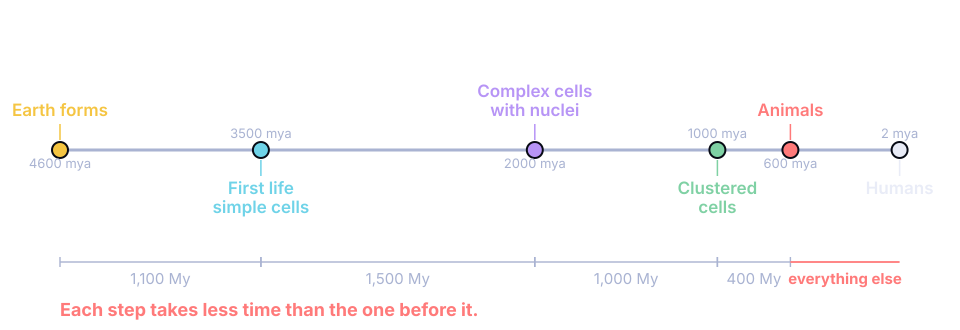
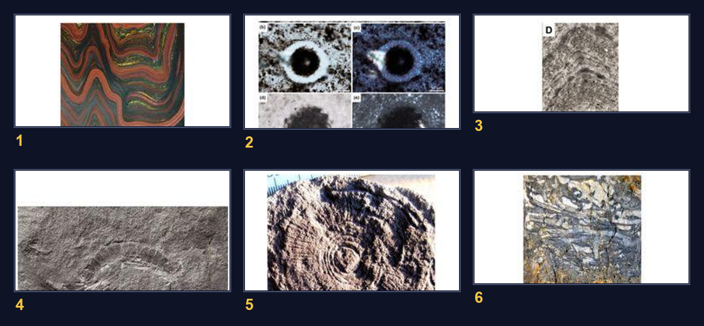
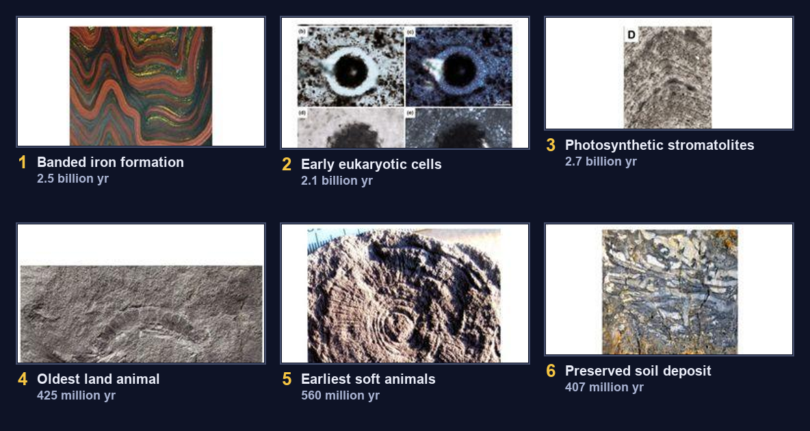
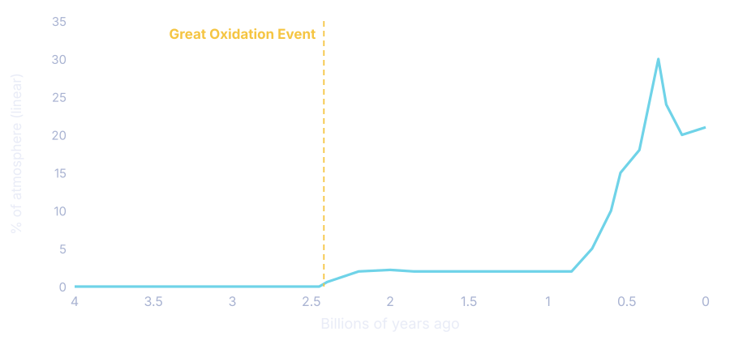
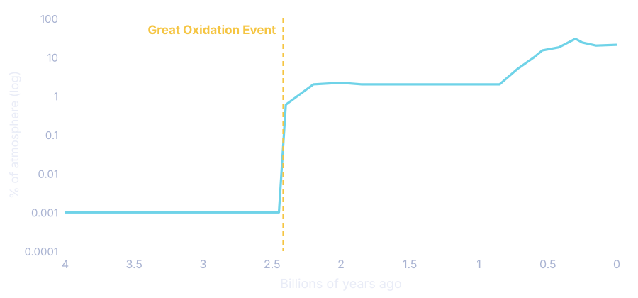
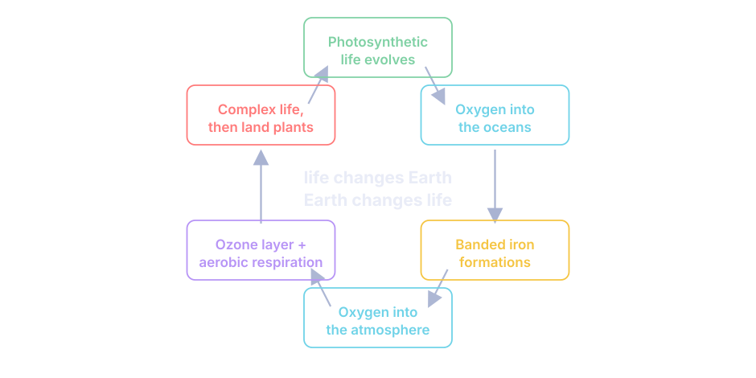
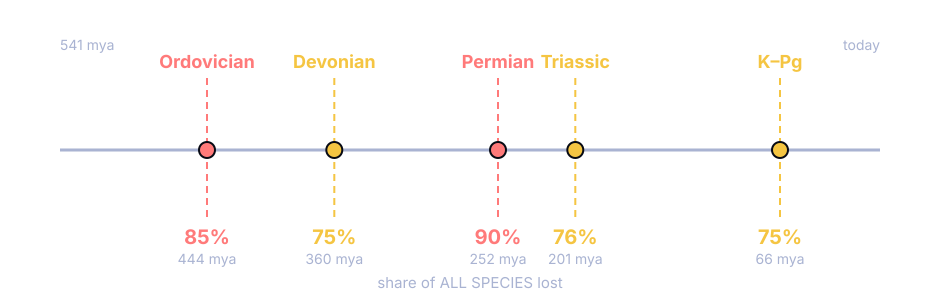

<!-- _class: title-slide -->

# 🧬 Coevolution of Earth and Life
## Unit 2: Probability of Life Elsewhere — Investigation 2
### life was here for three billion years before it got complicated · why?

<!--
WHAT THIS DECK IS: the 5E teaching deck for Investigation 2 of Unit 2. Four meetings. Student packet: "Coevolution of Earth and Life" (ess-u2-l2-coevolution.pdf). Organizer: PTO Part E.

THE FOUR MEETINGS
  M1 Thu 12/03 (B, 80 min) — ENGAGE + EXPLORE part 1 (the timeline card sort)
  M2 Fri 12/04 (C, 40 min) — EXPLORE parts 2-3 (isotopes, oxygen)
  M3 Mon 12/07 (D, 80 min) — EXPLAIN (coevolution argument) + the evidence-quality reading
  M4 Tue 12/08 (A, 40 min) — ELABORATE (mass extinctions) + PTO Part E. Part L goes home.

STANDARD: HS-ESS2-7 (SBG code ES-5) — construct an argument based on evidence about the coevolution of Earth's systems and life on Earth. SEP-7 argue from evidence. CCC: Stability and Change; Cause and Effect.

THE ONE THING: the word is COEVOLUTION. Students will readily tell you Earth changed life. The standard requires BOTH DIRECTIONS — life also changed Earth, and the oxygen in the air you are breathing is the proof. A response that only has Earth acting on life is not a coevolution argument, however detailed.

THE MISCONCEPTION THAT BREAKS EVERYTHING: students believe Earth's atmosphere always had oxygen. It is a WASTE PRODUCT OF LIFE. A student holding this backwards cannot produce a coevolution argument at all. Catch it in the Engage brainstorm, break it in the Explore.
-->

---

# Where we are

Last time: early Earth was bombarded, and life shows up in the record only **after** the bombardment ended.

That explains the **delay at the start**. It does not explain what came next.

**What you established**
- Life appears ~3.5 billion years ago
- Earth was hit as hard as the Moon
- Earth's surface erased the evidence

**What is still unexplained**
- Life was here for **3 billion years**
- And stayed **simple** the whole time
- Then, suddenly, it did not

### This investigation: once life had started, what let it become complex?

<!--
Two minutes, no more. Point at the PTO map table — this is piece two of four.

The honest framing: Investigation 1 answered "why so late a start?" This one answers "why so slow afterwards?" Those are different questions and students conflate them.
-->

---

<!-- _class: phase-title -->

# ENGAGE
## The Pace of Evolution
### Meeting 1 · Thursday 12/03 · first 25 minutes

<!--
PACKET PART A. Figure 1 plus the brainstorm table.

RUN: questions 1-6 individually first (8 min), then share out. The arithmetic is trivial; the PATTERN in the answers is the whole point and students will not see it until the numbers are lined up.

ROUTINE: Domino Discover on the brainstorm — every student puts one idea up before discussion.

CAPTURE THE TWO MISCONCEPTIONS ON THE BOARD, in their own words, and leave them standing:
  1. "Earth always had oxygen and life used it"  (broken in the Explore)
  2. "Life adapted to Earth"  (true, and only half — the other half is the standard)
-->

---

# The pace of evolution has increased

<!--
PACKET PART A q1-6. DO NOT SHOW THIS SLIDE UNTIL STUDENTS HAVE DONE THE SUBTRACTION — the gap brackets along the bottom give away the answer to question 6.

THE ANSWERS: 4,600 mya · 1,100 My · 1,500 My · 1,000 My · 400 My · everything else.

THE PATTERN: each major step takes less time than the one before, and the last stretch holds more change than all the rest put together. Evolution did not run at a steady rate — it ACCELERATED.

Ask: "what is the longest gap on this timeline?" (3,500 to 2,000 — fifteen hundred million years to get from a simple cell to a cell with a nucleus. ONE step. Longer than everything that has happened since animals appeared.)

DO NOT ANSWER WHY TODAY. Students leave with the pattern and no explanation for it.
-->

---

<!-- _class: phase-title -->

# EXPLORE
## Reconstructing Earth's History
### Meeting 1 (rest) + Meeting 2 · the fossil record, isotopes, oxygen

<!--
PACKET PARTS B, C, D.

M1 rest of the 80: the TIMELINE CARD SORT (Part B). Chart paper, line across the middle, "Life on Earth" above and "Earth's Other Systems" below. Sort the printed fossil cards by time and by system.
  0:25  set up and sort cards
  0:45  draw the ARROWS — this is the assessment, not the card placement
  1:00  analysis questions 7-12
  1:15  share the cross-midline arrows

M2 (40 min): Part C isotopes (q13-16 + the table) then Part D oxygen (q17-23). Tight — the oxygen graphs are the priority; Part C q13-14 can be trimmed if needed.

THE TIMELINE IS COMPLETE WHEN IT HAS ALL FIVE: 5+ causal arrows; 3+ crossing the midline; an annotation on each arrow; the role of oxygen clear; increasing complexity clear.
-->

---

# The arrows are the work

**Top half** — life on Earth

**Bottom half** — Earth's other systems

A timeline with every card in the right place and **no arrows** has missed the task.

At least **three** arrows must cross the middle — and they must cross in **both directions**.

If every arrow you have drawn points from Earth **to** life, ask yourself: is there anything life did **to Earth**?

<!--
PACKET PART B q7.

THE CROSSINGS THAT MUST APPEAR:
 • photosynthetic bacteria (bio) → oxygen in the oceans (geo)
 • ocean oxygen (geo) → banded iron formations (geo)
 • atmospheric oxygen (geo) → ozone layer → life on land (bio)
 • ocean oxygen (geo) → complex cells / aerobic respiration (bio)
 • impact or volcanism (geo) → mass extinction (bio)
 • extinction (bio) → new organisms fill the gap (bio)

CONFERRING PROMPT for a group whose arrows all point one way is on the slide — use it verbatim, it works.

LOOK AND LISTEN FOR: a group that puts banded iron formations in the bottom half and cannot say where the oxygen in them came from. That is the single best entry point to the whole investigation.
-->

---

# What are you actually looking at?

<!--
PACKET PART B q10 — "how easy is it to tell what the fossils are showing if you didn't have the captions?"

RUN IT AS A GUESSING GAME, 3 minutes. Six real images from the card deck, captions removed. Ask each group to write down what they think each one is. Take guesses out loud before the reveal.

THE ANSWER TO q10 IS "VERY DIFFICULT", and the point is for them to FEEL it rather than be told. Expect "a rock" six times.

These are not obscure specimens chosen to be unfair — they are the actual evidence this entire investigation rests on. #1 is the single best piece of evidence in the unit for life changing Earth, and it looks like a decorative countertop.

DO NOT let them off with "I don't know." Push: "what would you need in order to tell?" That question is the bridge to the reading in Part H — scale bars, chemical analysis, context in the rock, and more than one line of evidence agreeing.
-->

---

# What they actually are

<!--
THE REVEAL. Go one at a time and let the gap between guess and answer land.

 1. BANDED IRON FORMATION, 2.5 By — the rock that cannot form without free oxygen. Looks like polished decorative stone.
 2. EARLY EUKARYOTIC CELLS, 2.1 By — the first complex cells. Looks like smudges.
 3. PHOTOSYNTHETIC STROMATOLITES, 2.7 By — the evidence that photosynthesis had begun. Looks like gray rock.
 4. OLDEST LAND ANIMAL, 425 My — looks like a scratch.
 5. EARLIEST SOFT ANIMALS, 560 My — the concentric disc. Could easily be a sedimentary structure, and for decades people argued about exactly that.
 6. PRESERVED SOIL DEPOSIT, 407 My — looks like a rock face, because it is one.

THE POINT TO LAND, and it is the thread to Part H: a biosignature is only convincing when several independent lines agree. Non-biological processes mimic every one of these. #5 is the honest example — concentric discs like that were argued over for decades.

THEN SAY IT: "every date you are about to sort onto a timeline came from an image like these, interpreted by someone." That is what makes the uncertainty discussion in Part H real rather than a box to tick.
-->

---

# Correlation is not cause

### What the timeline gives you
Two things happened at **about the same time**.

That is **correlation**.

### What it does not give you
That one **caused** the other.

Two events can coincide and not be connected.

What closes the gap is a **mechanism** — a reason, grounded in chemistry or biology, why one *would* cause the other.

<!--
PACKET PART B q11. This is the most transferable idea in the unit and it is worth real time.

WHAT WOULD STRENGTHEN A CORRELATION INTO A CAUSE:
 • a mechanism (the big one)
 • repetition — the same pattern at several independent times
 • tighter dating, so the ORDER is unambiguous
 • more complete samples, since what survives is a biased fraction

THE SENTENCE TO LAND, and the best students produce it themselves:
  "The timeline gives correlation. The reasoning about energy gives cause."

This comes back three times: Part D q20, Part H q25, and PTO Part E. Flag it each time.

PART B q12 — why the record is incomplete — is the same argument students already proved in Investigation 1 about craters. Weathering, erosion, burial, subduction. Almost no ocean floor is older than 200 My. Say the link out loud; they will not make it themselves.
-->

---

# Choosing an isotope

The 2024 **ESRT**, page 14, gives you two different things:

| | Half-life | **Useful dating range** |
|:--|:--|:--|
| Carbon-14 | 5,730 yr | **100 – 70,000 yr** |
| Potassium-40 | 1.3 billion yr | **100,000 – 4.6 billion yr** |
| Uranium-235 | 713 million yr | 10 million – 4.6 billion yr |
| Rubidium-87 | 48.8 billion yr | 10 million – 4.6 billion yr |

Half-life and useful range are **not the same thing**. The second column is the one that answers the question.

<!--
PACKET PART C. All four values are the ESRT's own — not textbook values. U-235 is 713 My here, not 704. Students should be reading these off the booklet they get on the exam (SKL-1).

THE BANDED IRON FORMATIONS, 2.5 By:
 • U-235 remaining ≈ 9%  (between 3 half-lives at 12.5% and 4 at 6.25%) — a big, easy-to-measure change
 • Rb-87 remaining ≈ 96.5% — only 3.5% has decayed

WHY Rb-87 IS HARDER (q14): measuring a 3.5% change is hard because measurement error is a large fraction of the signal. Watch for "because its half-life is too long" with nothing after it — push for the two percentages.

ADVANTAGE OF A SHORTER HALF-LIFE (q15): more has decayed, so there is a bigger change to detect, so the age is more precise. The trade-off is that it eventually runs out — which is the next slide.
-->

---

# The trap

### Early humans emerged about **200,000 years ago.** Which isotope dates them?

**Carbon-14**
range 100 – **70,000** yr

200,000 is **past the end**.

After ~35 half-lives, what remains is 0.000000003%.

**Potassium-40**
range **100,000** – 4.6 By

200,000 falls **inside** it.

The answer is **Potassium-40** — and the chart tells you so.

<!--
PACKET PART C q16. NEARLY EVERY STUDENT WILL WRITE CARBON-14, and their reasoning is sound: it is the isotope they know, it is the one used on "once-living things," and they have correctly learned that shorter half-lives suit younger samples. That reasoning runs exactly one step too far.

SEND THEM TO THE USEFUL DATING RANGE COLUMN. It is on the chart; the question says to use evidence from the chart.

THE SHARP STUDENT'S OBJECTION, and you should hope for it: "how can K-40 work when only 0.01% of it has decayed in 200,000 years? That's the same problem you just said Rb-87 had."

THE HONEST ANSWER: K-Ar dating measures the ARGON THAT HAS ACCUMULATED, not the potassium that remains. Argon is a gas that was not there at all when the rock formed, so going from zero to a tiny amount is measurable — while going from 100% to 99.99% is not. In practice it is done on volcanic ash layers above and below the fossils, not on the bones. A student who raises this has out-reasoned the worksheet. Say so.

THE K-40 TABLE (q17 follow-up): 1.3 / 2.6 / 3.9 / 5.2 By. POINT AT THE LAST ROW — four half-lives of K-40 is older than the Earth. The table is arithmetic, not a description of anything that has happened.
-->

---

# Oxygen through Earth's history

<!--
PACKET PART D, Figure 2. LINEAR scale.

What students read off this: flat at essentially zero for the first 1.5 billion years; a small bump at 2.4 By; a long plateau around 2%; then a steep climb from about 0.8 By; a peak near 30% at 300 million years ago (the Carboniferous); settling to 21% today.

q17 when did it start rising from nearly 0?  → ~2.4 By, the Great Oxidation Event
q19 when did it reach its highest?          → ~300 mya, about 30%, higher than today

HOLD q18 ("when did it rise SHARPLY?") UNTIL THE NEXT SLIDE IS UP. On this graph the honest answer is 0.8–0.6 By. On the next one it is 2.4 By. That tension is deliberate.
-->

---

# The same data

<!--
PACKET PART D, Figure 3. LOG scale — each gridline is TEN TIMES the one below it.

NOW ASK q18 AGAIN. On this graph the Great Oxidation Event is a jump of several thousand-fold and is obviously the largest event on the whole record. The Neoproterozoic rise is a modest step.

NEITHER GRAPH IS LYING AND NEITHER IS THE RIGHT ONE:
  a linear axis answers  "how many percentage points?"
  a log axis answers     "how many times larger?"

New Visions calls the 2.1–2.4 By rise "sharp" — true on a log axis, false on a linear one.

THIS IS SKL-3 (reading data across scales) AND IT IS THE CLEAREST EXAMPLE THE COURSE OFFERS. Spend the five minutes:
 • "Which graph would you use to argue the Great Oxidation Event was the most important change in Earth's atmosphere?"
 • "Which would you use to argue it was minor?"
 • "Is either one dishonest?"
 • "What should you check before trusting a graph someone shows you?"

ACCEPT EITHER ANSWER TO q18 with reasoning. Both are correct.
-->

---

<!-- _class: phase-title -->

# EXPLAIN
## Arguing for Coevolution
### Meeting 3 · Monday 12/07 · 80 minutes

<!--
PACKET PARTS E, F, G, H, I.

TIMING for the 80:
  0:00  Making Sense See-Think-Wonder (Part E) — row 3 is the one that matters
  0:12  Class Consensus Discussion on row 3
  0:20  video, The Role of Oxygen in Earth's History — notes in Part F
  0:32  the evidence table, Part F — three claims, eight rows
  0:52  Part G — write the argument
  1:08  Part H reading + q25-26 on evidence quality

ROUTINE: Class Consensus Discussion before the evidence table. Build the evidence as a class and let them write from the shared list.

SCAFFOLD: the "Scaffolded Explain Cards" classroom resource supplies the evidence as cards for students who cannot generate it. The REASONING column stays theirs either way.
-->

---

# Life changed the air

### The early atmosphere
CO₂, methane, ammonia, nitrogen, water vapor.

**Essentially no free oxygen.**

### Today
78% nitrogen, **21% oxygen**.

The oxygen is the difference — and **life put it there.** It is a *waste product* of photosynthesis, not a condition life needed in advance.

**Cyanobacteria** → oxygen into the **oceans** → reacts with dissolved iron → **banded iron formations** (2.5 By) → oceans saturate → oxygen into the **atmosphere**

<!--
PACKET PART D q21 and PART F claim 1. THE MISCONCEPTION DIES HERE, and if it survives this slide nothing downstream can be right.

WHY THE OCEANS FIRST: the banded iron formations date to about 2.5 By — just BEFORE the atmospheric rise at 2.4. The oceans were a sink that had to fill before oxygen could build up in the air. That ordering is evidence, not a detail.

THE BANDED IRON FORMATIONS ARE THE BEST SINGLE PIECE OF EVIDENCE IN THIS INVESTIGATION: a rock type that cannot form without free oxygen, dated to the moment free oxygen first appeared, made by a biological process. Life created a new kind of rock.

CALL BACK: these are the same rocks they dated in Part C with U-235 and Rb-87.
-->

---

# Why oxygen permits complexity

1. **Aerobic respiration** releases far more usable energy per unit of food than anaerobic pathways. Complex cells are expensive to run.
2. Atmospheric oxygen builds the **ozone layer**, which blocks UV and makes the **land surface survivable** — a whole new habitat.
3. High oxygen supports **large, active animals** with high metabolic demand.

Check the order on your timeline. Oxygen rises at 2.4 By → complex cells at 2.0 By. Oxygen rises again at 0.8 By → animals at 0.6 By. **Oxygen first, complexity after. Every time.**

<!--
PACKET PART D q22 and PART F claim 3.

THE ENERGY ARGUMENT IS THE MECHANISM, and it is what turns the correlation on the timeline into a causal claim. It is also the reasoning students most often leave out.

WATCH FOR "organisms needed oxygen to breathe" and nothing more. True but circular. Push: WHY does oxygen-breathing permit complexity? Because of the energy budget.

"Oxygen first, complexity after, every time" — the REPETITION is itself evidence. One coincidence is weak; the same sequence twice, separated by a billion and a half years, is much harder to dismiss as chance. Link back to the correlation-vs-cause slide.
-->

---

# The loop

<!--
PACKET PART G component 5 — the heart of the task.

EVERY ARROW CROSSES BETWEEN THE LIVING AND NON-LIVING WORLD, and the output of each step is the input of the next. That is a feedback mechanism, and it is why this took billions of years rather than millions: each step had to run to completion before the next could start.

THE RETURN ARROW (Part D q23) — what complex life did back to the planet:
 • land plants (~0.47 By) drove oxygen to its Carboniferous peak near 30%
 • their roots accelerated rock weathering, changing soil and river chemistry
 • burying that plant carbon removed CO2 and cooled the climate
 • shell-building marine organisms CREATE ROCK — limestone is a biological product

GRADE PART G ON DIRECTION, NOT VOLUME. The one question that separates proficient from developing: does the argument show Earth changing life AND life changing Earth? A response with only one direction is not a coevolution argument, however detailed.
-->

---

# What this evidence can and cannot show

**Limits**
- Dating carries uncertainty
- Biosignatures can be **mimicked** by non-living processes
- The oxygen curve is **reconstructed**, not measured
- The record is the **biased fraction that survived**

**Why it still works**
Several **independent** lines of evidence — fossils, oxidised rocks, isotopes — each with *different* weaknesses.

When all three point the same way, the conclusion is far stronger than any one of them.

An argument that names its own uncertainty is **stronger**, not weaker.

<!--
PACKET PART H (the "Signals in the Sands of Time" reading) q25-26, and PART I q29.

WATCH FOR "the data is unreliable so we can't know anything." That is giving up, not evaluating. Ask: "so is it wrong that oxygen rose? How confident are you, and what makes you that confident?"

WHERE IT STAYS CORRELATIONAL: the claim that a particular mass extinction was caused by a particular oxygen drop. The dates roughly coincide, the causes are still argued over, and the dating uncertainty is comparable to the gap. The extinction table in Part J says so itself — point at that sentence tomorrow.

TELL STUDENTS THIS IS GRADED ON THE PERFORMANCE TASK, not an optional flourish. PTO Part D already required it.
-->

---

<!-- _class: phase-title -->

# ELABORATE & EVALUATE
## Mass Extinctions
### Meeting 4 · Tuesday 12/08 · 40 minutes

<!--
PACKET PARTS J, K, M. Part L (Arguing from Evidence) GOES HOME.

TIMING for 40:
  0:00  the extinction table, read silently (Part J)
  0:08  Read-Generate-Sort-Solve on the three prompts (Part K)
  0:22  individual response
  0:30  PTO PART E assigned, rubric in Part M walked through
  0:38  Part L set as homework

ROUTINE: Read-Generate-Sort-Solve. Everyone stars ONE idea before the group discusses — it stops the loudest idea winning by default.
-->

---

# Five times, most of life died

Every one of them **cleared ecological niches** — and the survivors radiated into them.

<!--
PACKET PART J.

THE TABLE'S OWN STORY, row by row: invertebrates out, fish in. Reefs collapse, four-legged land animals explode. 90% die, dinosaurs evolve. Ecosystems collapse, the age of dinosaurs begins. Dinosaurs out, MAMMALS IN.

WE ARE HERE BECAUSE OF THE K–Pg EXTINCTION, not in spite of it. Mammals were small and marginal for 150 million years until the dinosaurs were removed. Ask students where mammals were during the age of the dinosaurs — most have never considered it.

THE PERMIAN AT 90% is the one to dwell on. Massive volcanism, rapid warming, ocean acidification. Nine species in ten.

OXYGEN: each extinction coincided with a DECREASE in atmospheric oxygen, and levels rose again afterwards. NOTE THE PHRASING — "coincided with", not "was caused by". The exact causes are still being worked out and the dating uncertainty is real. This is yesterday's correlation-vs-cause lesson, live.
-->

---

# Life rebuilds the planet

1. An extinction kills photosynthetic organisms too, so **oxygen production falls**.
2. Recovery starts with **plants and algae** — the base of the food chain, needing only sunlight, water and CO₂.
3. Photosynthesis resumes at scale and **oxygen climbs back**.
4. Only *then* can animals that depend on that oxygen recover.

The planet does not restore itself and then invite life back. **Life restores the planet.**

<!--
PACKET PART K, prompts 2 and 3.

THE ORDER MATTERS AND IT IS THE WHOLE ANSWER: producers first, then consumers. This is the same feedback loop as the Great Oxidation Event, running again in miniature — five separate times.

LINK TO THE UNIT QUESTION, and make it explicit before they leave: a civilisation needs a long uninterrupted run to develop technology. Earth has had five interruptions severe enough to remove most species. That is the factor PTO Part H calls "those societies surviving long enough" — and Investigation 4 is about whether a technological species can do anything about it.
-->

---

# Before Investigation 3

**Performance Task Organizer, Part E.** You need **two** organisms that changed oxygen, and **three** times an oxygen change led to more complex life.

| What you need | Where it is |
|:--|:--|
| Organisms that changed oxygen | Part F claim 1 · Part D q21 |
| Oxygen leading to complexity | Part F claim 3 · Part D q22 |
| The feedback loop | Part G component 5 |

**Also due:** Part L — arguing from evidence.

<!--
THE CLAIM IS GIVEN: "Earth's systems and life coevolved over 3.5 billion years, resulting in the evolution of humans, with oxygen playing a central role." Their job is evidence and reasoning.

WALK THE RUBRIC IN PART M. Proficient needs 2 sources on organisms changing oxygen AND 3 on oxygen changing life. Developing is 1 and 2. Students routinely supply four pieces of evidence for one claim and none for the other — the rubric is explicit about the split and they should see it before they write.

NEXT INVESTIGATION: Origin of the Universe. The transition question from the Driving Question Board is whether there might be other Earth-like planets out there that could support this kind of coevolution. If it is not on the board, put it there before they leave.
-->

---

<!-- _class: compact -->

# Vocabulary

**coevolution** — two things evolving together, each causing change in the other

**photosynthesis** — using light energy to build sugars from CO₂ and water, releasing oxygen as waste

**cyanobacteria** — the photosynthetic bacteria that first oxygenated Earth's oceans

**Great Oxidation Event** — the rise of free oxygen beginning ~2.4 billion years ago

**banded iron formation** — layered rock that forms when dissolved iron meets free oxygen; evidence that oxygen was in seawater

**aerobic respiration** — releasing energy from food using oxygen; yields far more usable energy than anaerobic pathways

<!--
Reference slide, 1 of 2. Leave it up during the Part G writing and PTO Part E.

The three students reach for most: coevolution, banded iron formation, aerobic respiration.
-->

---

<!-- _class: compact -->

# Vocabulary, continued

**ozone layer** — atmospheric oxygen that absorbs ultraviolet radiation, making the land surface survivable

**eukaryote** — a complex cell with a nucleus

**biosignature** — a marker in the rock record indicating past life

**correlation** — two things happening together

**causation** — one thing making the other happen; needs a mechanism, not just timing

**mass extinction** — an event in which a large share of all species dies out

**useful dating range** — the span of ages over which an isotope gives a reliable date; **not** the same as its half-life

<!--
Reference slide, 2 of 2.

CORRELATION / CAUSATION and USEFUL DATING RANGE are the two that carry beyond this unit. Both appear on the Regents in other contexts.
-->
