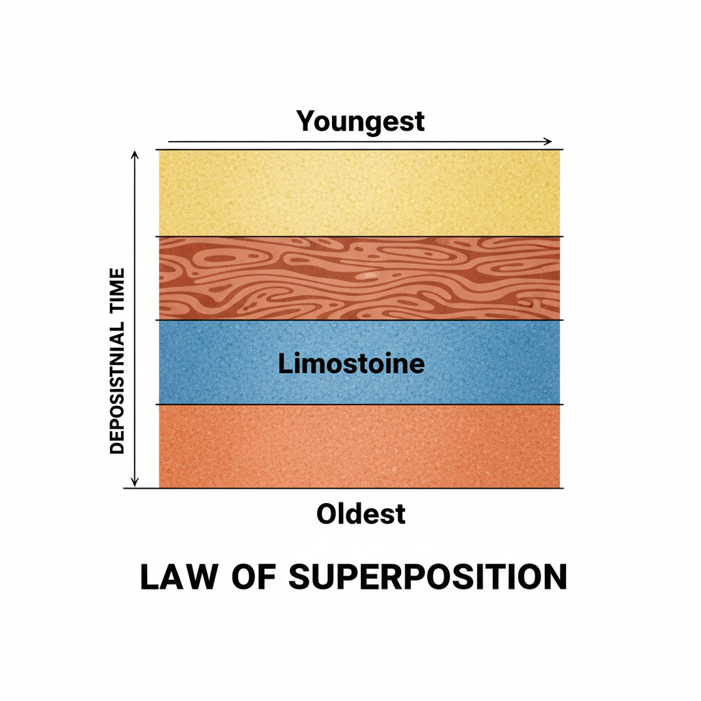
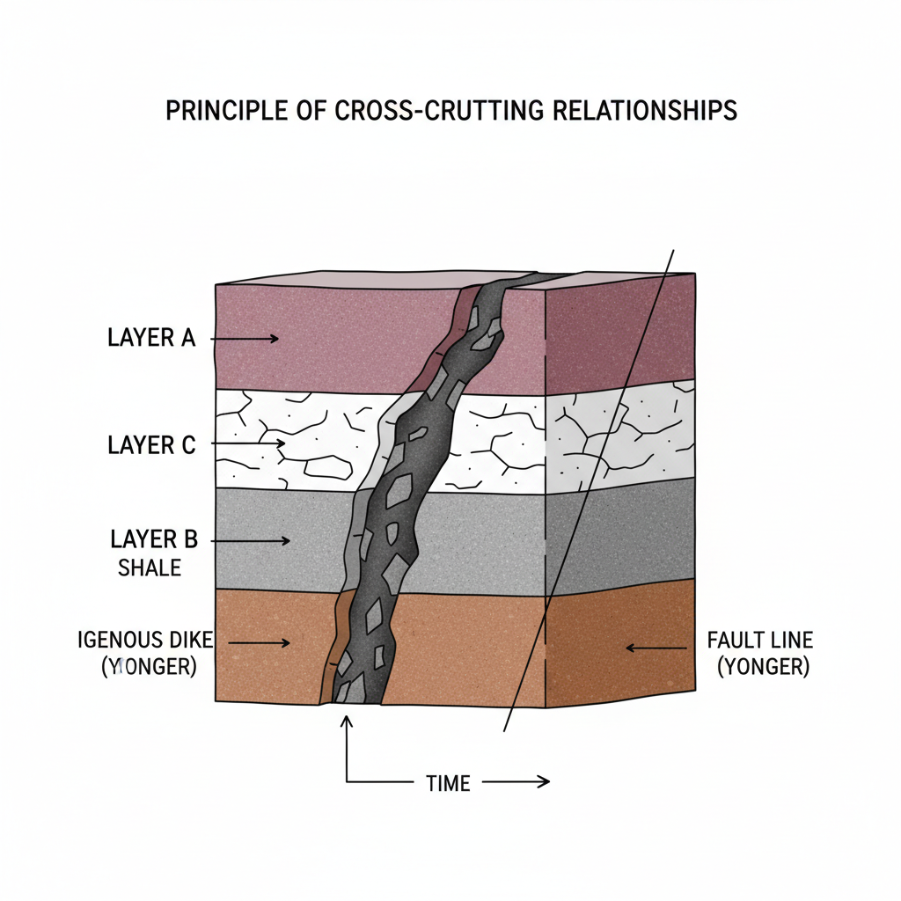
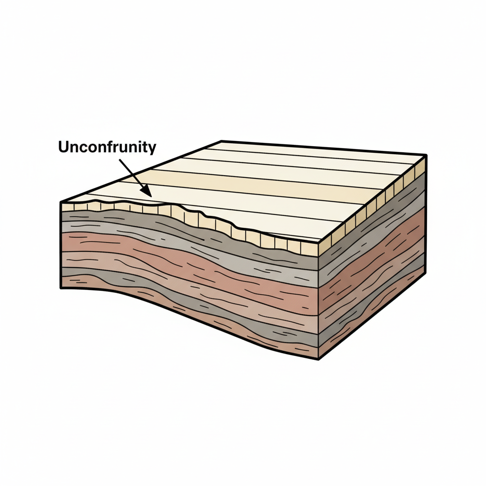

<!--
  RELATIVE DATING — Earth's History, second half
  ============================================================
  Split out of the old `GeologicDating.md` on 2026-11-20. See
  `U2_Absolute_Dating.md`'s header for the full list of fixes.

  ** THE ORDER OF THIS DECK IS THE WHOLE POINT. READ THIS. **

  The old deck taught "Principles of Relative Dating" as a numbered list
  of five, up front, as direct instruction. The Reading an Outcrop lab is
  built so that students INVENT those same five principles off unlabeled
  cross sections and write them in their own words before any of them has
  a name. Running the principles slides first does not just duplicate the
  lab — it destroys it. There is nothing left to discover.

  So this deck is in three blocks and they are not interchangeable:

    BLOCK 1  (before the lab)   framing only. Relative vs absolute, and
                                the question the lab will answer. NO
                                principle is named here.
    --- THE LAB RUNS HERE ---   Reading an Outcrop, Parts A-E.
    BLOCK 2  (after Part C)     the naming slides. These are the payoff:
                                each principle appears beside the wording
                                the class already put on the board.
    BLOCK 3                     index fossils, correlation, geologic time
                                and the New York record.

  The stop-sign slide between Block 1 and Block 2 is deliberate and
  should not be deleted.
-->

<!-- _class: title-slide -->

# Relative Dating

## Reading the order without reading a number

### Earth & Space Science · Earth's History

---

<!-- _class: phase-title -->

# Block 1 — Before the Lab

## Framing only

---

# You can already put a number on a rock

...if you can find the right isotope in it.

**But most rock will not give you one.** Sedimentary layers — the ones that hold fossils — generally cannot be dated radiometrically at all. The clock runs from when a crystal formed, and the grains in a sandstone are older than the sandstone.

So: here is a cliff face with eight layers in it and no isotope you can use. **What can you still say about it?**

---

# Two ways to ask "how old?"

### Relative

- *"This rock is older than that rock."*
- An **order**.
- No numbers.
- Read from the layers themselves.

### Absolute

- *"This rock is 1.2 million years old."*
- A **number**.
- Radiometric decay.
- Needs the right mineral.

Almost all of the geologic time scale was built from **relative** dating first. The numbers were hung on it afterwards.

---

<!-- _class: phase-title -->

# STOP

## The lab comes next. Do not go past this slide.

---

<!-- _class: compact -->

# Teacher note — do not project

**The next block is the naming slides, and they belong after Part C of the Reading an Outcrop lab.**

In the lab students meet five outcrops with no principles given, order the events, and **write the rule they used in their own words**. Those rules go on the board. Only then does Part C attach the formal names.

If you run the slides below first, there is nothing for them to invent and the lab becomes a worksheet. The slides are built to be shown **beside the class's own wording**, not instead of it.

**Before you advance:** the five rules should already be on the board in the students' words.

---

<!-- _class: phase-title -->

# Block 2 — Now They Get Their Names

## You worked these out. Here is what geologists call them.

---

## Law of Superposition

- In an **undisturbed** sequence, each layer is **older** than the one above and **younger** than the one below.
- *Bottom = oldest. Top = youngest.*

**The word that matters is "undisturbed."** Beds can be overturned by folding. The bottom of the *page* is not automatically the oldest.

---

## Principle of Original Horizontality

- Sediment is deposited in **horizontal** layers.
- So if layers are **tilted or folded**, the tilting happened **after** they were laid down.

This is the one that turns a tilt into an **event** you can place in the sequence.

---

## Principle of Cross-Cutting Relationships

- A fault or an igneous intrusion that cuts through layers is **younger** than what it cuts.
- The cutter is younger than the cut.

**Why it must be true:** the rock had to be there first in order to be cut.

---

## Inclusions

- Fragments of one rock contained inside another.
- The rock **holding** the fragments is **younger** than the fragments.
- The piece had to exist before it could be caught up in something else.

---

## Unconformities

- A **gap in the record** — erosion removed rock, or nothing was deposited for a long time.
- **Angular unconformity:** tilted or folded beds overlain by flatter, younger ones.

**Four steps, every time:** deposition → **uplift** → **erosion** → submergence, then the next layer.

---

<!-- _class: phase-title -->

# Block 3 — Matching Rock Between Places

---

## Index fossils

A good index fossil is:

1. **Widespread** geographically.
2. Existed for a **short** span of time.
3. **Abundant** enough to actually find.
4. **Easy to identify.**

**The common mistake:** picking the most abundant fossil, or the oldest. A fossil that lived for 200 million years tells you almost nothing about *when*. A short-lived one is worth more precisely because it is pickier.

---

## Index fossils are on the reference table

- **ESSRT pages 6 and 7** — *Time Distribution of Fossils and Index Fossils*.
- Lettered **A–O** on page 6 and **P–BB** on page 7.
- The drawings are at the bottom; the **bars** show the range.

Two fossils: one abundant across 200 million years, one rare across 2 million. **Which is the better index fossil, and why?**

---

## Correlation

- Matching layers **between** outcrops that are miles apart.
- Match on **rock type** first — but rock types repeat, so that alone can give two different answers.
- **Fossils settle it.** The same index fossil in two places means the same slice of time.

Correlation is what turns a handful of separate cliff faces into one regional history.

---

<!-- _class: compact -->

## The geologic time scale ESSRT pp. 6–7

**Eon → Era → Period → Epoch**, largest to smallest.

  
Precambrian — 4.6 to 0.539 billion years

  
Paleozoic

  
Mesozoic

  
Cenozoic

**The chart is not drawn to scale and your sense of it is wrong.** The Precambrian is about **88%** of Earth's history. Everything with shells, bones, trees or footprints is in the last sliver.

In the 2026 edition the epoch ages are printed as **boundary lines**, not ranges — so a duration is a subtraction. The Miocene is 23 − 5.3 = **17.7 million years**.

---

## New York's own record ESSRT p. 7

Four orogenies on page 7, oldest to youngest:

| Orogeny | Caused by |
|---|---|
| **Taconian** | Western Iapetus closes; Proto-North America meets a volcanic island arc |
| **Salinic** | New subduction east of Proto-North America |
| **Acadian** | Proto-North America meets Avalon; the rest of Iapetus closes |
| **Alleghenian** | Proto-North America meets Africa — **Pangaea** |

A fifth, the **Grenville**, is on **page 6** — it is Precambrian (1.2–0.98 billion years) and made the bedrock of the Adirondacks and Hudson Highlands.

---

## Exit ticket

1. A fault cuts through three layers. **Where does it go in the sequence, and which principle tells you?**
2. Give the **four steps** an unconformity records.
3. Name **one** reason a fossil that lived for 200 million years makes a poor index fossil.
