

<!-- _class: title-slide -->
<!-- _paginate: false -->

# Dynamics

## A causal model for motion

### AP Physics 2026-27 with Mr. Porter

---

# Contents

**Phase 1 — Balanced forces**
1. [Pass the Water & Mallet Ball](#pass-the-water)
2. [Interactions & the Third Law](#a-force-is-an-interaction)
3. [Common Forces](#common-forces)
4. [Force Diagrams](#force-diagrams)
5. [Equilibrium](#equilibrium-f--0)
6. [Mass vs. Weight](#mass-vs-weight)

**Phase 2 — The Second Law**

7. [Fan Cart Lab](#fan-cart-lab)
8. [Newton's Second Law](#newtons-second-law)
9. [The N2L Protocol](#the-n2l-protocol)

**Phase 3–4 — Deploying the model**

10. [Friction](#friction)
11. [Inclined Planes](#inclined-planes)

---

<!-- _class: phase-title -->

# Phase 1 — Balanced Forces

## Days 1–5 · CED 2.1, 2.2, 2.3, 2.4, 2.6

---

# Today's Question

### What does it take to **change** an object's motion — and what happens to something with **no force on it at all**?

**Two phenomena, one rule.** In Part 1 you watch water that nobody is pushing. In Part 2 you do the pushing yourself. You leave with one statement that explains both.

**In your notebook, right now** — how many mallet taps does it take to keep a bowling ball rolling at a steady speed? Commit to a number. We come back to it at the end of the period.

---

# Pass the Water

# 💧 🥣 💧 🥣

---

<!-- _class: compact -->

# Part 1 — Pass the Water

**The relay** — carry a **brimful** dish of water one lap each around the oval, hand off at the line, and run the whole relay **twice**: lap 1 careful, lap 2 fast.

**Scoring**

$$\text{score} = t + 4\,V_{\text{spilled}}$$

$t$ in seconds, $V$ in mL. **Lowest score wins** — so spilling 50 mL costs you exactly what 200 extra seconds would.

**Three things will sink this lab**

1. **Fill to the rim, every leg.** A part-filled dish hides the effect and your volume stops meaning anything.
2. **Somebody is always watching the dish.**
3. Mark your sketch **at the track**, not from memory afterwards.

---

<!-- _class: compact -->

# The track — and what you are watching

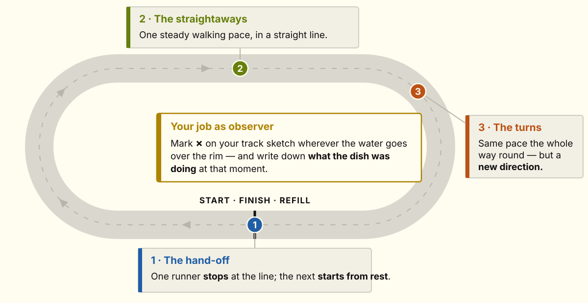

---

# Before anyone picks up a dish

**Write the observation plan in your notebook**

1. Who watches which leg? Nobody runs un-watched.
2. What exactly are you watching for, and how will you record it?
3. Sketch the track, and agree where on it your marks will go.

**Observation matters more than speed.** A fast lap with nobody watching gives you a number with no evidence behind it — and the evidence is the part that gets graded.

---

# Lab Safety — Part 1 is wet

**Walk briskly. Never sprint.** A wet hard floor is the most serious hazard in this lab.

1. Carry the dish **low and stable** — never raise it overhead.
2. Report any spill outside the dish at once; the spill responder goes in with towels.
3. No crowding at the refill station — that is where runners and observers collide.
4. Closed-toe shoes.
5. **The floor must be dry before the bowling ball comes out.** That one is not negotiable.

---

# Two laps, on purpose

**Lap 1 — careful**

Slow, smooth, gentle on the turns. Spill as little as you can.

**Lap 2 — fast**

Push the pace. Same dish, same fill line, same track.

One number tells you nothing. **A pair of numbers tells you what changed when the only thing you changed was the pace.**

---

<!-- _class: compact -->

# Measure and score

**For each lap**

1. Pour whatever is left in the dish back into the 1000 mL cylinder. Read it at eye level.
2. $V_{\text{spilled}} = 1000\ \text{mL} - V_{\text{left}}$
3. $\text{score} = t + 4\,V_{\text{spilled}}$

**Estimate your uncertainty in $V_{\text{spilled}}$**

It is **not** the markings on the cylinder. It is the water still clinging to the dish when you stop pouring. You need that number before you can say whether your two laps genuinely differ.

**Post both of your points on the board** — $(t,\ V_{\text{spilled}})$ for each lap. Everybody's pairs together are the class data set, and that graph is on the analysis sheet.

---

<!-- _class: compact -->

# Nobody pushed the water


Where did yours go over the rim — and what was the dish doing at that moment?

Where did it **not** spill, even when you were moving quickly? What did those moments have in common, in **speed** and in **direction**?

---

# Towels down

### The bowling ball does not come out until the floor is dry.

**Hold on to the water.** Part 2 looks like a completely different lab. By the end of the period we are coming back to that dish with one rule that covers both.

---

# Which objects move with constant speed?

### What do you notice about the conditions where the objects move at a constant speed?

---

<!-- _footer: Bouncing ball, strobe photograph · MichaelMaggs, edit by Richard Bartz · Wikimedia Commons, CC BY-SA 3.0 -->

---

<!-- _footer: Falling ball · Ball thrown downward · MichaelMaggs · Wikimedia Commons, CC BY-SA 3.0 -->

# Two more — same camera, same flash rate

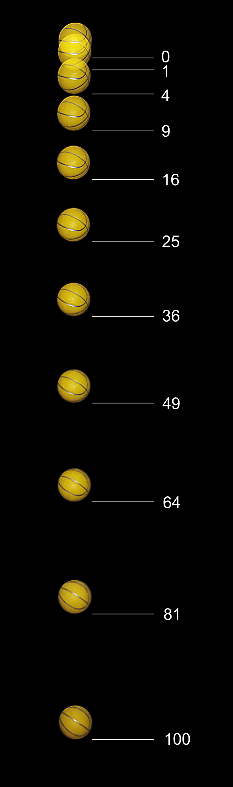

**Dropped from rest**

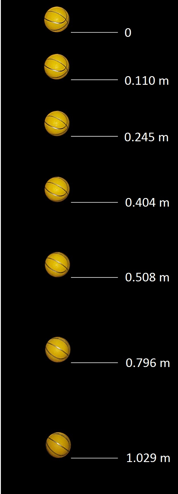

**Thrown downward**

Both speed up on the way down. Does starting faster change **how quickly** the gaps grow?

Read the left-hand labels out loud: **0, 1, 4, 9, 16 … 100**. You met that pattern in Unit 1.

---

# What did you notice?

**The bouncing ball** — the spacing side to side stayed even, but the spacing up and down kept changing.

**The dropped balls** — the gaps grew every flash, whichever speed they started with.

**Even spacing means constant speed.** Changing spacing means something is changing the motion — and that is what we are going to chase for the rest of this unit.

---

# Mallet Ball

# 🔨 🎳 🔨 🎳

---

# Mallet Ball

### We are going to try to recreate motion where $a = 0$ and where $a \ne 0$, with objects moving over smooth, hard, level surfaces.

* First with a bowling ball,
* then by looking at a simulation.

---

<!-- _class: compact -->

### Bowling ball situations — using a mallet and a bowling ball

Each time we use the mallet, let it bounce. (Don't use the mallet like a bulldozer.)

* Start with a stationary bowling ball. Then speed up the bowling ball from rest.
* Have someone roll a bowling ball. Then bring it to a stop.
* Have someone roll a bowling ball. Then keep it moving at a constant velocity.
* Have someone roll a bowling ball. With one tap, have the bowling ball make a 90° turn.
* Keep a bowling ball moving in a circle at constant speed.

**Your goal** — summarize the relation between taps and motion in as few statements as possible.

---

# Lab Safety

1. No high mallets
2. Be aware of your surroundings
3. No excessive rolls
4. No smashing into walls, mats, classmates, etc.

---

# Lab Instructions

1. Everyone in your group should *play mallet ball* at least once.
2. As a group, think about how you will accomplish the mallet ball task.
3. Attempt to accomplish the task.
4. Record how you successfully accomplished the task:
    - written description
    - drawing that models the motion and your mallet taps
5. Finally, write a general descriptive model that explains how mallet taps relate to the motion of the bowling ball.

---

# How do **taps** relate to

# the **motion** of

# the bowling ball?

---

# Does our rule work in reverse?

## Does the bowling ball tap the mallet?

Keep this one open — we come back to it tomorrow.

---

# What would happen as we make the taps more "constant"?

---

# Newton's First Law

**Balanced** — when the forces acting on a system are balanced, the system keeps its **constant velocity**.

**Unbalanced** — when the forces acting on a system are unbalanced, the system **accelerates**.

**Inertia** — the tendency of an object to keep doing what it is already doing. More mass, more inertia. Inertia is why "no force" does **not** mean "no motion."

---

# Back to the water

Nobody tapped the water. So why did it climb the back wall when you started, and the front wall when you stopped?

**The water was obeying the first law the whole time.** Left alone it keeps the velocity it already had — it is the **dish** that changes velocity. The rim is the only thing touching the water, so the rim is the only thing that can push it. Wherever the rim could not push hard enough, the water went over it.

---

<!-- _class: phase-title -->

# Day 2 — Interactions

## A force is a thing two objects do to each other

---

# [PhET Tug of War](https://phet.colorado.edu/sims/html/forces-and-motion-basics/latest/forces-and-motion-basics_all.html)

## CER

On the next slide there is a list of statements. Decide whether each statement is ***true*** or ***false***, then support that claim with evidence from the simulation and reasoning based on our models of motion and forces.

---

<!-- _class: tiny -->
<!-- _footer: Forces and Motion&#58; Basics · PhET Interactive Simulations, University of Colorado Boulder -->

# [PhET Tug of War](https://phet.colorado.edu/sims/html/forces-and-motion-basics/latest/forces-and-motion-basics_all.html)

1. A person's location on the rope matters.
2. Different combinations of people can produce the same sum of forces.
3. The sum of the forces on the cart is always equal to the addition of the individual forces.
4. It is impossible for the cart to accelerate to the left if there are people pulling it to the right.
5. The side with the bigger person will always win.
6. The side with more people will always win.
7. It is impossible to make the cart decrease in speed.
8. It is impossible to make the cart move at a steady speed.
9. The cart will always move in the direction of the sum of the forces.
10. If the sum of the forces is zero, the cart must be at rest.

---

# ✏️ Write a Summary

# How do forces affect the motion of an object?

You can do this in ***2 sentences***.

---

# A **force** is

# an *interaction* between two objects.

### A force can be the result of **contact**, or a force **at a distance**.

**So every force needs two names.** Not "the force on the box" — the force *of the hand* on *the box*. If you cannot name both objects, it is not a force.

---

# Can an object exert a force on itself?

### Try to argue for it

- Can you lift yourself by your own belt?
- Can a car's engine push the car?
- Can you push yourself across the floor?

**No.** A force needs *two* objects. Whenever it looks like self-propulsion, a second object is doing the pushing — the floor, the ground, the road.

---

# Newton's Third Law

A **force** is an interaction between two objects. The two objects mutually apply this force on each other, and the force is **always equal in magnitude and opposite in direction**.

**The two forces act on *different objects*.** That is the whole law. It is also the reason they never cancel.

---

<!-- _class: plain -->

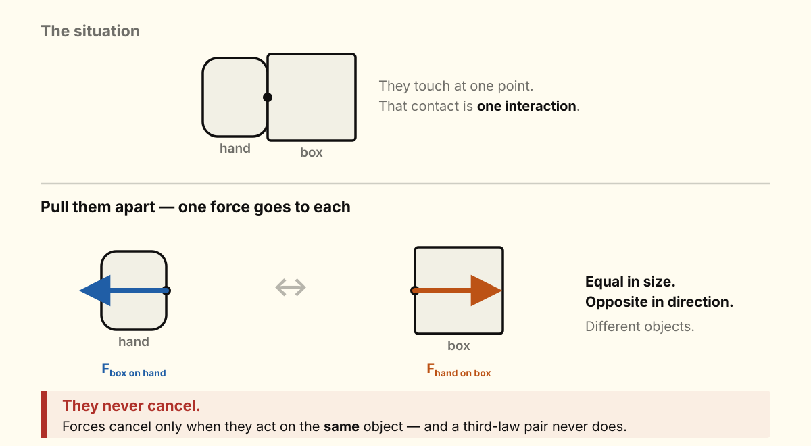

---

# Force Pairs

* Newton's Third Law describes force **pairs**.
  * You can identify these pairs with an **interaction diagram**.
  * The line that connects each bubble or object is the force pair.

Back to yesterday: **does the bowling ball tap the mallet?**

---

<!-- _class: plain -->

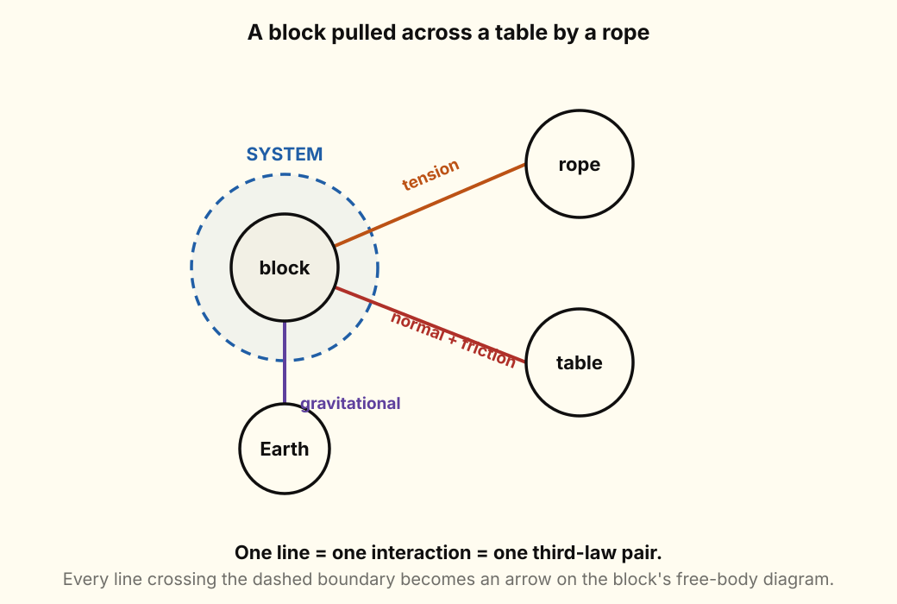

---

### Contact Interactions

1. ***Compression*** — when two objects' surfaces are pushed together and the surfaces *deform*
2. ***Stretch*** — when two objects pull on each other and are elongated
3. ***Shear*** — when surfaces pull on each other as they slide, or attempt to slide

All three are *deformation*. So what is actually pushing back?

---

<!-- _class: plain -->

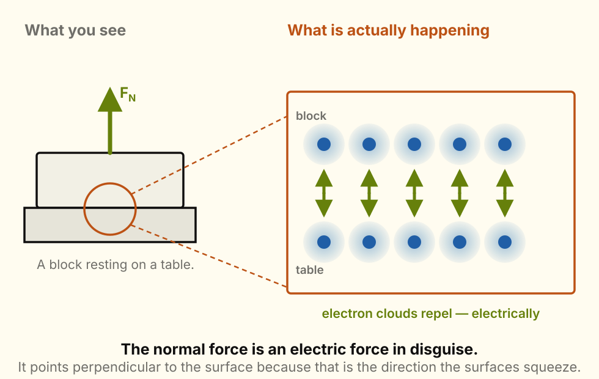

---

# Every contact force is electric

**Contact forces come from interatomic electric forces.** Atoms at the two surfaces get close enough that their electron clouds repel.

**Normal** is perpendicular to the surface because *that* is the direction the surfaces are squeezed.

**Tension** can only pull, because stretched bonds pull back toward each other — a rope cannot push.

**Friction** is sideways because the surfaces catch and shear across each other.

**Spring** pulls back toward the rest length because that is the shape the bonds prefer.

---

# Common Forces

---

# Make a Table

| Type of Force | Symbol | When is this force present? | In which direction is this force? | Field or Contact? |
| :--- | :--- | :--- | :--- | :--- |
| | | | | |

**Fill one row per force as we go.** Five rows today.

---

<!-- _class: compact lefttable -->

| Type of Force | Symbol | When is this force present? | In which direction is this force? | Field or Contact? |
| :--- | :--- | :--- | :--- | :--- |
| gravitational | $\vec{F}_g$ | Two objects with mass interact. One object is often the Earth. | Toward the center of the Earth (or other large object) | **Field** |

---

<!-- _class: compact lefttable -->

| Type of Force | Symbol | When is this force present? | In which direction is this force? | Field or Contact? |
| :--- | :--- | :--- | :--- | :--- |
| normal | $\vec{F}_N$ | Two solid surfaces compress one another | **Perpendicular** to the surface | Contact |

---

<!-- _class: compact lefttable -->

| Type of Force | Symbol | When is this force present? | In which direction is this force? | Field or Contact? |
| :--- | :--- | :--- | :--- | :--- |
| tension | $\vec{F}_T$ | An object (often a rope) gets stretched | Along the rope, **always a pull** | Contact |

---

<!-- _class: compact lefttable -->

| Type of Force | Symbol | When is this force present? | In which direction is this force? | Field or Contact? |
| :--- | :--- | :--- | :--- | :--- |
| friction | $\vec{F}_f$ | Two surfaces "catch" on one another and shear | **Parallel** to the surface | Contact |

---

<!-- _class: compact lefttable -->

| Type of Force | Symbol | When is this force present? | In which direction is this force? | Field or Contact? |
| :--- | :--- | :--- | :--- | :--- |
| spring | $\vec{F}_s$ | A spring or elastic object is stretched or compressed | Back toward the **rest length** | Contact |

**Hooke's law** — $|\vec{F}_s| = k|\Delta x|$. We name it here; we *measure* $k$ in Unit 3, where we need it for elastic energy.

---

# Forces you will meet later

**Electric** $\vec{F}_E$ · **Magnetic** $\vec{F}_M$

Field forces, like gravity. Unit 3 of AP Physics 2 — but you have already used them today, because every contact force on this list *is* an electric force.

**Buoyant** $\vec{F}_B$

A fluid pushing up on something immersed in it. We meet it properly in **Unit 8, Fluids**.

**Not on our list:** "the force of motion." A moving object does not carry a forward force with it — that was the whole point of Mallet Ball.

---

<!-- _class: phase-title -->

# Day 3 — Force Diagrams

## 💭 ↙️ ➡️ ⬇️ ⬆️ 🗯️

---

<!-- _class: plain -->

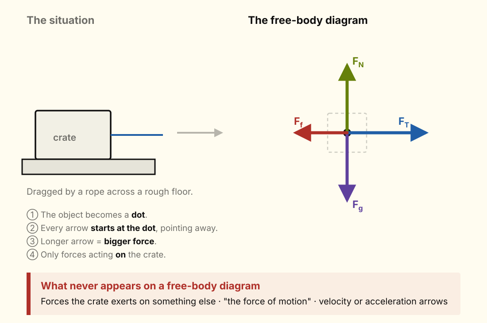

---

<!-- _class: plain -->

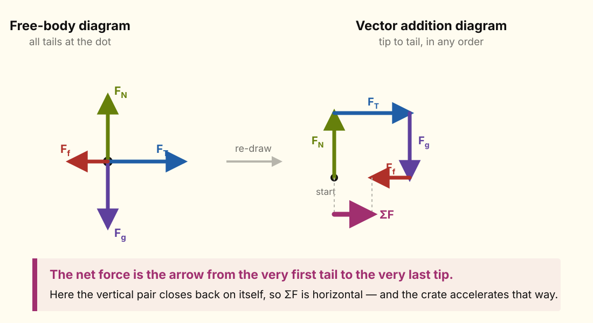

---

# Your turn

**In class**

1. **FBD card sort** — match the situation to its diagram, at your table
2. Monkey FBD & VAD practice

**At home**

Physics Classroom Concept Builders:
- *Recognizing Forces*
- *Match That Free Body Diagram*

**Quiz 7 is next meeting** — N1L, identifying forces, FBDs, N3L pairs.

---

<!-- _class: phase-title -->

# Day 4 — Equilibrium

## $\Sigma \vec{F} = 0$

---

# Equilibrium

If an object is at rest, or moving at **constant velocity**, then the forces on it are balanced:

$$\Sigma \vec{F} = 0 \quad\Longrightarrow\quad \Sigma F_x = 0 \;\text{ and }\; \Sigma F_y = 0$$

**Always** — one equation per axis. Never one equation for the whole diagram.

---

# Try it — Mild

Two giant holiday ornaments are hanging on Mr. Porter's front porch, as shown in the diagram to the right.

1. Draw the FBD for each ornament.
2. Determine the value of **all** of the forces.

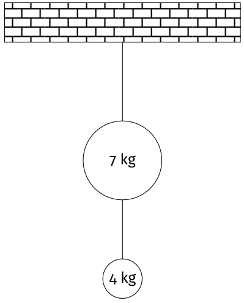

---

# Medium

In another episode of *Don't Do This At Home*, Jason secures a strong cable to two dead trees in the woods behind his home and attempts to jump-start his tightrope-walking career. His first attempt ends in the rather precarious position shown in the diagram. The rope makes an angle of 10° with the horizontal. Jason has a mass of 70 kg.

**Determine the tension in the cable.**

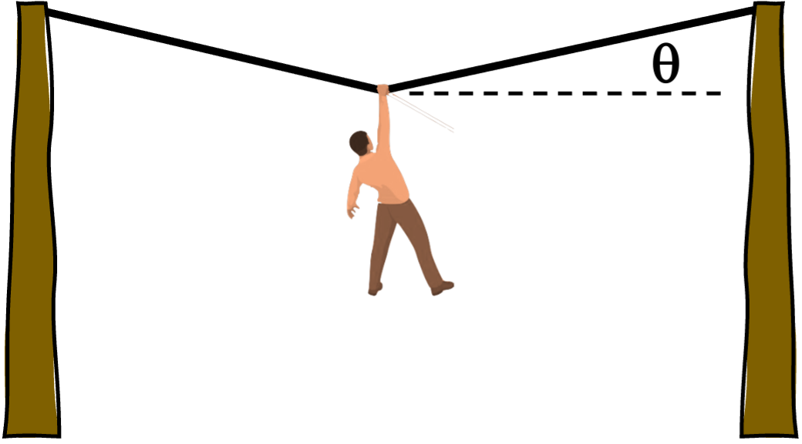

---

# Spicy

Tarzan, much to his dismay, gets his loincloth stuck on a branch. He is left hanging with the vine pulling upward at a $40^\circ$ angle and his loincloth pulling him horizontally to the right.

1. Draw the FBD for Tarzan.
2. Write the equation for the vertical forces ($\Sigma F_y =$) and the horizontal forces ($\Sigma F_x =$).
3. Tarzan is 75 kg — what is his weight?
4. Determine the tension in the vine and in his loincloth.

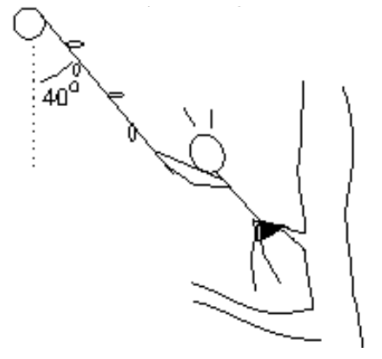

---

<!-- _class: phase-title -->

# Day 5 — Mass vs. Weight

## $F_g = mg$, and what $g$ actually is

---

# Do Now

## You, on the Moon.

### What changes — your **mass** or your **weight**?

---

# Gravity, $F_g$

* Weight **is** $F_g$, the gravitational force — so $F_g = mg$
* Weight is a **force**, measured in newtons.
* Mass is a **scalar**, measured in kilograms, and it does not change when you travel.

**$g$ is a field strength**, not "gravity."

Measured in **N/kg** — how many newtons the field pulls per kilogram you bring.

Near the surface of the Earth, $g \approx 9.8$ N/kg. We round to **10 N/kg** for class work.

$g$ changes with the planet, and with where you stand on it. Your **mass** does not.

---

# Angled equilibrium — one more

### Go back to the Tarzan problem and redo it with $F_g$ written as $mg$ from the start.

Which number in that problem would change on the Moon? Which would not?

---

<!-- _class: phase-title -->

# Phase 2 — Newton's Second Law

## Days 6–9 · CED 2.5

---

# Do Now

### Draw the FBD and the vector addition diagram for the fan cart in each situation:

1. Fan off, cart at rest
2. Fan on, held in place by Mr. Porter
3. Fan on, moving on a level track

---

# Fan Cart Lab

# What variables affect the **acceleration** of the fan cart?

---

# Unbalanced Forces

Design an experiment (or two) to find a mathematical relationship between those variables and acceleration.

**Consider:**

- What will you measure?
- How will you measure it?
- What tools can you use to limit uncertainty?
- How can you design your experiment to limit uncertainty?

🤔 Before you begin — **how will you measure the fan force at each setting?**

---

# Lab expectations — say these before you start

**These are the three that cost points on the AP exam.**

**1 · Name the tool**

*Indicate* can be one word. ***Describe*** must name **what you measure** and **the tool you measure it with**. That is often a whole point.

**2 · Five or more data points**

**3 · Repeat each setting and average**

Five runs at one setting is *not* five data points. Repeat each value of the independent variable, then average.

---

## Fan Cart Lab

*Create a mathematical model relating mass, force, and acceleration.*

#### Essential questions

1. How is **mass** related to **acceleration** for a *constant net force*?
2. How is **net force** related to **acceleration** for a *constant mass*?

#### Notes

- Design **two** experiments to answer the questions above
- At least **5 data points**, each repeated and averaged
- **Linearize** your data in the analysis

---

### 🎯 Board Meeting Goal

### Develop a mathematical model relating **net force**, **mass**, and **acceleration**

**Structure**

1. How did you run your experiment?
2. What are your results for each experiment?
    - What is your slope and intercept? What does each represent? How do they compare to the controls?

**Questions to ask your peers**

- How do you know that?
- What is your evidence for…?
- Why do you think…?
- How does your data support…?
- That's interesting — our data shows the opposite…

---

<!-- _class: plain -->

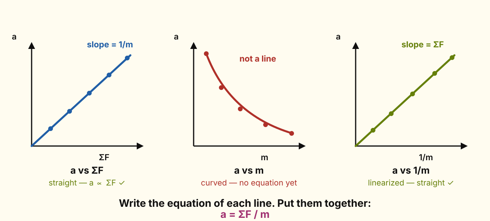

---

# Write the equation of each line

**This is the one from Unit 1.** "Students could not write the equation of the line" was the recurring snag on the kinematics test. Here is the second chance — and this time the slope has a name.

$a$ vs. $\Sigma F$ &nbsp;→&nbsp; slope is $\dfrac{1}{m}$

$a$ vs. $\dfrac{1}{m}$ &nbsp;→&nbsp; slope is $\Sigma F$

Put them together and you get the same statement twice.

---

# Newton's Second Law

$$\vec{a} = \frac{\Sigma \vec{F}}{m}$$

**Acceleration** is proportional to the **net force**, and inversely proportional to the **mass**.

Notice what this says about Mallet Ball: no net force, no acceleration. Newton's first law is just this law with $\Sigma \vec F = 0$.

---

# Two ways to measure mass

**Inertial mass**

How hard is it to *change* this object's motion?

Push it and measure the acceleration.

$m_{\text{inertial}} = \dfrac{\Sigma F}{a}$

**Gravitational mass**

How hard does the Earth *pull* on this object?

Put it on a balance.

$m_{\text{grav}} = \dfrac{F_g}{g}$

**They always come out the same.** Nothing in Newton's laws says they must — it is an experimental fact, and Einstein built general relativity on it.

---

# Systems and their center of mass

**System** — whatever you draw the boundary around. You choose it. Everything outside the boundary that touches the system is an **external** force; forces between parts *inside* are **internal**.

---

<!-- _class: plain -->

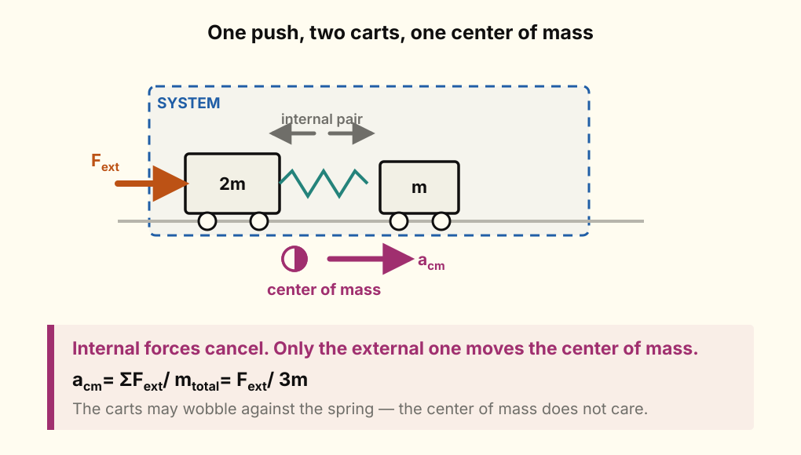

---

<!-- _class: phase-title -->

# Day 8 — The N2L Protocol

## FBD → one equation per axis → solve

---

# Do Now

### Set up — do **not** solve — this two-force problem.

### Stop when you have one equation per axis.

---

# Applying Newton's Second Law

**The protocol — every time, no exceptions**

**① Draw** the free-body diagram
**② Split** any angled force into $x$ and $y$ components
**③ Write** one equation per axis: $\Sigma F_x = ma_x$ and $\Sigma F_y = ma_y$
**④ Solve**

**Label the steps on your own work.** ① ② ③ ④ in the margin. Every worked example on these slides is labeled — yours should be too.

---

# Elevator Problems

## Solve on a **whiteboard** with your group first, then make notes for your future forgetful self **in your notebook**.

---

<!-- _class: compact -->

# Elevator Scale Reading

A person who weighs **500 N** is standing on a scale in an elevator. The elevator is identical in all cases. The velocity and acceleration of the elevators at the instant shown are given.

1. List the cases where the scale reading is **greater** than 500 N.
2. List the cases where the scale reading is **less** than 500 N.
3. List the cases where the scale reading is **equal to** 500 N.

What does the scale actually measure?

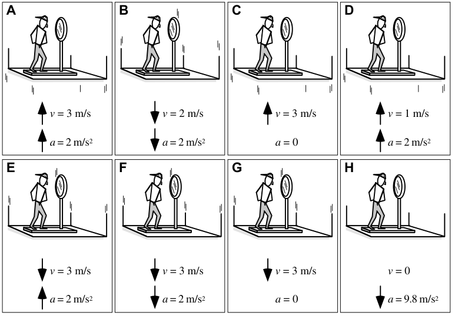

---

<!-- _class: phase-title -->

# Day 9 — Forces at an Angle

## Resolve first, then one equation per axis

---

# N2L with an angled force

**Nothing new — step ② just stops being free.**

① FBD &nbsp;·&nbsp; ② **components** &nbsp;·&nbsp; ③ one equation per axis &nbsp;·&nbsp; ④ solve

$$F_x = F\cos\theta$$
$$F_y = F\sin\theta$$

…when $\theta$ is measured from the **horizontal**.

**Check the angle before you trust sine and cosine.** Measured from the vertical, they swap. Draw the triangle every time.

---

# With your table

# AP Workbook **2.A – 2.E**

---

<!-- _class: phase-title -->

# Phase 3 — Friction

## Days 10–12 · CED 2.7

---

# Do Now — ranking task

### Which block is hardest to **start** moving, and why?

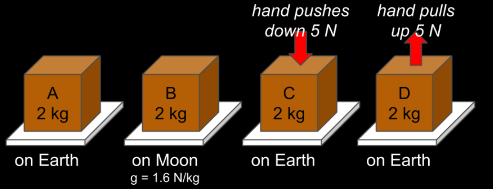

---

# Friction Lab

#### **Objective**

Determine the coefficient of **static** friction *and* the coefficient of **kinetic** friction between your block and two flat surfaces in the classroom.

#### **Materials**

- Wooden block
- Electronic force sensor

#### **Design questions**

What does $F_f$ depend on? Normal force? Surface? Area? Speed?

Which surface will have the greater coefficient?

**Target both coefficients from the same data run.** Watch the force reading at the instant it starts to slide, then while it slides steadily.

---

<!-- _class: plain -->
<!-- _footer: Static and kinetic friction demonstration -->

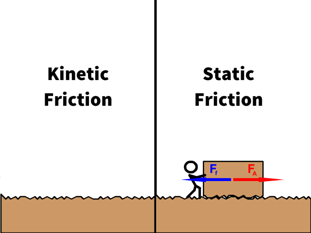

---

<!-- _class: plain -->

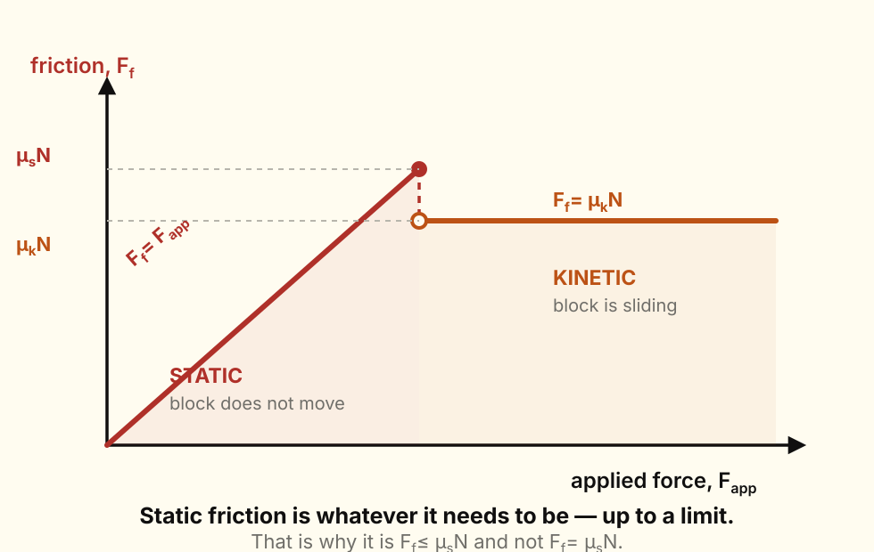

---

# Friction — the two equations

**Static** — not sliding

$$F_f \le \mu_s F_N$$

It is **whatever it needs to be** to keep things balanced, up to a maximum.

**Kinetic** — sliding

$$F_f = \mu_k F_N$$

Once it slides, friction is **fixed**. It does not care how hard you push.

**The inequality is not decoration.** "Friction is $\mu N$" is wrong for static friction, and it is the single most expensive habit on the AP exam. Write $\le$ every time.

---

# The coefficient of friction

* $\mu$ — the Greek letter mu, pronounced "*mew*"
* It describes how much a **pair** of surfaces catch on each other — never one surface alone
* $\mu_s$ is almost always **larger** than $\mu_k$: harder to start than to keep going

**$\mu$ is not always less than 1.** Rubber on dry asphalt runs about **1.0–1.1**, which is exactly why car tires grip the way they do. Soft, grippy pairs of surfaces can go higher still.

---

<!-- _class: plain -->

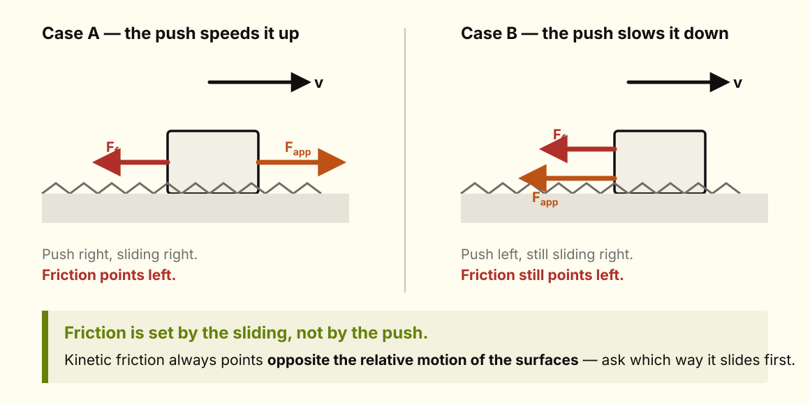

---

<!-- _class: plain -->
<!-- _footer: Coefficients of friction · NYS Regents Physics Reference Tables -->

# Common $\mu$ Values

### **How do the kinetic values compare to the static values?**

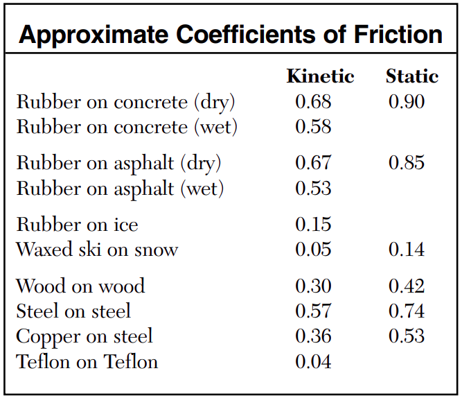

---

<!-- _class: compact -->

#### Boxes are held at rest against rough, vertical walls by forces pushing horizontally on the boxes, as shown.

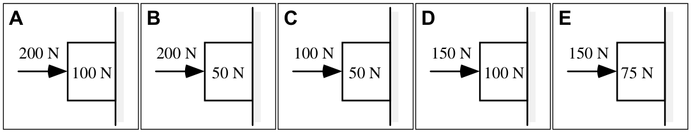

##### Rank the **magnitude of the normal force** exerted on the walls by the boxes.

---

#### In both cases below, Grace pulls the same large crate across a floor at a constant speed of $1.48 \textrm{ m/s}$.

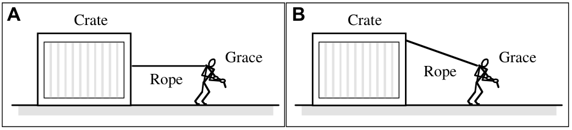

##### Is the magnitude of the force exerted by Grace on the rope (i) *greater* in Case A, (ii) *greater* in Case B, or (iii) *the same* in both cases? Explain your reasoning.

---

<!-- _class: compact -->
<!-- _footer: Diagram · The Physics Classroom, CalcPad -->

#### Friction Practice

Consider the free-body diagram for an object accelerating across a surface. The object has a mass of 2.12 kg. There is a forward thrust force of 50.0 N. The coefficient of friction between the object and the surface is 0.365. Determine the …

1. $F_N$ experienced by the object
2. $F_f$ experienced by the object
3. $F_{net}$ experienced by the object
4. Acceleration experienced by the object

---

## Dexter Eius is running through the cafeteria when he slips on some mashed potatoes and falls to the floor. (Let that be a lesson for Dexter.) Dexter lands in a puddle of milk and skids to a stop with an acceleration of $-4.23 \textrm{ m/s}^2$. Dexter weighs $723.0 \textrm{ N}$.

## **Determine the coefficient of friction between Dexter and the milky floor.**

---

## Amaya is driving her $1300 \textrm{ kg}$ car home after soccer practice. She is traveling down Lake Avenue with a speed of $15.8 \textrm{ m/s}$. A deer runs onto the road and Amaya skids to a stop in $3.41 \textrm{ s}$.

## **Determine the coefficient of friction between the car tires and the roadway.**

---

<!-- _class: phase-title -->

# Day 12 — Friction at an Angle

## When the normal force stops being $mg$

---

<!-- _class: plain -->

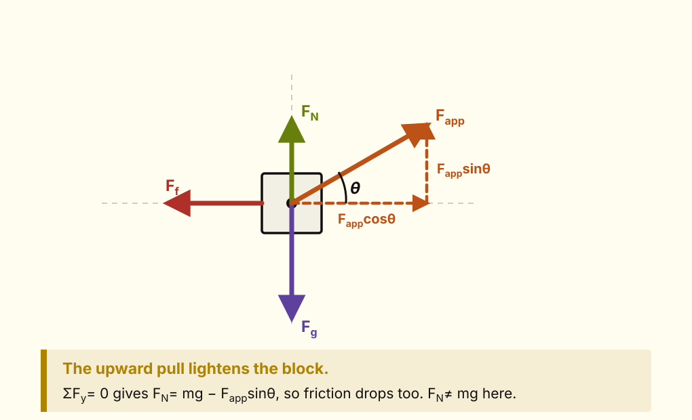

---

<!-- _class: compact -->

# Work it through

Consider the free-body diagram shown. The applied force is **97.7 N at 27.4°** above the horizontal, the gravitational force is **110 N**, and the coefficient of friction is **0.369**.

**What is the acceleration of the object?**

**① FBD** — done for you &nbsp;·&nbsp; **② components** of $F_{app}$ &nbsp;·&nbsp; **③** $\Sigma F_y = 0$ **first**, to get $F_N$ &nbsp;·&nbsp; then $\Sigma F_x = ma_x$ &nbsp;·&nbsp; **④ solve**

Do **not** use $F_N = mg$ here. The angled pull lifts some of the weight off the surface.

---

# Practice

**Started here, finished at home**

AP Workbook **2.F** and **2.G**

**Homework**

AP Workbook **2.N** — design your own measurement of $\mu$

**Note for the quiz:** friction at an angle is **not** on Quiz 9. It is assessed on the unit test.

---

<!-- _class: phase-title -->

# Phase 4 — Inclined Planes

## Days 13–14 · CED 2.5, 2.7

---

# Do Now

### A block sits at rest on a **frictionless** ramp.

### Draw its FBD with your axes **horizontal and vertical**, and write $\Sigma F_x$ and $\Sigma F_y$.

Keep going until it gets annoying. The annoyance is the point.

---

# 🔄 Turn the axes

**You get to choose your axes.** Nothing in physics says $x$ has to be horizontal — it only has to be perpendicular to $y$.

### [Turning the Axes — drag θ, then drag "Turn the board"](https://www.mrporterphysics.com/AP%20Resource%20Pages/inclinedPlaneAxes.html)

---

<!-- _class: plain -->


---

# Why we break up gravity, and nothing else

With the axes turned to match the slope:

- **normal** lies on the $y$ axis
- **friction** lies on the $x$ axis
- **gravity** lies on neither

So gravity is the **only** force you have to resolve into components. That is the whole reason for turning the axes.

---

<!-- _class: plain -->

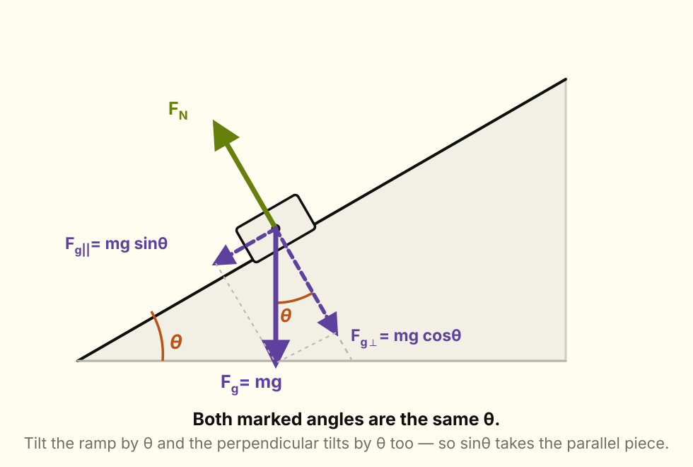

---

# Inclined Planes

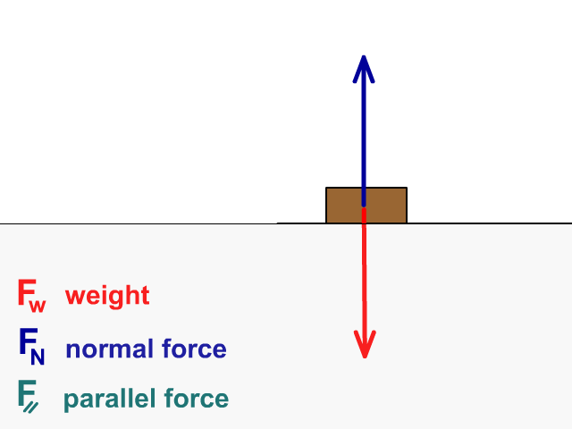

Component of gravity ***perpendicular to the incline***

$$F_{g\perp} = mg\cos\theta$$

Component of gravity ***parallel to the incline***

$$F_{g\parallel} = mg\sin\theta$$

**Check it, don't memorize it.** Which component vanishes when $\theta = 0$? Does that match a block on a flat table?

---

# The limiting cases

**$\theta \to 0°$** — flat ground

$F_{g\parallel} = mg\sin 0 = 0$
$F_{g\perp} = mg\cos 0 = mg$

All of the weight presses into the surface. Nothing pulls it along. ✓

**$\theta \to 90°$** — a vertical wall

$F_{g\parallel} = mg\sin 90 = mg$
$F_{g\perp} = mg\cos 90 = 0$

Free fall. The surface presses on nothing. ✓

If you ever forget which is which, test $\theta = 0$ in your head. It takes five seconds and it has never been wrong.

---

<!-- _class: compact -->
<!-- _footer: Diagram · The Physics Classroom, CalcPad -->

Lab partners Anna Litical and Noah Formula placed a 0.25 kg glider on their air track and inclined the track at 10.4° above the horizontal. Use the structure provided at the right to determine the …

1. Force of gravity
2. Parallel component of gravity
3. Perpendicular component of gravity
4. Normal force
5. Net force
6. Acceleration

---

<!-- _class: phase-title -->

# Day 14 — Inclines with Friction

## And the angle that gives away $\mu_s$

---

# The tipping angle

### Tilt a ramp until the block is *just about* to slide. At that instant, static friction is at its maximum.

$$\Sigma F_\parallel = 0:\quad mg\sin\theta = \mu_s mg\cos\theta$$

$$\boxed{\mu_s = \tan\theta}$$

The mass **cancels**. The angle alone tells you the coefficient — which is why this is such a good way to measure it.

---

# The Einstein Ramp

The image shows our Einstein action figure sitting on a slab of wood coated with plastic tape. The angle at which Einstein slips is $\theta$.

**Determine the maximum coefficient of static friction, $\mu_E$, for Einstein in terms of $\theta$, $m$, and physical constants.**

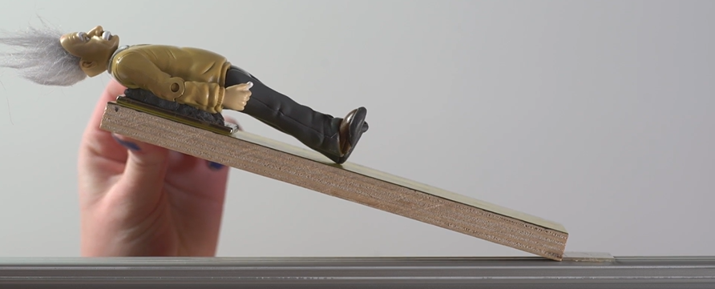

---

# Einstein, both ways

**Tilt until it slips** → that angle gives $\mu_s$

**Tilt until it slides steadily** → that angle gives $\mu_k$

Which angle is bigger? Predict first, then we run it.

---

# With your table

# AP Workbook **2.H**

### Then one released AP FRQ ramp question — individually, but at the lab table.

---

<!-- _class: phase-title -->

# Review & Test

## Days 15–16

---

# Review

**AP Classroom — Progress Check, Unit 2**

Assigned tonight. This is the review; there is no separate review day.

**On the test**

CED 2.2 – 2.7 · MC + FRQ
FBDs · N3L pairs · N2L
mass vs. weight · friction
inclines · **friction at an angle**

**Not on the test:** multi-body systems and Atwood machines. Those come in January.

---

# 🧪 Unit 2 Test

---

<!-- _class: phase-title -->

# ⏸ January

## Everything past this point is taught after winter recess

---

**Do not teach these in December.** Multi-body systems moved to January (decided 2026-11-15) and they run immediately before the Find the Force stations practical. The Unit 2 test carries no multi-body item.

### See also the dedicated [Accelerating Systems](AcceleratingSystems.html) deck, which works the modified Atwood machine in full — individual objects, system thinking, and with friction.

---

<!-- _class: compact -->

### Accelerating Systems

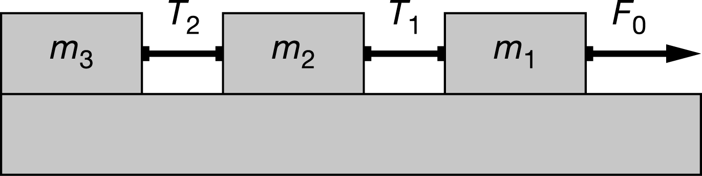

Three blocks are connected by strings and pulled to the right by a force of magnitude $F_0$, as shown above. All frictional forces are negligible. The tensions in the right and left strings have magnitudes $T_1$ and $T_2$ respectively. Taking the positive direction to be toward the right:

***If the acceleration is $a_{sys}$, derive expressions for $F_0$, $T_1$, and $T_2$ in terms of $a_{sys}$, $m_1$, $m_2$, $m_3$ and any universal constants.***

---

### Accelerating Systems

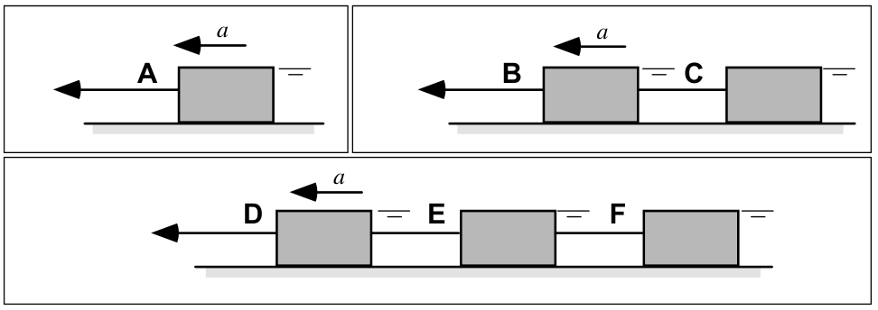

Boxes are pulled by ropes along frictionless surfaces, accelerating toward the left. All of the boxes are identical, and the accelerations of all three systems are the same.

**Rank the tensions in the ropes.** Explain your reasoning.

---

<!-- _class: compact -->

#### Accelerating Systems

In both cases a spaceship is pulling two cargo pods, one empty and one full. At the instant shown, the speed of the pods and spaceships is 300 m/s, but they have different accelerations as shown. All masses are given in terms of $M$, the mass of an empty pod.

**Will the tension at point *S* in the tow rod be (i) *greater in Case A*, (ii) *greater in Case B*, or (iii) *the same in both cases*?** Find the tension in each rope to help.

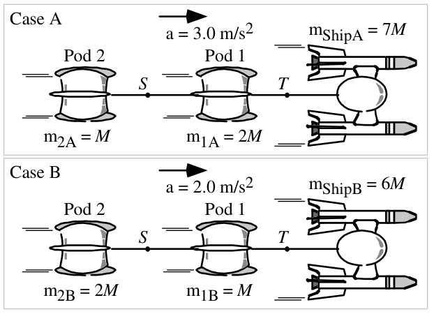

---

# With your table

# AP Workbook **2.I, 2.J, 2.M**

---

<!-- _class: compact -->

In each case shown below, a box is sliding along a horizontal surface. There is friction between the box and the horizontal surface. The box is tied to a hanging stone by a massless rope running over a massless, frictionless pulley. All these cases are identical except for the different initial velocities of the boxes.

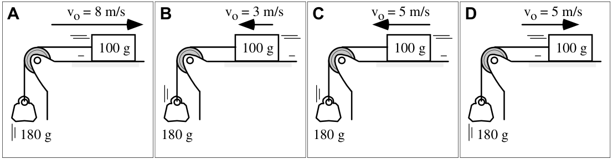

**Rank the magnitudes of the accelerations of the boxes at the instant shown.** Explain your ranking.

---

<!-- _class: compact -->

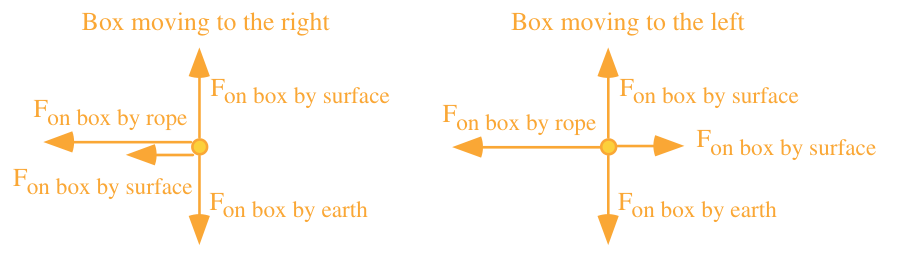
