<!--- _class: title-slide --->

# Two Dimensional Motion 

## Physics 

### Maple Hill High School 2025-26

---

<!--- _class: phase-title --->

# Free Fall Motion

---

# Free Fall 

## An object in **free fall** experiences *only* the force of gravity.

* This means that it accelerates at $g$, which is referred to as "_acceleration due to gravity_" or "_gravitational field strength_"
* Units N/kg and m/s/s are the ***same***
* We ignore air resistance unless a problem tells us not to

---

<iframe width="1150" height="715" src="https://www.youtube.com/embed/E43-CfukEgs?si=8DZF93LgcQA3LuZy" title="YouTube video player" frameborder="0" allow="accelerometer; autoplay; clipboard-write; encrypted-media; gyroscope; picture-in-picture; web-share" referrerpolicy="strict-origin-when-cross-origin" allowfullscreen></iframe>

---

# How Big Is $g$?

## Near the surface of the Earth, $g = 9.8 \text{ m/s/s}$

### In AP Physics we will use $\boxed{g = 10 \text{ m/s/s}}$

---

# How Big Is $g$?

## Near the surface of the Earth, $g = 9.8 \text{ m/s/s}$

### In AP Physics we will use $\boxed{g = 10 \text{ m/s/s}}$

**$g$ is a magnitude, so it is always positive.** The *sign* of the acceleration comes from the direction **you** chose as positive — not from $g$ itself.

---

# Pick a Positive Direction First

### If **up** is positive

* $a = -g = -10 \text{ m/s/s}$
* Rising $\rightarrow v$ is $+$
* Falling $\rightarrow v$ is $-$
* Landing below the start $\rightarrow \Delta y$ is $-$

### If **down** is positive

* Falling $\rightarrow v$ is $+$
* $a = +g = +10 \text{ m/s/s}$
* Rising $\rightarrow v$ is $-$
* Landing below the start $\rightarrow \Delta y$ is $+$

**Both choices give the same physics.** Pick one, write it on your paper, and keep it for the whole problem. Most free fall mistakes are sign errors from switching halfway through.

---

# Free Fall Facts
## If an object is _dropped_, $v_0 = 0$ 

---

# Free Fall Facts
## If an object is projected upwards it will slow down as it rises. The y-velocity will be zero at its highest point, or peak.

### You can treat $v = 0$ at the peak

---

<!--- _class: compact --->

# Free Fall Facts

## Up and down are mirror images

An object projected upward returns to its **initial height** with a velocity **equal in magnitude** and **opposite in direction**.

A ball thrown up at $+30$ m/s passes its launch height again at $-30$ m/s.

Up is positive &nbsp;•&nbsp; $g = 10$ m/s/s

<svg viewBox="0 0 560 390" width="100%" style="max-height:430px" xmlns="http://www.w3.org/2000/svg" font-family="Inter, 'Helvetica Neue', Arial, sans-serif">
  <polygon points="80,54 284,180 80,180" fill="var(--aurora, #66800B)" opacity="0.20"/>
  <polygon points="284,180 488,306 488,180" fill="var(--coral, #AF3029)" opacity="0.20"/>
  <line x1="80" y1="54"  x2="520" y2="54"  stroke="var(--ink-3, #B7B5AC)" stroke-opacity="0.55" stroke-width="1"/>
  <line x1="80" y1="306" x2="520" y2="306" stroke="var(--ink-3, #B7B5AC)" stroke-opacity="0.55" stroke-width="1"/>
  <line x1="284" y1="44" x2="284" y2="334" stroke="var(--solar, #AD8301)" stroke-opacity="0.45" stroke-width="1.5" stroke-dasharray="6 5"/>
  <line x1="488" y1="44" x2="488" y2="334" stroke="var(--ink-3, #B7B5AC)" stroke-opacity="0.75" stroke-width="1.5" stroke-dasharray="6 5"/>
  <line x1="80" y1="40" x2="80" y2="334" stroke="var(--muted, #6F6E69)" stroke-width="2"/>
  <line x1="56" y1="180" x2="528" y2="180" stroke="var(--muted, #6F6E69)" stroke-width="2"/>
  <line x1="80" y1="54" x2="488" y2="306" stroke="var(--star, #205EA6)" stroke-width="4" stroke-linecap="round"/>
  <circle cx="80"  cy="54"  r="6" fill="var(--star, #205EA6)"/>
  <circle cx="284" cy="180" r="6" fill="var(--solar, #AD8301)"/>
  <circle cx="488" cy="306" r="6" fill="var(--star, #205EA6)"/>
  <text x="66" y="60"  text-anchor="end" fill="var(--aurora, #66800B)" font-size="19" font-weight="600">+30</text>
  <text x="66" y="187" text-anchor="end" fill="var(--muted, #6F6E69)" font-size="19">0</text>
  <text x="66" y="313" text-anchor="end" fill="var(--coral, #AF3029)" font-size="19" font-weight="600">&#8722;30</text>
  <text x="284" y="356" text-anchor="middle" fill="var(--solar, #AD8301)" font-size="17">3.0 s</text>
  <text x="488" y="356" text-anchor="middle" fill="var(--muted, #6F6E69)" font-size="17">6.0 s</text>
  <text x="26" y="196" text-anchor="middle" fill="var(--muted, #6F6E69)" font-size="17" transform="rotate(-90 26 196)">velocity (m/s)</text>
  <text x="300" y="382" text-anchor="middle" fill="var(--muted, #6F6E69)" font-size="17">time (s)</text>
  <text x="142" y="132" text-anchor="middle" fill="var(--aurora, #66800B)" font-size="16">area = +45 m</text>
  <text x="142" y="152" text-anchor="middle" fill="var(--aurora, #66800B)" font-size="14" opacity="0.8">rising</text>
  <text x="418" y="228" text-anchor="middle" fill="var(--coral, #AF3029)" font-size="16">area = &#8722;45 m</text>
  <text x="418" y="248" text-anchor="middle" fill="var(--coral, #AF3029)" font-size="14" opacity="0.8">falling</text>
  <text x="302" y="98"  fill="var(--star, #205EA6)" font-size="16">slope = <tspan font-style="italic">a</tspan> = &#8722;10 m/s&#178;</text>
  <text x="302" y="144" fill="var(--solar, #AD8301)" font-size="16"><tspan font-style="italic">v</tspan> = 0 at the peak</text>
</svg>

---

<!--- _class: compact --->

# Two Graphs, One Throw

<svg viewBox="0 0 420 345" width="100%" style="max-height:290px" xmlns="http://www.w3.org/2000/svg" font-family="Inter, 'Helvetica Neue', Arial, sans-serif">
  <line x1="60" y1="65" x2="380" y2="65" stroke="var(--ink-3, #B7B5AC)" stroke-opacity="0.55" stroke-width="1"/>
  <line x1="210" y1="50" x2="210" y2="290" stroke="var(--solar, #AD8301)" stroke-opacity="0.45" stroke-width="1.5" stroke-dasharray="6 5"/>
  <line x1="60" y1="45" x2="60" y2="290" stroke="var(--muted, #6F6E69)" stroke-width="2"/>
  <line x1="40" y1="265" x2="390" y2="265" stroke="var(--muted, #6F6E69)" stroke-width="2"/>
  <path d="M 60 265 Q 210 -135 360 265" fill="none" stroke="var(--nebula, #5E409D)" stroke-width="4" stroke-linecap="round"/>
  <circle cx="210" cy="65" r="6" fill="var(--solar, #AD8301)"/>
  <text x="50" y="71"  text-anchor="end" fill="var(--muted, #6F6E69)" font-size="17">45</text>
  <text x="50" y="272" text-anchor="end" fill="var(--muted, #6F6E69)" font-size="17">0</text>
  <text x="210" y="288" text-anchor="middle" fill="var(--solar, #AD8301)" font-size="16">3.0</text>
  <text x="360" y="288" text-anchor="middle" fill="var(--muted, #6F6E69)" font-size="16">6.0</text>
  <text x="22" y="165" text-anchor="middle" fill="var(--muted, #6F6E69)" font-size="16" transform="rotate(-90 22 165)">position (m)</text>
  <text x="215" y="320" text-anchor="middle" fill="var(--muted, #6F6E69)" font-size="16">time (s)</text>
  <text x="215" y="340" text-anchor="middle" fill="var(--nebula, #5E409D)" font-size="17" font-weight="600">position vs. time</text>
</svg>

<svg viewBox="0 0 420 345" width="100%" style="max-height:290px" xmlns="http://www.w3.org/2000/svg" font-family="Inter, 'Helvetica Neue', Arial, sans-serif">
  <polygon points="60,65 210,165 60,165" fill="var(--aurora, #66800B)" opacity="0.20"/>
  <polygon points="210,165 360,265 360,165" fill="var(--coral, #AF3029)" opacity="0.20"/>
  <line x1="210" y1="50" x2="210" y2="290" stroke="var(--solar, #AD8301)" stroke-opacity="0.45" stroke-width="1.5" stroke-dasharray="6 5"/>
  <line x1="60" y1="45" x2="60" y2="290" stroke="var(--muted, #6F6E69)" stroke-width="2"/>
  <line x1="40" y1="165" x2="390" y2="165" stroke="var(--muted, #6F6E69)" stroke-width="2"/>
  <line x1="60" y1="65" x2="360" y2="265" stroke="var(--star, #205EA6)" stroke-width="4" stroke-linecap="round"/>
  <circle cx="210" cy="165" r="6" fill="var(--solar, #AD8301)"/>
  <text x="50" y="71"  text-anchor="end" fill="var(--aurora, #66800B)" font-size="17">+30</text>
  <text x="50" y="172" text-anchor="end" fill="var(--muted, #6F6E69)" font-size="17">0</text>
  <text x="50" y="272" text-anchor="end" fill="var(--coral, #AF3029)" font-size="17">&#8722;30</text>
  <text x="210" y="288" text-anchor="middle" fill="var(--solar, #AD8301)" font-size="16">3.0</text>
  <text x="360" y="288" text-anchor="middle" fill="var(--muted, #6F6E69)" font-size="16">6.0</text>
  <text x="22" y="165" text-anchor="middle" fill="var(--muted, #6F6E69)" font-size="16" transform="rotate(-90 22 165)">velocity (m/s)</text>
  <text x="215" y="320" text-anchor="middle" fill="var(--muted, #6F6E69)" font-size="16">time (s)</text>
  <text x="215" y="340" text-anchor="middle" fill="var(--star, #205EA6)" font-size="17" font-weight="600">velocity vs. time</text>
</svg>

**Discuss** — The position graph is curved but the velocity graph is straight. What does that tell you about the acceleration? Where on the position graph is the velocity zero?

---
<!--- _class: compact --->

# The Cross Diagram

Five variables describe one stage of constant-acceleration motion. The cross puts them where you can see how they relate.

- **Top row** is space, **bottom row** is time
- **Left column** is the start, **right column** is the end
- **Middle column** is what *changes*

After Sinkovits, *Phys. Teach.* **60**, 744 (2022)

<svg viewBox="0 0 560 330" width="100%" style="max-height:300px" xmlns="http://www.w3.org/2000/svg" font-family="Inter, 'Helvetica Neue', Arial, sans-serif">
  <line x1="280" y1="40" x2="280" y2="300" stroke="var(--ink-3, #B7B5AC)" stroke-width="1.5" stroke-dasharray="5 6"/>
  <line x1="60" y1="170" x2="500" y2="170" stroke="var(--ink-3, #B7B5AC)" stroke-width="1.5" stroke-dasharray="5 6"/>
  <text x="280" y="78" text-anchor="middle" fill="var(--nebula, #5E409D)" font-size="32" font-weight="600">&#916;y</text>
  <text x="110" y="182" text-anchor="middle" fill="var(--star, #205EA6)" font-size="32" font-weight="600">v<tspan font-size="21" dy="7">0</tspan></text>
  <text x="280" y="182" text-anchor="middle" fill="var(--coral, #AF3029)" font-size="32" font-weight="600">a</text>
  <text x="455" y="182" text-anchor="middle" fill="var(--star, #205EA6)" font-size="32" font-weight="600">v</text>
  <text x="280" y="288" text-anchor="middle" fill="var(--plasma, #BC5215)" font-size="32" font-weight="600">&#916;t</text>
  <text x="280" y="34" text-anchor="middle" fill="var(--muted, #6F6E69)" font-size="16">space</text>
  <text x="280" y="316" text-anchor="middle" fill="var(--muted, #6F6E69)" font-size="16">time</text>
  <text x="110" y="222" text-anchor="middle" fill="var(--muted, #6F6E69)" font-size="16">start</text>
  <text x="455" y="222" text-anchor="middle" fill="var(--muted, #6F6E69)" font-size="16">end</text>
  <text x="280" y="222" text-anchor="middle" fill="var(--muted, #6F6E69)" font-size="16">the change</text>
</svg>

---

<!--- _class: compact --->

# Five Boxes, Five Equations

<svg viewBox="0 0 1180 300" width="100%" style="max-height:330px" xmlns="http://www.w3.org/2000/svg" font-family="Inter, 'Helvetica Neue', Arial, sans-serif" font-size="21">
  <g fill="var(--ink, #100F0F)" text-anchor="middle">
  <rect x="18" y="26" width="138" height="152" rx="7" fill="none" stroke="var(--star, #205EA6)" stroke-width="3"/>
  <text x="110" y="62" fill="var(--nebula, #5E409D)">&#916;y</text>
  <text x="42"  y="112" fill="var(--star, #205EA6)">v<tspan font-size="14" dy="5">0</tspan></text>
  <text x="110" y="112" fill="var(--coral, #AF3029)">a</text>
  <text x="180" y="112" fill="var(--ink-3, #B7B5AC)">v</text>
  <text x="110" y="162" fill="var(--plasma, #BC5215)">&#916;t</text>
  <text x="110" y="222" font-size="18" fill="var(--muted, #6F6E69)">left</text>
  <text x="110" y="262" font-size="19">&#916;y = v<tspan font-size="13" dy="4">0</tspan><tspan dy="-4">&#916;t + ½a&#916;t²</tspan></text>
  <rect x="268" y="26" width="138" height="152" rx="7" fill="none" stroke="var(--star, #205EA6)" stroke-width="3"/>
  <text x="337" y="62" fill="var(--nebula, #5E409D)">&#916;y</text>
  <text x="268" y="112" fill="var(--ink-3, #B7B5AC)">v<tspan font-size="14" dy="5">0</tspan></text>
  <text x="337" y="112" fill="var(--coral, #AF3029)">a</text>
  <text x="406" y="112" fill="var(--star, #205EA6)">v</text>
  <text x="337" y="162" fill="var(--plasma, #BC5215)">&#916;t</text>
  <text x="337" y="222" font-size="18" fill="var(--muted, #6F6E69)">right</text>
  <text x="337" y="262" font-size="19">&#916;y = v&#916;t &#8722; ½a&#916;t²</text>
  <rect x="472" y="36" width="178" height="92" rx="7" fill="none" stroke="var(--star, #205EA6)" stroke-width="3"/>
  <text x="561" y="62" fill="var(--nebula, #5E409D)">&#916;y</text>
  <text x="492" y="112" fill="var(--star, #205EA6)">v<tspan font-size="14" dy="5">0</tspan></text>
  <text x="561" y="112" fill="var(--coral, #AF3029)">a</text>
  <text x="630" y="112" fill="var(--star, #205EA6)">v</text>
  <text x="561" y="162" fill="var(--ink-3, #B7B5AC)">&#916;t</text>
  <text x="561" y="222" font-size="18" fill="var(--muted, #6F6E69)">top</text>
  <text x="561" y="262" font-size="19">v² &#8722; v<tspan font-size="13" dy="4">0</tspan><tspan dy="-4">² = 2a&#916;y</tspan></text>
  <rect x="696" y="86" width="178" height="92" rx="7" fill="none" stroke="var(--star, #205EA6)" stroke-width="3"/>
  <text x="785" y="62" fill="var(--ink-3, #B7B5AC)">&#916;y</text>
  <text x="716" y="112" fill="var(--star, #205EA6)">v<tspan font-size="14" dy="5">0</tspan></text>
  <text x="785" y="112" fill="var(--coral, #AF3029)">a</text>
  <text x="854" y="112" fill="var(--star, #205EA6)">v</text>
  <text x="785" y="162" fill="var(--plasma, #BC5215)">&#916;t</text>
  <text x="785" y="222" font-size="18" fill="var(--muted, #6F6E69)">bottom</text>
  <text x="785" y="262" font-size="19">v &#8722; v<tspan font-size="13" dy="4">0</tspan><tspan dy="-4"> = a&#916;t</tspan></text>
  <rect x="920" y="26" width="222" height="152" rx="70" fill="none" stroke="var(--star, #205EA6)" stroke-width="3"/>
  <text x="1031" y="62" fill="var(--nebula, #5E409D)">&#916;y</text>
  <text x="950" y="112" fill="var(--star, #205EA6)">v<tspan font-size="14" dy="5">0</tspan></text>
  <text x="1031" y="112" fill="var(--ink-3, #B7B5AC)">a</text>
  <text x="1112" y="112" fill="var(--star, #205EA6)">v</text>
  <text x="1031" y="162" fill="var(--plasma, #BC5215)">&#916;t</text>
  <line x1="1012" y1="98" x2="1050" y2="124" stroke="var(--ink-3, #B7B5AC)" stroke-width="2.5"/>
  <text x="1031" y="222" font-size="18" fill="var(--muted, #6F6E69)">outside (no a)</text>
  <text x="1031" y="262" font-size="19">&#916;y = ½(v<tspan font-size="13" dy="4">0</tspan><tspan dy="-4"> + v)&#916;t</tspan></text>
  </g>
</svg>

**How to use it.** Underline every known. Star the unknown you want. Then find the box that holds **all your knowns plus exactly one unknown** — that box *is* the equation to use.

---

# Problem-Solving Process

1) Draw a diagram/picture of physical situation
2) Sketch Physics motion graphs (XT & VT)
3) Fill out cross diagram with givens and unknowns 
    - (choose a positive direction, then set $a = \pm 10 \text{ m/s/s}$ to match)
4) Identify equation with cross diagram
5) Substitute and solve

---

# Worked Examples
## Free Fall with $g = 10 \text{ m/s/s}$

**Our toolkit:**  $\ \Delta y = v_0 t + \tfrac12 a t^2 \qquad v = v_0 + a t \qquad v^2 = v_0^2 + 2 a \Delta y$

---

### A ball is dropped from rest from $h = 20.0\ \mathrm{m}$. Up is positive. Find:
- time to impact
- impact velocity (with sign)

          

<!--
Reveal:
- $v_0 = 0$, $a = -10$, $\Delta y = -20$
- $-20 = \tfrac12(-10)t^2 \Rightarrow t^2 = 4 \Rightarrow t = 2.0\ \mathrm{s}$
- $v = at = (-10)(2.0) = -20\ \mathrm{m/s}$ (20 m/s downward)
-->

---

### A rock is thrown straight up at $v_0 = 12.0\ \mathrm{m/s}$ from ground level.

- Time to the top. Hint: $v = 0$ at peak.
- Height at the top.

          

<!--
Reveal:
- $t_{\text{top}} = \dfrac{0 - v_0}{-g} = \dfrac{12.0}{10} = 1.2\ \mathrm{s}$
- $y_{\max} = v_0 t + \tfrac12 a t^2 = 12(1.2) - 5(1.2)^2 = 7.2\ \mathrm{m}$
- Check with $y_{\max} = \dfrac{v_0^2}{2g} = \dfrac{144}{20} = 7.2\ \mathrm{m}$
-->

---

### A ball is thrown _downward_ at $5 \text{ m/s}$ from a height of $10 \text{ m}$.

- How long does it take to reach the ground?

          

---

### Drop from $\Delta y = 45.0\ \mathrm{m}$. Down is positive. _What is the impact velocity?_

Template:
- $v^2 = v_0^2 + 2 a \Delta y$

          

<!--
Reveal:
- $v_0 = 0$, $a = +10$, $\Delta y = +45.0$
- $v^2 = 2(10)(45.0) = 900 \Rightarrow v = +30\ \mathrm{m/s}$ (downward)
- Notice: no time needed. This equation skips $t$ entirely.
-->

---

### Compare: does a head start change the fall?

### Case A (drop): $v_0 = 0$ from $h = 10.0\ \mathrm{m}$
### Case B (throw down): $v_0 = 5.0\ \mathrm{m/s}$ from $h = 10.0\ \mathrm{m}$

        

<!--
Down is positive, $a = +10$, $\Delta y = +10.0$ for both.
- A: $10 = \tfrac12 (10) t^2 \Rightarrow t^2 = 2 \Rightarrow t \approx 1.41\ \mathrm{s}$
- B: $10 = 5t + 5t^2 \Rightarrow t^2 + t - 2 = 0 \Rightarrow (t+2)(t-1) = 0 \Rightarrow t = 1.0\ \mathrm{s}$

Prompt: What stayed the same? What changed? (Same $a$, same $\Delta y$ — only $v_0$ differs.)
-->

---

# Error Analysis — Sign Convention

**A student writes:** up is positive, $a = +10$, for a ball thrown upward at $v_0 = 8.0\ \mathrm{m/s}$ — and concludes the ball speeds up on the way up.

**Diagnose:** with up positive, $a = -g = -10$. Velocity and acceleration point in *opposite* directions, so the ball must slow down as it rises.

**Correct the peak time:**
- $v = v_0 + a t = 0 \Rightarrow t = \dfrac{-v_0}{a} = \dfrac{-8.0}{-10} = 0.80\ \mathrm{s}$

---

# Quick Checks Before You Commit

- Which equation matches your knowns and unknowns?
- Are all signs consistent with the positive direction you chose?
- Does the magnitude make physical sense? Is the unit right?
- If the object went up and came back, is your time about double the time to the peak?

---

# Heads Up: CalcPad Uses $g = 9.8$

**Physics Classroom auto-grades with $g = 9.8\ \mathrm{m/s/s}$.** Use **9.8** on the CalcPad sets so your answers are accepted. Use **10** on AP-style problems, quizzes and the exam.

This is the one place in the unit where the two numbers matter. Everywhere else, 10 is close enough and much faster without a calculator.

---

---

<!--- _class: phase-title --->

# Vectors  <!--fit--->

### :arrow_upper_left: ↗️ ↘️ ⬆️ ⬇️ <!--fit--->

---

# Vector Quantities:

### A *<u>vector</u>* is a quantity with both **magnitude** (size) and **direction**.

#### Examples:

  - The child was displaced 9 meters North.
  - The car has a velocity of 10 meters per second East
  - $\vec{F}$, $\vec{p}$, $\vec{a}$, $\vec{v}$, $\Delta \vec{x}$, etc

---

# Scalar Quantities

### A *<u>scalar</u>* is a quantity with just **magnitude**.

#### Examples

  - The child traveled a distance of 12 meters
  - The car is moving 20 miles per hour
  - The frog has mass of 0.5 kg.
  - $m$, $t$, $r$, etc

---

# Representing Vectors 

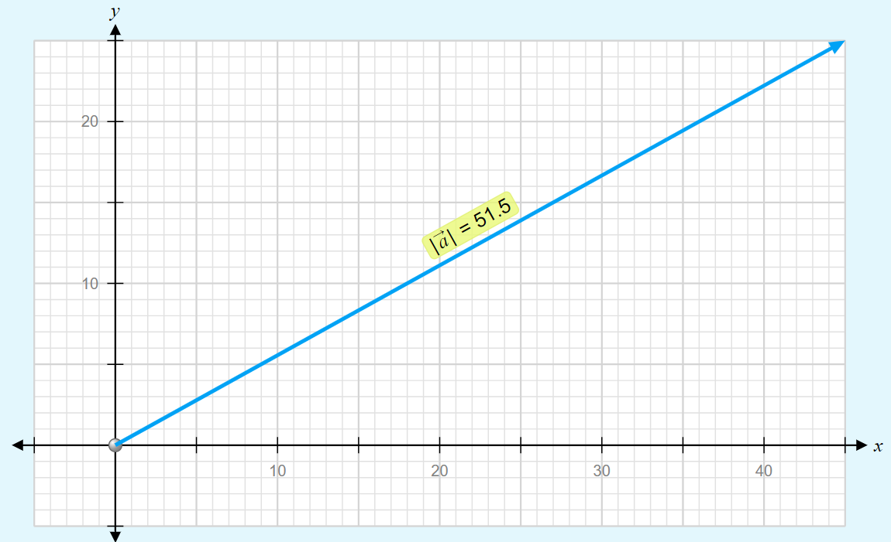

---

# Representing Vectors

- a scale is clearly listed
- a vector arrow (with arrowhead) is drawn in a specified direction. The vector arrow has a head and a tail.
- the magnitude and direction of the vector is clearly labeled. 
    - The magnitude is **20 m** and the direction is (**30 degrees _West of North_**).

 

---

# Vector Direction Conventions

1) expressed as an angle of rotation about its "tail"
    * **40 degrees North of West** (meaning a vector pointing West has been rotated 40 degrees towards the northerly direction) 
    * **65 degrees East of South** (meaning a vector pointing South has been rotated 65 degrees towards the easterly direction).
2) expressed as a counterclockwise angle of rotation about its "tail"
    * 30 degrees is a vector that has been rotated 30 degrees in a counterclockwise direction relative to due east
    *  160 degrees is a vector that has been rotated 160 degrees in a counterclockwise direction relative to due east

---

# Vector Direction Conventions

 

---

# The Magnitude of a Vector

- Magnitude of a vector is scaled in the vector diagram by the **length** of the arrow
- This can be scaled (i.e. 1 cm = 5 miles)

---

# Adding Vectors

- When vectors are in the same, or opposite directions we can add them with regular algebra

---

# Try It...

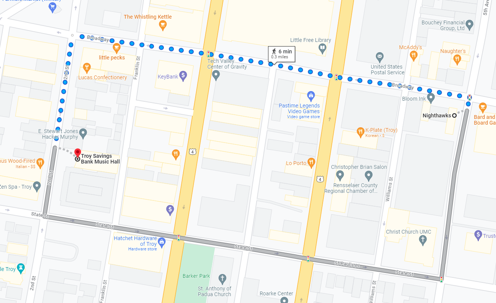

Mr. Porter and his wife walk from Nighthawks to Troy Savings Bank Music Hall. They walk 6 blocks East and then 2 Blocks South. [1 Block = 100 Meters]

1. Determine the **distance** that they traveled.
2. Determine their  **displacement**.

---

---

# Adding Angled Vectors

---

<!--- _footer:  --->

## Adding Vectors 

Vectors are added ___"tip to tail"___, that is redraw the vectors so that the tip of one vector is attached to the tail of the second vector. 

$$\vec{C} = \vec{a} + \vec{b}$$

>_The **resultant** vector S is equal to the addition of vectors a and b_

---

# Right Angled Vectors

Eric leaves the base camp and hikes 11 km, north and then hikes 11 km east. Determine Eric's resulting displacement.

---

# Determining the Angle

 

---

# The Calculated Angle isn't always the answer...

---

# Using Scaled Vectors

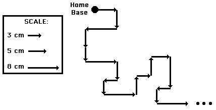

---

# Scaled Vectors

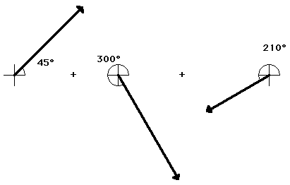

---

# Scaled Vectors

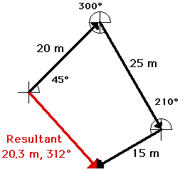

**Resultant**: the vector sum of two or more vectors. It is the _result_ of adding two or more vectors
- _Resultant Displacement_ or _Resultant Force_ or _Resultant Velocity_

---

# Order Does Not Matter

---

# Stop 🛑 <!--fit--->

---

# Representing Vector Components

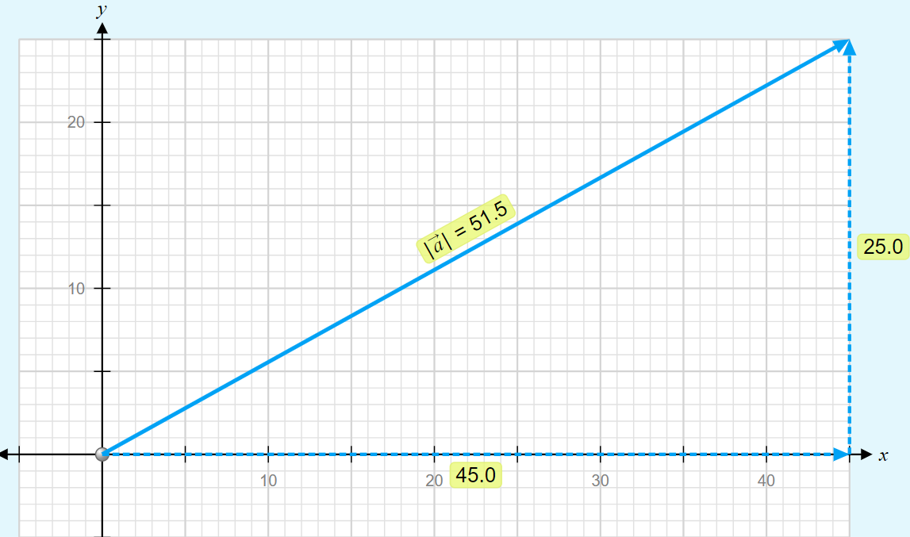 

---
<!--- _footer:   --->

# Vector Components

* Parts of a two-dimensional vector
* The *component* of a vector is the influence of that vector in a given direction.
    * i.e. How far _East_ of a North East displacement did you walk?
* We look at the ***perpendicular components***
    * How much of the vector is in the *x-direction*
    * How much of the vector is in the *y-direction*
* Vector $\vec{A}$ is made up of components $\vec{A}_x$ and $\vec{A}_y$
    * $\vec{A} = \vec{A}_x + \vec{A}_y$

---

# Vector Components Math

- Notice this is a right triangle
    * $\vec{A}^2 = \vec{A}_x^2 + \vec{A}_y^2$
    * Depending on the angle...
        * $A_x = \pm A \cos \theta$
        * $A_y = \pm A \sin \theta$

---

## What are the components of Vector $\vec{A}$?

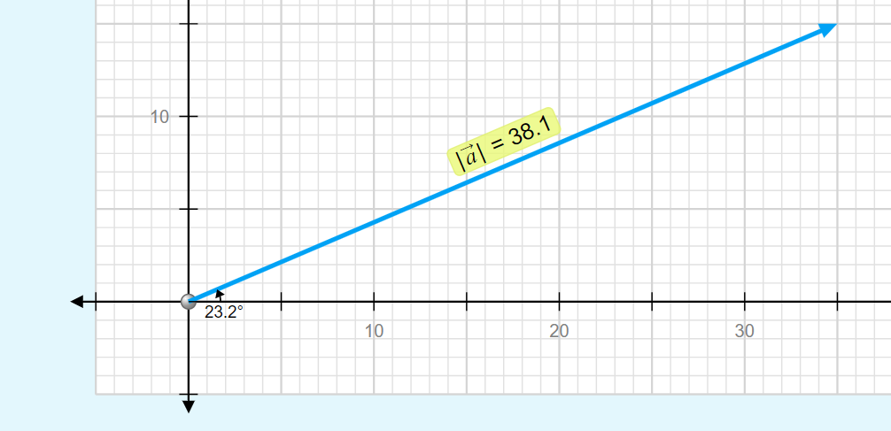

---

## What are the components of Vector $\vec{A}$ and $\vec{B}$?

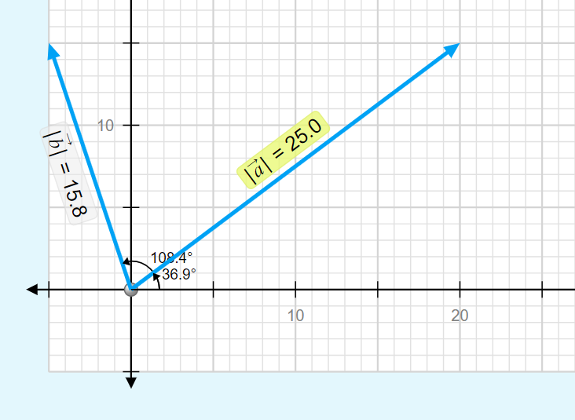

---

## Use Trig to Find $\vec{A}_x$ and $\vec{A}_y$

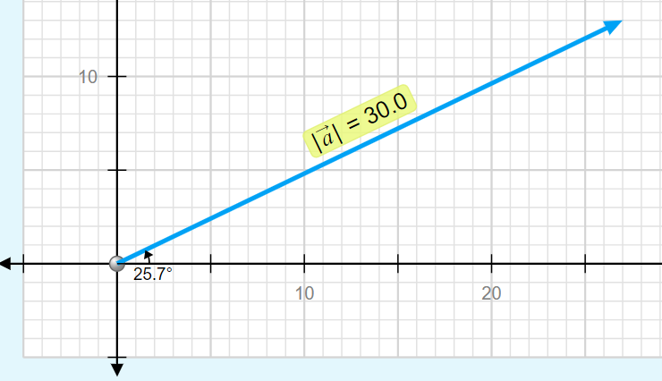

---

---

## Adding Vectors 

#### Using Components

You can sum the components of the two vectors to find the components of the **resultant** vector 

If $\vec{C} = \vec{A} + \vec{B}$...

* $C_x = A_x + B_x$
* $C_y = A_y + B_y$
* $|C| = \sqrt{C_x^2 + C_y^2 }$

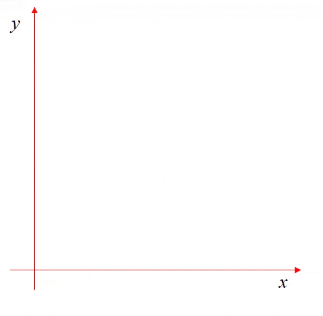

---

### Adding Perpendicular Vectors

Mac and Tosh are doing the Vector Walk Lab. Starting at the door of their physics classroom, they walk 2.0 meters, south. They make a right hand turn and walk 16.0 meters, west. They turn right again and walk 24.0 meters, north. They then turn left and walk 36.0 meters, west. What is the magnitude of their overall displacement?

_A graphical representation of the given problem will help visualize what is happening. The diagram below depicts such a representation._

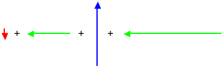

---

## Step 1: Tip-to-tail

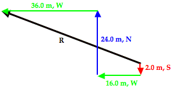

---

## Step 2: Sum $X$ and $Y$ directions

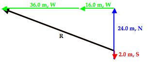

---

# Practice 🎯 <!--fit--->

## [Adding 2 Perpendicular Vectors](https://www.physicsclassroom.com/calcpad/launch/CPVP5)

## [Adding 3 or More Perpendicular Vectors](https://www.physicsclassroom.com/calcpad/launch/CPVP6)

---

# Vector Treasure Hunt 🪙

1. Create a Vector Map (draw this on the map of the school) -> start at one of the entrances of the school.
2. Record all vectors in component form and Magnitude-direction from (use the convention degrees clockwise from North...this is the setting your iPhone compass uses)
3. Exchange vector directions with another group and draw their vector map on your grid in another color or symbol (i.e. dotted line)
4. Calculate the displacement of the the vector map
5. Go walk the map and record the landmarks at the end of each vector.

---

# Vector Descriptions

- Component Form:
    - $\vec{a} = \langle a_x, a_y\rangle$
    - $\vec{a} = \langle 20,10 \rangle$
- Magnitude-direction form:
    - $|\vec{a}|=22.4$ units at $\theta = 26.6$ degrees

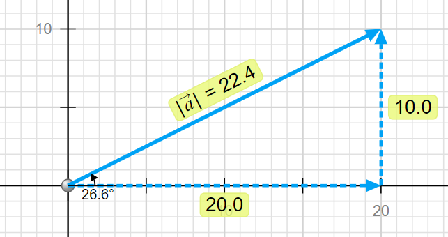

---

# Relative Motion <!--fit--->

---

<iframe width="1100" height="700" src="https://www.youtube.com/embed/bJMYoj4hHqU?si=CIP2ANhEbkR27lj-" title="YouTube video player" frameborder="0" allow="accelerometer; autoplay; clipboard-write; encrypted-media; gyroscope; picture-in-picture; web-share" referrerpolicy="strict-origin-when-cross-origin" allowfullscreen></iframe>

---

# Relative Velocity and Vector Addition

- **Goal:** Understand how velocities add as vectors and why motion is relative to the observer.

---

# 📝 Complete AP Workbook **1.E** <!--fit--->

---

# 1D Relative Motion: Vector Sums

 

 

---

# Pivot: One-Dimensional Relative Motion Using a Drone

---

# Boat Crossing a River: Resultant Velocity

When a boat heads straight across, the river current carries it downstream. The boat’s velocity relative to water adds vectorially to the current’s velocity relative to ground.

---

<iframe id="interactiveIframe" style="width:100%; height:100%;" scrolling="no" allowfullscreen="allowfullscreen" src="https://www.physicsclassroom.com/html-module/river-boat/1/index.html"></iframe>

---

---

# [Riverboat Problems](https://www.physicsclassroom.com/PhysicsClassroom/media/interactive/RiverBoatSim/index.html)

- River current is 4 m/s North
- Boat velocity is 4 m/s East
- What does a drone see?
- How can we predict this **resultant velocity**?

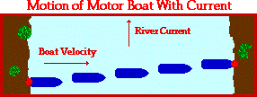

---

# Example Riverboat

A motorboat traveling 4 m/s, East encounters a current traveling 3.0 m/s, North.

1. What is the resultant velocity of the motorboat?
2. If the width of the river is 80 meters wide, then how much time does it take the boat to travel shore to shore?
3. What distance downstream does the boat reach the opposite shore?

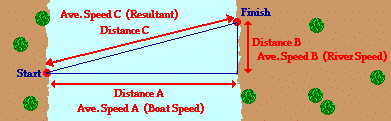

---

# [Riverboat Practice](https://www.physicsclassroom.com/calcpad/launch/CPVP10) <!--fit--->

---

# Pivot: 2D Motion with a Drone

---
<!--- _class: phase-title --->

# Horizontal Projectiles

---

Two toy trucks roll off the ends of identical tables. The speeds and masses of the trucks are given.

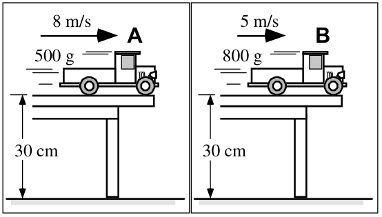

**Will Truck A be in the air for (i) _a longer time_, (ii) a _shorter time_, or (iii) the _same time_ as Truck B before it reaches the floor?**

Explain your reasoning.

---

Two toy trucks roll off the ends of identical tables. The speeds and masses of the trucks are given.

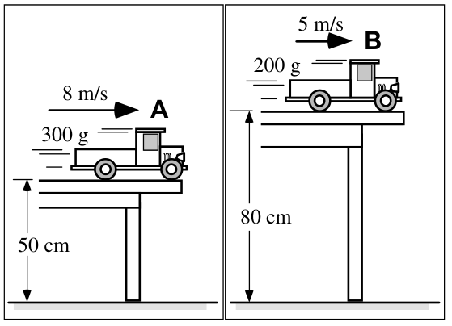

**Will Truck A be in the air for (i) _a longer time_, (ii) a _shorter time_, or (iii) the _same time_ as Truck B before it reaches the floor?**

Explain your reasoning.

---

# **Launcher** Demo <!--fit--->

---

# What are the three possible outcomes?

1) Right ball ($v_x > 0$) hits first 
2) Left ball ($v_x =0$) hits first 
3) Balls hit at the same time 

---

# What does each result imply about the **horizontal velocity's** effect on **flight time**?

1. Right ball ($v_x > 0$) hits first 
2. Left ball ($v_x =0$) hits first 
3. Balls hit at the same time 

---

<!--- _class: compact --->

# What the Demo Showed

## The two motions are independent

Both balls are released at the same instant. Every dashed line joins them at the **same moment in time**.

They are always at the **same height** — the horizontal velocity does nothing to the fall.

Positions drawn at equal time steps

<svg viewBox="0 0 640 400" width="100%" style="max-height:330px" xmlns="http://www.w3.org/2000/svg" font-family="Inter, 'Helvetica Neue', Arial, sans-serif">
  <line x1="40" y1="368" x2="615" y2="368" stroke="var(--muted, #6F6E69)" stroke-width="2.5"/>
  <line x1="95" y1="50" x2="95" y2="368" stroke="var(--coral, #AF3029)" stroke-width="1.5" stroke-dasharray="5 5" opacity="0.55"/>
  <path d="M 95 50 Q 335 50 575 368" fill="none" stroke="var(--star, #205EA6)" stroke-width="2.5" stroke-dasharray="5 5" opacity="0.6"/>
  <line x1="95" y1="70"  x2="215" y2="70"  stroke="var(--ink-3, #B7B5AC)" stroke-width="1.5" stroke-dasharray="4 4"/>
  <line x1="95" y1="130" x2="335" y2="130" stroke="var(--ink-3, #B7B5AC)" stroke-width="1.5" stroke-dasharray="4 4"/>
  <line x1="95" y1="229" x2="455" y2="229" stroke="var(--ink-3, #B7B5AC)" stroke-width="1.5" stroke-dasharray="4 4"/>
  <line x1="95" y1="368" x2="575" y2="368" stroke="var(--ink-3, #B7B5AC)" stroke-width="1.5" stroke-dasharray="4 4"/>
  <circle cx="95" cy="70"  r="9" fill="var(--coral, #AF3029)"/>
  <circle cx="95" cy="130" r="9" fill="var(--coral, #AF3029)"/>
  <circle cx="95" cy="229" r="9" fill="var(--coral, #AF3029)"/>
  <circle cx="95" cy="368" r="9" fill="var(--coral, #AF3029)"/>
  <circle cx="215" cy="70"  r="9" fill="var(--star, #205EA6)"/>
  <circle cx="335" cy="130" r="9" fill="var(--star, #205EA6)"/>
  <circle cx="455" cy="229" r="9" fill="var(--star, #205EA6)"/>
  <circle cx="575" cy="368" r="9" fill="var(--star, #205EA6)"/>
  <circle cx="95" cy="50" r="10" fill="var(--solar, #AD8301)"/>
  <text x="112" y="44" fill="var(--solar, #AD8301)" font-size="17" font-weight="600">released together</text>
  <text x="80" y="392" text-anchor="middle" fill="var(--coral, #AF3029)" font-size="17" font-weight="600">dropped</text>
  <text x="520" y="392" text-anchor="middle" fill="var(--star, #205EA6)" font-size="17" font-weight="600">launched</text>
</svg>

---

# Horizontal Projectiles 

* A ***projectile*** is an object that *only* experiences a gravitational force
* For _**horizontal projectiles**_ the $v_{0y} = 0$
* We can separate motion in the $x$ and $y$ planes and solve separately

---

# Path of a Projectile 

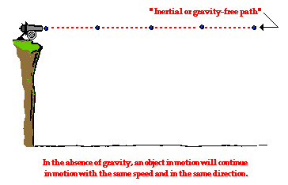

 

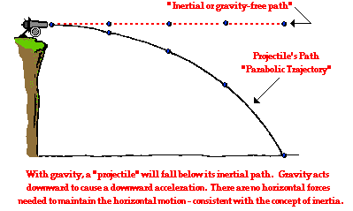

---

# Path of a Projectile

 

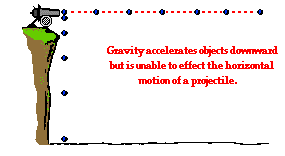

 

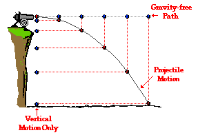

---

|                                                                                 | Horizontal Motion | Vertical Motion     |
| ------------------------------------------------------------------------------- | -------------------------------------- | --------------------------------------------- |
| **Forces** (Present? - Yes or No) (If present, what dir'n?)       | No                                     | Yes The force of gravity acts downward |
| **Acceleration** (Present? - Yes or No) (If present, what dir'n?) | No                                     | Yes $g$ is downward at 10 m/s/s       |
| **Velocity** (Constant or Changing?)                                     | Constant                               | Changing (by 10 m/s each second)      |

---

## Horizontal and Vertical Velocity 

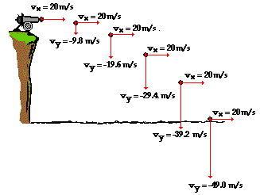

---

## Horizontal and Vertical Displacement 

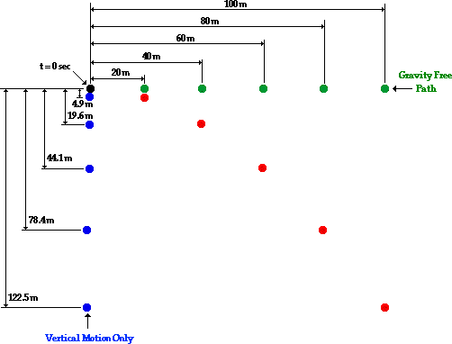

---

<!--- _class: compact --->

# The Two Graphs That Matter

<svg viewBox="0 0 420 330" width="100%" style="max-height:275px" xmlns="http://www.w3.org/2000/svg" font-family="Inter, 'Helvetica Neue', Arial, sans-serif">
  <polygon points="60,100 340,100 340,250 60,250" fill="var(--star, #205EA6)" opacity="0.13"/>
  <line x1="60" y1="100" x2="380" y2="100" stroke="var(--ink-3, #B7B5AC)" stroke-width="1" stroke-opacity="0.7"/>
  <line x1="60" y1="45" x2="60" y2="275" stroke="var(--muted, #6F6E69)" stroke-width="2"/>
  <line x1="40" y1="250" x2="380" y2="250" stroke="var(--muted, #6F6E69)" stroke-width="2"/>
  <line x1="60" y1="100" x2="340" y2="100" stroke="var(--star, #205EA6)" stroke-width="4" stroke-linecap="round"/>
  <circle cx="60" cy="100" r="6" fill="var(--star, #205EA6)"/>
  <circle cx="340" cy="100" r="6" fill="var(--star, #205EA6)"/>
  <text x="50" y="106" text-anchor="end" fill="var(--star, #205EA6)" font-size="17" font-weight="600">10</text>
  <text x="50" y="256" text-anchor="end" fill="var(--muted, #6F6E69)" font-size="17">0</text>
  <text x="200" y="180" text-anchor="middle" fill="var(--star, #205EA6)" font-size="15">area = horizontal distance</text>
  <text x="22" y="150" text-anchor="middle" fill="var(--muted, #6F6E69)" font-size="16" transform="rotate(-90 22 150)">v (m/s)</text>
  <text x="210" y="276" text-anchor="middle" fill="var(--muted, #6F6E69)" font-size="16">time (s)</text>
  <text x="210" y="302" text-anchor="middle" fill="var(--star, #205EA6)" font-size="18" font-weight="600">horizontal</text>
  <text x="210" y="322" text-anchor="middle" fill="var(--muted, #6F6E69)" font-size="15">slope = 0, so no acceleration</text>
</svg>

<svg viewBox="0 0 420 330" width="100%" style="max-height:275px" xmlns="http://www.w3.org/2000/svg" font-family="Inter, 'Helvetica Neue', Arial, sans-serif">
  <polygon points="60,100 340,250 60,250" fill="var(--coral, #AF3029)" opacity="0.13"/>
  <line x1="60" y1="250" x2="380" y2="250" stroke="var(--ink-3, #B7B5AC)" stroke-width="1" stroke-opacity="0.7"/>
  <line x1="60" y1="45" x2="60" y2="275" stroke="var(--muted, #6F6E69)" stroke-width="2"/>
  <line x1="40" y1="100" x2="380" y2="100" stroke="var(--muted, #6F6E69)" stroke-width="2"/>
  <line x1="60" y1="100" x2="340" y2="250" stroke="var(--coral, #AF3029)" stroke-width="4" stroke-linecap="round"/>
  <circle cx="60" cy="100" r="6" fill="var(--coral, #AF3029)"/>
  <circle cx="340" cy="250" r="6" fill="var(--coral, #AF3029)"/>
  <text x="50" y="106" text-anchor="end" fill="var(--muted, #6F6E69)" font-size="17">0</text>
  <text x="50" y="256" text-anchor="end" fill="var(--coral, #AF3029)" font-size="17" font-weight="600">&#8722;30</text>
  <text x="235" y="200" text-anchor="middle" fill="var(--coral, #AF3029)" font-size="15">area = drop height</text>
  <text x="22" y="150" text-anchor="middle" fill="var(--muted, #6F6E69)" font-size="16" transform="rotate(-90 22 150)">v (m/s)</text>
  <text x="210" y="92" text-anchor="middle" fill="var(--muted, #6F6E69)" font-size="16">time (s)</text>
  <text x="210" y="302" text-anchor="middle" fill="var(--coral, #AF3029)" font-size="18" font-weight="600">vertical</text>
  <text x="210" y="322" text-anchor="middle" fill="var(--muted, #6F6E69)" font-size="15">slope = &#8722;10 m/s&#178;</text>
</svg>

**Same clock, two independent stories.** The horizontal graph is flat because nothing pushes sideways. The vertical graph is identical to a dropped object's.

---

# Horizontally Launched Projectiles

* Projectile launched with an initial horizontal velocity from an elevated position. 
* Predictable unknowns include the initial speed of the projectile, the initial height of the projectile, the time of flight, and the horizontal distance of the projectile.

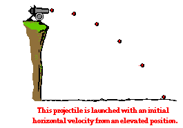

---

# Horizontal Projectiles 

## X-Plane Motion

- $v_x$ is ***constant***

$$d = v_x t$$

## Y-Plane Motion 

- constant acceleration $a_y = g$

$$d = v_{0y}t + \frac{1}{2}gt^2$$

$$v_y = v_{0y} + at$$

$$v_y^2 = v_{0y}^2 + 2ad$$

---

<!--- _class: compact --->

# The Double Cross Diagram

Two motions, **one clock**. Stack a horizontal cross on a vertical cross and let them share $\Delta t$.

- The $x$ cross has $a_x = 0$, so it collapses to $\Delta x = v_x \Delta t$
- The $y$ cross is ordinary free fall
- $\Delta t$ is the **only** quantity they share

**That shared $\Delta t$ is the whole trick.** Find the time in one cross, then carry it into the other.

<svg viewBox="0 0 560 440" width="100%" style="max-height:400px" xmlns="http://www.w3.org/2000/svg" font-family="Inter, 'Helvetica Neue', Arial, sans-serif" text-anchor="middle">
  <rect x="24" y="20" width="512" height="180" rx="10" fill="var(--star, #205EA6)" opacity="0.07"/>
  <rect x="24" y="238" width="512" height="180" rx="10" fill="var(--coral, #AF3029)" opacity="0.07"/>
  <text x="280" y="62" fill="var(--nebula, #5E409D)" font-size="29" font-weight="600">&#916;x</text>
  <text x="110" y="140" fill="var(--star, #205EA6)" font-size="29" font-weight="600">v<tspan font-size="19" dy="6">0x</tspan></text>
  <text x="280" y="140" fill="var(--coral, #AF3029)" font-size="29" font-weight="600">a<tspan font-size="19" dy="6">x</tspan></text>
  <text x="450" y="140" fill="var(--star, #205EA6)" font-size="29" font-weight="600">v<tspan font-size="19" dy="6">x</tspan></text>
  <text x="280" y="228" fill="var(--plasma, #BC5215)" font-size="31" font-weight="700">&#916;t</text>
  <text x="110" y="310" fill="var(--star, #205EA6)" font-size="29" font-weight="600">v<tspan font-size="19" dy="6">0y</tspan></text>
  <text x="280" y="310" fill="var(--coral, #AF3029)" font-size="29" font-weight="600">a<tspan font-size="19" dy="6">y</tspan></text>
  <text x="450" y="310" fill="var(--star, #205EA6)" font-size="29" font-weight="600">v<tspan font-size="19" dy="6">y</tspan></text>
  <text x="280" y="398" fill="var(--nebula, #5E409D)" font-size="29" font-weight="600">&#916;y</text>
  <text x="474" y="60" fill="var(--star, #205EA6)" font-size="16" text-anchor="end">horizontal</text>
  <text x="474" y="396" fill="var(--coral, #AF3029)" font-size="16" text-anchor="end">vertical</text>
  <text x="408" y="233" fill="var(--plasma, #BC5215)" font-size="16" text-anchor="start">shared by both</text>
</svg>

---

# Problem-solving Process

1) Read & sketch problem
2) Identify given information & fill out double cross diagram 
3) Identify the quantity you are solving for
4) **Using either horizontal or vertical information, find the flight time of the projectile**
5) With the time find the quantity you are solving for. 

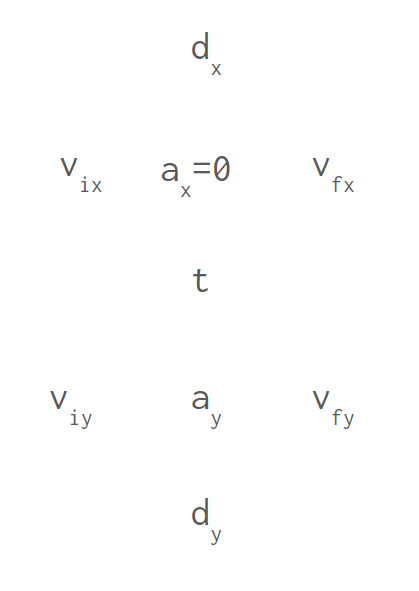

---

# Example 

A pool ball leaves a 0.60-meter high table with an initial horizontal velocity of 2.4 m/s. Predict the time required for the pool ball to fall to the ground and the horizontal distance between the table's edge and the ball's landing location.

---

# Practice 

A soccer ball is kicked horizontally off a 22.0-meter high hill and lands a distance of 35.0 meters from the edge of the hill. Determine the initial horizontal velocity of the soccer ball.

---

# Practice 

In many locations, old abandoned stone quarries have become filled with water once excavating has been completed. While standing on a quarry wall, a boy tosses a piece of granite into the water below. If he throws the rock horizontally with a velocity of 3.0 m/s, and it strikes the water 4.5 meters away, how high above the water is the wall?

---

# Practice w/ Table 

Suppose that an airplane flying 60 m/s, at a height of 300 meters, dropped a sack of flour. How far from the point of release would the sack have traveled when it struck the ground? Where will the plane be in relation to the sack when it hits the ground?

---

# Practice 

A stone is thrown horizontally to the right at a speed of 17.2 m/s from the top of a cliff that is 91.4 m high. Consider up and to the right positive directions.

1. How long does it take the stone to reach the bottom of the cliff?
2. How far from the base of the cliff does the stone hit the ground?
3. What is the horizontal component of the stone's velocity just before it hits the ground?
4. What is the vertical component of the stone's velocity just before it hits the ground?

---

### 🔑 **Key Ideas**:

### A projectile is an object with the following characteristics:

* The only force acting on it is the gravitational force; it is a free-falling object
* The acceleration is directed downwards and has a magnitude of $10 \text{ m/s}^2$ (we use $9.8$ on CalcPad)
* Once projected, it continues its horizontal motion without any need of a force
* As it travels through the air, its horizontal velocity remains constant
* As it rises, its vertical velocity ($v_y$) decreases; as it falls, its $v_y$ increases

---

# <!--fit---> Marble Mini-Experiment

1. Determine the launch velocity of your marble.

Equipment:

- Ruler track
- Marble
- Carbon paper
- Meterstick

2. Use to predict landing spot from new height (like off top of cabinets)

---

<!--- _class: phase-title --->

# Angled Projectiles

---

<!--- _class: compact --->

# Splitting the Launch Velocity

A projectile launched at an angle has **one** velocity, but it is easier to work with its two **perpendicular components**.

$$v_{0x} = v_0 \cos \theta$$

$$v_{0y} = v_0 \sin \theta$$

**Do this first, always.** Every angled projectile problem starts by splitting $v_0$ into $v_{0x}$ and $v_{0y}$.

<svg viewBox="0 0 420 310" width="100%" style="max-height:290px" xmlns="http://www.w3.org/2000/svg" font-family="Inter, 'Helvetica Neue', Arial, sans-serif">
  <defs><marker id="phv0" viewBox="0 0 10 10" refX="9" refY="5" markerWidth="5.5" markerHeight="5.5" orient="auto"><path d="M0,0 L10,5 L0,10 z" fill="var(--nebula, #5E409D)"/></marker><marker id="phvx" viewBox="0 0 10 10" refX="9" refY="5" markerWidth="5.5" markerHeight="5.5" orient="auto"><path d="M0,0 L10,5 L0,10 z" fill="var(--star, #205EA6)"/></marker><marker id="phvy" viewBox="0 0 10 10" refX="9" refY="5" markerWidth="5.5" markerHeight="5.5" orient="auto"><path d="M0,0 L10,5 L0,10 z" fill="var(--plasma, #BC5215)"/></marker></defs>
  <line x1="55" y1="250" x2="390" y2="250" stroke="var(--ink-3, #B7B5AC)" stroke-width="1.5"/>
  <line x1="55" y1="250" x2="55" y2="40" stroke="var(--ink-3, #B7B5AC)" stroke-width="1.5"/>
  <line x1="300" y1="250" x2="300" y2="95" stroke="var(--ink-3, #B7B5AC)" stroke-width="1.5" stroke-dasharray="5 4"/>
  <line x1="55" y1="250" x2="294" y2="250" stroke="var(--star, #205EA6)" stroke-width="5" marker-end="url(#phvx)"/>
  <line x1="300" y1="250" x2="300" y2="101" stroke="var(--plasma, #BC5215)" stroke-width="5" marker-end="url(#phvy)"/>
  <line x1="55" y1="250" x2="296" y2="97" stroke="var(--nebula, #5E409D)" stroke-width="5" marker-end="url(#phv0)"/>
  <path d="M 110 250 A 55 55 0 0 0 96 215" fill="none" stroke="var(--muted, #6F6E69)" stroke-width="2"/>
  <text x="122" y="233" fill="var(--muted, #6F6E69)" font-size="20" font-style="italic">&#952;</text>
  <text x="150" y="150" fill="var(--nebula, #5E409D)" font-size="19" font-weight="600">v</text>
  <text x="161" y="157" fill="var(--nebula, #5E409D)" font-size="14" font-weight="600">0</text>
  <text x="175" y="278" text-anchor="middle" fill="var(--star, #205EA6)" font-size="19" font-weight="600">v</text>
  <text x="186" y="285" fill="var(--star, #205EA6)" font-size="14" font-weight="600">0x</text>
  <text x="318" y="178" fill="var(--plasma, #BC5215)" font-size="19" font-weight="600">v</text>
  <text x="329" y="185" fill="var(--plasma, #BC5215)" font-size="14" font-weight="600">0y</text>
</svg>

---

# Components 

- The X-axis velocity component ($v_x$) is constant and will not accelerate, so it stays the same for the entire flight
- The initial Y-axis velocity component changes, because it is accelerated by gravity at 10 m/s² down. This is why we write ($v_{0y}$) and not just $v_y$ — it will change throughout the problem.

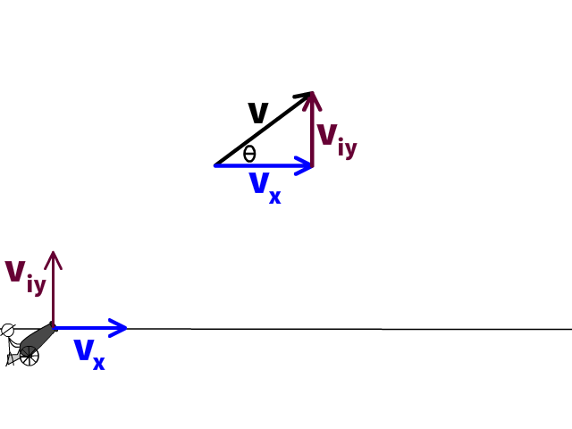

---

### Finding x & y components of initial velocity 

$$v_{0x} = v \cos \theta $$

$$v_{0y} = v \sin \theta$$

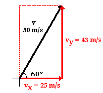

---

<!--- _class: compact --->

# Velocity Through the Flight

<svg viewBox="0 0 640 420" width="100%" style="max-height:395px" xmlns="http://www.w3.org/2000/svg" font-family="Inter, 'Helvetica Neue', Arial, sans-serif">
  <defs><marker id="trvx" viewBox="0 0 10 10" refX="9" refY="5" markerWidth="5.5" markerHeight="5.5" orient="auto"><path d="M0,0 L10,5 L0,10 z" fill="var(--star, #205EA6)"/></marker><marker id="trvy" viewBox="0 0 10 10" refX="9" refY="5" markerWidth="5.5" markerHeight="5.5" orient="auto"><path d="M0,0 L10,5 L0,10 z" fill="var(--plasma, #BC5215)"/></marker></defs>
  <line x1="30" y1="345" x2="615" y2="345" stroke="var(--muted, #6F6E69)" stroke-width="2.5"/>
  <path d="M 60 330 Q 320 -150 580 330" fill="none" stroke="var(--ink-3, #B7B5AC)" stroke-width="3" stroke-dasharray="7 6"/>
  <line x1="60" y1="330" x2="116" y2="330" stroke="var(--star, #205EA6)" stroke-width="4" marker-end="url(#trvx)"/>
  <line x1="190" y1="150" x2="246" y2="150" stroke="var(--star, #205EA6)" stroke-width="4" marker-end="url(#trvx)"/>
  <line x1="320" y1="90" x2="376" y2="90" stroke="var(--star, #205EA6)" stroke-width="4" marker-end="url(#trvx)"/>
  <line x1="450" y1="150" x2="506" y2="150" stroke="var(--star, #205EA6)" stroke-width="4" marker-end="url(#trvx)"/>
  <line x1="580" y1="330" x2="614" y2="330" stroke="var(--star, #205EA6)" stroke-width="4" marker-end="url(#trvx)"/>
  <line x1="60" y1="330" x2="60" y2="260" stroke="var(--plasma, #BC5215)" stroke-width="4" marker-end="url(#trvy)"/>
  <line x1="190" y1="150" x2="190" y2="116" stroke="var(--plasma, #BC5215)" stroke-width="4" marker-end="url(#trvy)"/>
  <line x1="450" y1="150" x2="450" y2="184" stroke="var(--plasma, #BC5215)" stroke-width="4" marker-end="url(#trvy)"/>
  <line x1="580" y1="330" x2="580" y2="400" stroke="var(--plasma, #BC5215)" stroke-width="4" marker-end="url(#trvy)"/>
  <circle cx="60" cy="330" r="7" fill="var(--ink, #100F0F)"/>
  <circle cx="190" cy="150" r="7" fill="var(--ink, #100F0F)"/>
  <circle cx="320" cy="90" r="7" fill="var(--solar, #AD8301)"/>
  <circle cx="450" cy="150" r="7" fill="var(--ink, #100F0F)"/>
  <circle cx="580" cy="330" r="7" fill="var(--ink, #100F0F)"/>
  <text x="320" y="68" text-anchor="middle" fill="var(--solar, #AD8301)" font-size="18" font-weight="600">peak: v<tspan font-size="13" dy="5">y</tspan><tspan dy="-5"> = 0</tspan></text>
  <text x="120" y="252" fill="var(--plasma, #BC5215)" font-size="16">v<tspan font-size="12" dy="4">y</tspan><tspan dy="-4"> shrinks</tspan></text>
  <text x="470" y="212" fill="var(--plasma, #BC5215)" font-size="16">v<tspan font-size="12" dy="4">y</tspan><tspan dy="-4"> grows, now downward</tspan></text>
  <text x="300" y="118" fill="var(--star, #205EA6)" font-size="16">v<tspan font-size="12" dy="4">x</tspan><tspan dy="-4"> never changes</tspan></text>
  <text x="320" y="412" text-anchor="middle" fill="var(--muted, #6F6E69)" font-size="16">positions drawn at equal time steps</text>
</svg>

---

Cannonballs of different masses are shot from cannons at various angles above the horizontal. The velocity of each cannonball as it leaves the cannon is given, along with the horizontal component of that velocity, which is the same.

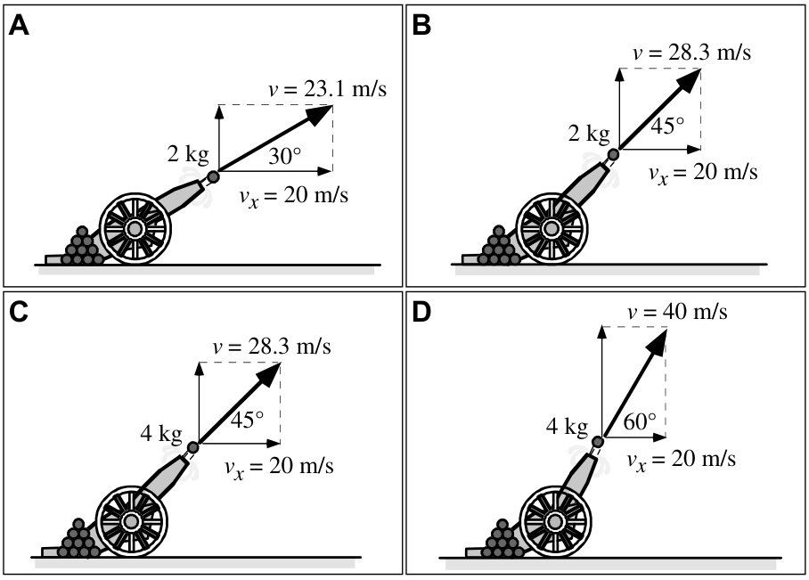

**Rank the horizontal distance traveled by the cannonballs.**

---

Cannonballs with different masses are shot from cannons at various angles above the horizontal. The velocity of each cannonball as it leaves the cannon is given, along with the same vertical component of that velocity.

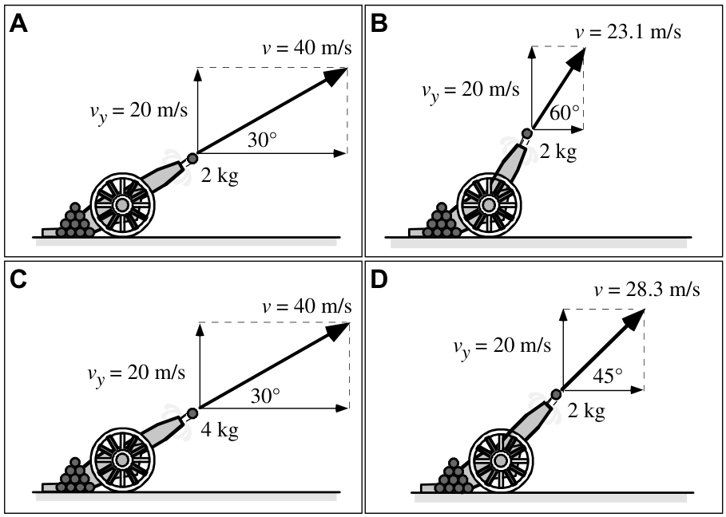

**Rank the time the cannonballs are in the air.**

---

# Projectile Fact Reminders

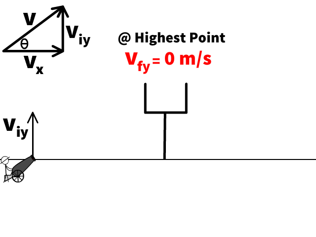

 

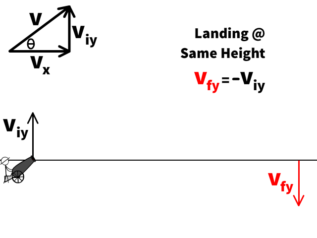

---

# Carried Over From Free Fall 

- Up positive $\Rightarrow a_y = -g = -10 \text{ m/s/s}$ &nbsp;•&nbsp; down positive $\Rightarrow a_y = +10 \text{ m/s/s}$
- At the peak, $v_y = 0$ — but $a_y$ is still $10 \text{ m/s/s}$ downward
- Launch and landing speeds match at the same height: up at $+30 \text{ m/s}$ means down at $-30 \text{ m/s}$

**Nothing new vertically.** An angled projectile's $y$-motion *is* the free fall you already solved — the only addition is a constant $v_x$ running alongside it.

---

# Problem-solving Process

1) Read & sketch problem
2) _**Calculate x & y components of initial velocity**_
3) Identify given information & fill out double cross diagram
4) Identify the quantity you are solving for
5) Using either horizontal or vertical information, find the flight time of the projectile
6) With the time find the quantity you are solving for. 

---

<iframe src="https://phet.colorado.edu/sims/html/projectile-motion/latest/projectile-motion_all.html" style="border:0px #ffffff none;" name="myiFrame" scrolling="no" frameborder="1" marginheight="0px" marginwidth="0px" height="700px" width="1000px" allowfullscreen></iframe>

---

# Where should 🎯 go?

<iframe src="https://phet.colorado.edu/sims/html/projectile-motion/latest/projectile-motion_all.html" style="border:0px #ffffff none;" name="myiFrame" scrolling="no" frameborder="1" marginheight="0px" marginwidth="0px" height="650px" width="1000px" allowfullscreen></iframe>
